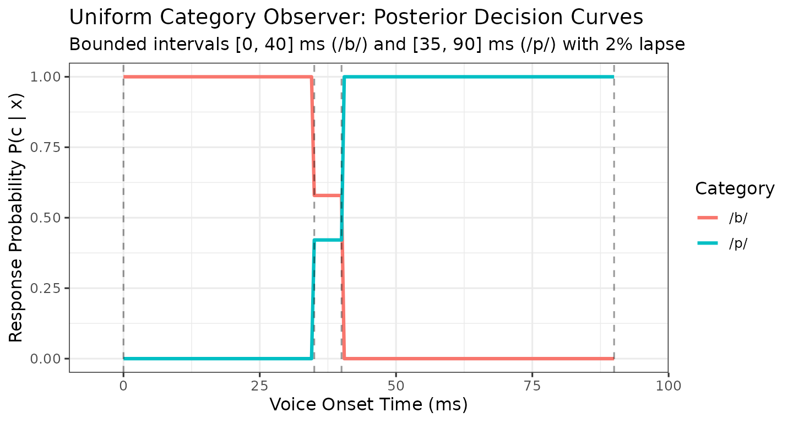

# Contributor Guide: Extending MVBeliefUpdatr and Adding Model Families

``` r

library(MVBeliefUpdatr)
library(S7)
library(ggplot2)
```

## 1. Overview & Architectural Philosophy

**MVBeliefUpdatr** uses R’s **S7** object-oriented programming system to
provide a modular, strongly typed, and extensible framework for
cognitive models of speech perception and categorization.

All model families in **MVBeliefUpdatr** follow a two-tier structural
hierarchy:

    MVBU_Object
    ├── MVBU_CategoryRepresentation
    │   ├── MVG_CategoryRepresentation     (Multivariate Gaussian)
    │   ├── UVG_CategoryRepresentation     (Univariate Gaussian)
    │   ├── MUVG_CategoryRepresentation    (Multiple Univariate Gaussians)
    │   ├── NIW_CategoryRepresentation     (Normal-Inverse-Wishart hyperprior)
    │   ├── NIX_CategoryRepresentation     (Normal-Inverse-Chi-squared hyperprior)
    │   ├── MNIX_CategoryRepresentation    (Multivariate NIX hyperprior)
    │   └── Exemplar_CategoryRepresentation(Non-parametric exemplar memory)
    └── MVBU_CognitiveModel
        ├── MVG_IdealObserver             (Static multivariate observer)
        ├── UVG_IdealObserver             (Static univariate observer)
        ├── MUVG_IdealObserver            (Static multi-univariate observer)
        ├── NIW_IdealAdaptor              (Dynamic NIW belief updater)
        ├── NIX_IdealAdaptor              (Dynamic NIX belief updater)
        ├── MNIX_IdealAdaptor             (Dynamic MNIX belief updater)
        └── Exemplar_Model                (Non-parametric exemplar model)

### Observers vs. Adaptors

1.  **Ideal Observers** represent perceptual agents with fixed, known
    category distributions. They evaluate likelihoods $`p(x \mid c)`$
    directly from category parameters (e.g., mean $`\mu`$ and covariance
    $`\Sigma`$) and form posterior beliefs $`p(c \mid x)`$ using Bayes’
    rule.
2.  **Ideal Adaptors** represent perceptual agents with uncertainty over
    category parameters. They maintain distributional beliefs
    (hyperpriors such as NIW, NIX, or MNIX) and incrementally update
    these beliefs when exposed to novel perceptual evidence via
    [`update_template()`](https://hlplab.github.io/MVBeliefUpdatr/reference/update_template.md)
    or Stan inference.
3.  **Exemplar Models** represent categories via collections of stored
    exemplars and evaluate category activations using perceptual
    distance metrics.

Because downstream operations
([`posterior()`](https://hlplab.github.io/MVBeliefUpdatr/reference/posterior.md),
[`likelihood()`](https://hlplab.github.io/MVBeliefUpdatr/reference/likelihood.md),
[`categorize()`](https://hlplab.github.io/MVBeliefUpdatr/reference/categorize.md),
[`evaluate_model()`](https://hlplab.github.io/MVBeliefUpdatr/reference/evaluate_model.md))
dispatch polymorphically on the abstract base classes
`MVBU_CategoryRepresentation` and `MVBU_CognitiveModel`, **any new model
family automatically inherits full workflow support as soon as it
implements the core S7 method contract**.

------------------------------------------------------------------------

## 2. The S7 Model Family Contract

To introduce a new cognitive model family into **MVBeliefUpdatr**, the
fundamental requirement is registering an `MVBU_Family` descriptor:

1.  An `MVBU_Family` registration via
    [`register_model_family()`](https://hlplab.github.io/MVBeliefUpdatr/reference/MVBU_Family.md)
    and
    [`new_mvbu_family()`](https://hlplab.github.io/MVBeliefUpdatr/reference/MVBU_Family.md),
    defining:
    - `density_function`: category likelihood or probability density
    - `sampling_function`: observation sampling closure
    - `expected_moments`: point-summary expected moments (`mu`, `Sigma`,
      `weights`)
    - (Optional) `marginal_moments`: predictive dispersion moments
    - (Optional) `stanmodel`: list bundling `stanmodel_name` and
      `stanfit_class` (or `NULL` if no Stan model is used).

Category representations and cognitive models can be instantiated
directly using the base constructors
[`new_category_representation()`](https://hlplab.github.io/MVBeliefUpdatr/reference/new_category_representation.md)
and
[`new_cognitive_model()`](https://hlplab.github.io/MVBeliefUpdatr/reference/MVBU-core-classes.md)
without declaring any custom S7 classes.

Optionally, for formal library extensions or strict slot validation,
contributors may define dedicated S7 classes: 2. A category
representation class inheriting from `MVBU_CategoryRepresentation`. 3. A
cognitive model container class inheriting from `MVBU_CognitiveModel`.

### Core Pipeline Capabilities Inherited via Registration

Once a model family is registered, all tier-level operations
automatically delegate to the family descriptor:

| Capability | Generic Function | Mechanism |
|:---|:---|:---|
| Family Introspection | [`get_family()`](https://hlplab.github.io/MVBeliefUpdatr/reference/get_model_family.md), [`get_family_name()`](https://hlplab.github.io/MVBeliefUpdatr/reference/get_model_family.md) | Resolves registered `MVBU_Family` descriptor |
| Observation Sampling | [`sample_observations()`](https://hlplab.github.io/MVBeliefUpdatr/reference/sample_observations.md) | Dispatches to `fam@sampling_function` |
| Expected Moments | [`get_expected_mu()`](https://hlplab.github.io/MVBeliefUpdatr/reference/get_parameters.md), [`get_expected_sigma()`](https://hlplab.github.io/MVBeliefUpdatr/reference/get_parameters.md) | Dispatches to `fam@expected_moments` |
| Likelihood, Posterior & Categorization | [`likelihood()`](https://hlplab.github.io/MVBeliefUpdatr/reference/likelihood.md), [`posterior()`](https://hlplab.github.io/MVBeliefUpdatr/reference/posterior.md), [`categorize()`](https://hlplab.github.io/MVBeliefUpdatr/reference/categorize.md) | Uses category likelihood function & Bayes rule |
| Quantitative Evaluation | [`evaluate_model()`](https://hlplab.github.io/MVBeliefUpdatr/reference/evaluate_model.md) | Evaluates log-likelihood / accuracy |

------------------------------------------------------------------------

## 3. End-to-End Worked Example: Uniform Bounded Category Observer

To illustrate how easy it is to add a novel model family, let us
implement a complete, working **Uniform Bounded Category Observer** for
1D cues. In this family, each category represents an acoustic interval
$`[a, b]`$ with constant likelihood within the bounds and zero outside.

### Step 1: Define the Category Representation Class

A single category representation stores the category’s lower bound $`a`$
and upper bound $`b`$:

``` r

Uniform_CategoryRepresentation <- S7::new_class(
  "Uniform_CategoryRepresentation",
  parent = MVBU_CategoryRepresentation,
  properties = list(
    lower = S7::class_numeric,
    upper = S7::class_numeric
  ),
  validator = function(self) {
    if (length(self@lower) != 1L || length(self@upper) != 1L) {
      return("lower and upper bounds must be single numeric scalars.")
    }
    if (self@lower >= self@upper) {
      return("lower bound must be strictly less than upper bound.")
    }
    NULL
  }
)
```

------------------------------------------------------------------------

### Step 2: Register the Model Family

We register the `Uniform` family using
[`register_model_family()`](https://hlplab.github.io/MVBeliefUpdatr/reference/MVBU_Family.md)
and
[`new_mvbu_family()`](https://hlplab.github.io/MVBeliefUpdatr/reference/MVBU_Family.md).
We provide closures for likelihood evaluation, random observation
sampling, and expected moments:

``` r

uniform_family <- new_mvbu_family(
  name_short = "Uniform",
  name_long = "Uniform Bounded Category Observer",
  name_details = list(
    CategoryRepresentation_name = "Uniform_CategoryRepresentation",
    CategoryTemplate_name = "Uniform_CategoryRepresentationTemplate",
    CognitiveModel_name = "Uniform_IdealObserver",
    CognitiveModelList_name = "Uniform_CognitiveModelList"
  ),
  density_function = function(x, rep, log = FALSE) {
    stats::dunif(x, min = rep@lower, max = rep@upper, log = log)
  },
  sampling_function = function(rep, n = 1L, with_replacement = TRUE, ...) {
    matrix(stats::runif(n, min = rep@lower, max = rep@upper), ncol = 1L)
  },
  expected_moments = function(rep) {
    list(
      mu = (rep@lower + rep@upper) / 2,
      Sigma = matrix((rep@upper - rep@lower)^2 / 12, 1L, 1L),
      weights = 1
    )
  }
)

register_model_family(uniform_family)
```

------------------------------------------------------------------------

### Step 3: Instantiate Representations and Template

Optionally, we can instantiate representations for, e.g., two phonetic
categories (`/b/` and `/p/`). Notice that we do not need to supply a
manual likelihood closure: `MVBeliefUpdatr` automatically delegates
category likelihood evaluation to the registered family’s
`density_function`:

``` r

cat_b <- Uniform_CategoryRepresentation(
  lower = 0,
  upper = 40,
  metadata = list(label_information = list(cue = "VOT", category = "/b/"))
)

cat_p <- Uniform_CategoryRepresentation(
  lower = 35,
  upper = 90,
  metadata = list(label_information = list(cue = "VOT", category = "/p/"))
)

uniform_template <- new_category_representation_template(
  list("/b/" = cat_b, "/p/" = cat_p)
)

uniform_template
#> <MVBU_CategoryRepresentationTemplate>
#>   Categories (2): /b/, /p/
#>   Cues (1): VOT
#>   Representations (2):
#>     /b/: Uniform_CategoryRepresentation
#>     /p/: Uniform_CategoryRepresentation
```

------------------------------------------------------------------------

### Step 4: Define Cognitive Model Class and Constructor

Next, define `Uniform_IdealObserver` inheriting from
`MVBU_CognitiveModel`. The package internal helper
`.new_family_cognitive_model()` handles default parameter validation,
lapse configuration, and noise behaviors:

``` r

Uniform_IdealObserver <- S7::new_class(
  "Uniform_IdealObserver",
  parent = MVBU_CognitiveModel
)

new_uniform_ideal_observer <- function(
  category_template,
  decision_rule = "sampling",
  category_prior = NULL,
  lapse_rate = 0,
  lapse_bias = NULL,
  Sigma_noise = NULL,
  noise_treatment = "no_noise",
  lapse_treatment = "no_lapses",
  metadata = list()
) {
  MVBeliefUpdatr:::.new_family_cognitive_model(
    category_template = category_template,
    category_representation_class = Uniform_CategoryRepresentation,
    model_class = Uniform_IdealObserver,
    family_label = "Uniform",
    decision_rule = decision_rule,
    category_prior = category_prior,
    lapse_rate = lapse_rate,
    lapse_bias = lapse_bias,
    Sigma_noise = Sigma_noise,
    noise_treatment = noise_treatment,
    lapse_treatment = lapse_treatment,
    metadata = metadata
  )
}
```

------------------------------------------------------------------------

### Step 5: Automatic Pipeline & Sampling Delegation

Notice what we **did not** have to write: there was no need to implement
individual S7 methods for
[`sample_observations()`](https://hlplab.github.io/MVBeliefUpdatr/reference/sample_observations.md)
across single representations, templates, and cognitive models! Because
`Uniform` is registered in the family registry, all tiers delegate
observation sampling directly to `uniform_family@sampling_function`:

``` r

# Sampling directly from a single category representation
set.seed(123)
sample_observations(cat_b, n = 3L)
#> # A tibble: 3 × 2
#>   category   VOT
#>   <fct>    <dbl>
#> 1 /b/       31.5
#> 2 /b/       11.5
#> 3 /b/       16.4

# Sampling across an entire template
sample_observations(uniform_template, n = 4L)
#> # A tibble: 4 × 2
#>   category   VOT
#>   <fct>    <dbl>
#> 1 /b/       18.1
#> 2 /p/       72.3
#> 3 /p/       66.5
#> 4 /b/       38.3
```

------------------------------------------------------------------------

## 4. Verifying Workflow Parity

Let us instantiate our new observer and demonstrate that it immediately
supports the standard package workflows:

``` r

observer <- new_uniform_ideal_observer(
  uniform_template,
  decision_rule = "proportional",
  lapse_rate = 0.02
)

observer
#> <Uniform_IdealObserver>
#>   Categories (2): /b/, /p/
#>   Cues (1): VOT
#>   Decision rule: proportional
#>   Category prior: /b/: 0.5, /p/: 0.5
#>   Lapse rate: 0.02 (treatment: no_lapses)
#>   Perceptual noise: none (treatment: no_noise)
#>   Category representations (2):
#>     /b/: Uniform_CategoryRepresentation
#>     /p/: Uniform_CategoryRepresentation
```

### Simulating Observations

``` r

set.seed(42)
sim_df <- sample_observations(observer, n = 4L)
sim_df
#> # A tibble: 4 × 2
#>   category   VOT
#>   <fct>    <dbl>
#> 1 /b/       25.7
#> 2 /b/       29.5
#> 3 /b/       20.8
#> 4 /p/       42.4
```

### Computing Posterior Probabilities with `posterior()`

``` r

test_stimuli <- data.frame(VOT = c(10, 25, 37.5, 60, 85))
post_probs <- posterior(observer, new_data = test_stimuli)
cbind(test_stimuli, post_probs)
#>    VOT       /b/       /p/
#> 1 10.0 1.0000000 0.0000000
#> 2 25.0 1.0000000 0.0000000
#> 3 37.5 0.5789474 0.4210526
#> 4 60.0 0.0000000 1.0000000
#> 5 85.0 0.0000000 1.0000000
```

Notice how `VOT = 37.5` falls in the overlap region $`[35, 40]`$ ms,
yielding balanced category competition between `/b/` and `/p/`.

### Categorization Decisions with `categorize()`

The generic
[`categorize()`](https://hlplab.github.io/MVBeliefUpdatr/reference/categorize.md)
automatically applies the model’s decision rule:

``` r

# Proportional response probabilities
categorize(observer, new_data = test_stimuli, decision_rule = "proportional")
#>   response_category response_probability
#> 1               /b/            1.0000000
#> 2               /b/            1.0000000
#> 3               /b/            0.5789474
#> 4               /p/            1.0000000
#> 5               /p/            1.0000000

# Deterministic optimal choice (criterion)
categorize(observer, new_data = test_stimuli, decision_rule = "criterion")
#> [1] "/b/" "/b/" "/b/" "/p/" "/p/"
```

### Quantitative Model Evaluation with `evaluate_model()`

We can evaluate the model’s log-likelihood on empirical or simulated
response data:

``` r

eval_data <- data.frame(
  VOT = c(12, 28, 55, 78),
  response = c("/b/", "/b/", "/p/", "/p/")
)

log_lik <- evaluate_model(
  model = observer,
  x = eval_data[, "VOT", drop = FALSE],
  response_category = eval_data$response,
  method = "log_lik"
)
log_lik
#> [1] 0
```

### Introspecting the Model Family

The generic
[`get_family_name()`](https://hlplab.github.io/MVBeliefUpdatr/reference/get_model_family.md)
and
[`get_family()`](https://hlplab.github.io/MVBeliefUpdatr/reference/get_model_family.md)
seamlessly resolve the registered family descriptor from the model or
its underlying representations:

``` r

get_family_name(observer)
#> [1] "UNIFORM"

get_family(observer)
#> <MVBeliefUpdatr::MVBU_Family>
#>  @ family_names                  :List of 3
#>  .. $ name_short  : chr "UNIFORM"
#>  .. $ name_long   : chr "Uniform Bounded Category Observer"
#>  .. $ name_details:List of 4
#>  ..  ..$ CategoryRepresentation_name: chr "Uniform_CategoryRepresentation"
#>  ..  ..$ CategoryTemplate_name      : chr "Uniform_CategoryRepresentationTemplate"
#>  ..  ..$ CognitiveModel_name        : chr "Uniform_IdealObserver"
#>  ..  ..$ CognitiveModelList_name    : chr "Uniform_CognitiveModelList"
#>  @ density_function              : function (x, rep, log = FALSE)  
#>  @ sampling_function             : function (rep, n = 1L, with_replacement = TRUE, ...)  
#>  @ expected_moments              : function (rep)  
#>  @ marginal_moments              : NULL
#>  @ sufficient_statistics_function: NULL
#>  @ stanmodel                     : NULL
```

### Extracting Category Moments and Sufficient Statistics

Because `uniform_family` provides `expected_moments`, expected moments
(means and covariances) can be extracted directly from the observer:

``` r

get_expected_mu(observer)
#> $`/b/`
#> [1] 20
#> 
#> $`/p/`
#> [1] 62.5
get_expected_sigma(observer)
#> $`/b/`
#>          [,1]
#> [1,] 133.3333
#> 
#> $`/p/`
#>          [,1]
#> [1,] 252.0833
```

For empirical observations in a data frame, sufficient category
statistics are calculated using
[`get_sufficient_category_statistics()`](https://hlplab.github.io/MVBeliefUpdatr/reference/get_sufficient_category_statistics.md):

``` r

obs_df <- sample_observations(observer, n = 30L)
get_sufficient_category_statistics(obs_df, cues = "VOT")
#> # A tibble: 2 × 6
#>   category     n mean      cov           css           uss          
#>   <fct>    <int> <list>    <list>        <list>        <list>       
#> 1 /b/         15 <dbl [1]> <dbl [1 × 1]> <dbl [1 × 1]> <dbl [1 × 1]>
#> 2 /p/         15 <dbl [1]> <dbl [1 × 1]> <dbl [1 × 1]> <dbl [1 × 1]>
```

### Visualizing Category Likelihoods and Decision Landscapes

We can easily plot the category likelihoods and decision probabilities
using `ggplot2`:

``` r

grid_df <- data.frame(VOT = seq(-5, 95, by = 0.5))
grid_post <- posterior(observer, new_data = grid_df)
plot_df <- data.frame(
  VOT = rep(grid_df$VOT, 2),
  Probability = c(grid_post[, "/b/"], grid_post[, "/p/"]),
  Category = rep(c("/b/", "/p/"), each = nrow(grid_df))
)

ggplot(plot_df, aes(x = VOT, y = Probability, color = Category)) +
  geom_line(linewidth = 1.1) +
  geom_vline(xintercept = c(0, 35, 40, 90), linetype = "dashed", alpha = 0.4) +
  theme_bw(base_size = 12) +
  labs(
    title = "Uniform Category Observer: Posterior Decision Curves",
    subtitle = "Bounded intervals [0, 40] ms (/b/) and [35, 90] ms (/p/) with 2% lapse",
    x = "Voice Onset Time (ms)",
    y = "Response Probability P(c | x)"
  )
```



> \[!NOTE\] **Plotting Distributional Assumptions**: Built-in category
> contour plotting
> ([`plot_categories()`](https://hlplab.github.io/MVBeliefUpdatr/reference/plot_categories.md))
> draws elliptical confidence regions based on the second-order moments
> provided by `fam@expected_moments(r)`. For non-Gaussian distributions
> where ellipses do not capture the true geometry (such as bounded
> uniform intervals or non-convex regions), direct `ggplot2` plotting
> (as shown above) provides full visual fidelity.

------------------------------------------------------------------------

## 5. Adding Sequential Belief Updating (Adaptor Models)

If the model family represents an **Ideal Adaptor** (Bayesian belief
updating model over parameters), implement
[`update_template()`](https://hlplab.github.io/MVBeliefUpdatr/reference/update_template.md):

``` r

S7::method(update_template, My_IdealAdaptor) <- function(
  x,
  exposure_data,
  ...
) {
  # 1. Extract sufficient statistics from exposure data
  # 2. Update category parameters analytically or via MCMC
  # 3. Return an updated S7 model instance with a clean cache:
  #    x@category_template@representations <- updated_representations
  #    x@cache <- list()
  #    x
}
```

Key principles for adaptors: - **Clean Cache Invariant**: Always reset
`@cache <- list()` when returning an updated model to ensure pure
functional copy-on-modify semantics. - **Label Preservation**: Ensure
`cue_labels` and `category_labels` remain strictly synchronized across
exposure updates.

------------------------------------------------------------------------

## 6. Contributing to Core: Why Promote Custom Families to Built-in Classes?

While the lightweight family registration pattern
([`new_mvbu_family()`](https://hlplab.github.io/MVBeliefUpdatr/reference/MVBU_Family.md) +
[`new_category_representation()`](https://hlplab.github.io/MVBeliefUpdatr/reference/new_category_representation.md))
allows full runtime simulation, categorization, and likelihood
evaluation without defining new S7 classes, contributing a family as a
permanent built-in class in **MVBeliefUpdatr** core brings compelling
engineering and usability advantages:

1.  **IDE Tab Completion and Discoverability**: Concrete typed
    constructors (such as
    [`new_uvg_category_representation()`](https://hlplab.github.io/MVBeliefUpdatr/reference/family-uvg.md)
    or
    [`new_niw_category_representation()`](https://hlplab.github.io/MVBeliefUpdatr/reference/family-niw.md))
    expose explicit, named function arguments. Modern IDEs (RStudio,
    Positron, VS Code) provide instant tab completion for parameters
    (e.g., `mu`, `Sigma`, `kappa`, `nu`), eliminating guesswork about
    slot names.
2.  **Strict Property Validation at Object Construction**: Dedicated S7
    classes enforce mathematical domain constraints at the moment of
    object creation (e.g., covariance matrices must be positive-definite
    and symmetric; degrees of freedom $`\nu > d - 1`$; probabilities and
    weights must sum to 1). This catches specification bugs early before
    costly model fitting or simulation loops run.
3.  **Compile-Time Dispatch and High-Performance Specialization**: Core
    classes allow specialized S7 method implementations (such as
    Cholesky-factorized distance calculations or analytical Stan priors)
    to dispatch instantly without reflective inspection of property
    names.
4.  **Stan Generative Models and C++ Compilation**: Built-in classes can
    couple directly with compiled Stan models (`.stan` programs),
    enabling fast Bayesian parameter inference via MCMC or variational
    inference that is unavailable for arbitrary dynamic R closures.

If you have developed a useful custom family and wish to contribute it
as a permanent built-in class, consult the companion developer guide:
[Contributor Guide: Adding Permanent Model
Families](https://hlplab.github.io/MVBeliefUpdatr/articles/contributor-guide-adding-permanent-model-families.html).

------------------------------------------------------------------------

## 7. Contribution and Testing Checklist

When contributing a new model family to **MVBeliefUpdatr**, ensure your
pull request satisfies all quality and architectural requirements:

**Family Registration**: Register with
[`new_mvbu_family()`](https://hlplab.github.io/MVBeliefUpdatr/reference/MVBU_Family.md)
and
[`register_model_family()`](https://hlplab.github.io/MVBeliefUpdatr/reference/MVBU_Family.md).
Provide `density_function`, `sampling_function`, `expected_moments`, and
specify `stanmodel` list
`list(stanmodel_name = ..., stanfit_class = ...)` (or `NULL` if no Stan
model exists).

Optional: add

**S7 Inheritance**: If specified, category representation inherits from
`MVBU_CategoryRepresentation`; cognitive model inherits from
`MVBU_CognitiveModel`.

**Method Coverage**: If dynamic, implement
[`update_template()`](https://hlplab.github.io/MVBeliefUpdatr/reference/update_template.md)
method for the new category representation type.
