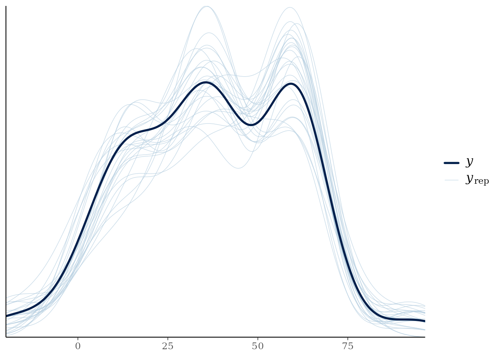

# Fitting and Working with MVBeliefUpdatr Stanfit Models

## 1. Introduction and Overview

The **MVBeliefUpdatr** package provides Bayesian hierarchical Stan
models for incremental cognitive belief-updating during speech
perception and multidimensional categorization experiments. These models
fit observer and adaptor beliefs (e.g., Normal-Inverse-Wishart \[NIW\]
and Normal-Inverse-$`\chi^2`$ \[NIX\]) across exposure blocks or
participant groups using MCMC sampling via **rstan** or **cmdstanr**.

Fitted models are returned as typed S7 objects inheriting from
`MVBU_Stanfit` (e.g., `NIW_IdealAdaptorStanfit` or
`NIX_IdealAdaptorStanfit`). This vignette details:

1.  **Preparing Data and Inputs**: Structuring exposure data and
    bundling priors with
    [`new_ideal_adaptor_stanfit_input()`](https://hlplab.github.io/MVBeliefUpdatr/reference/new_ideal_adaptor_stanfit_input.md).
2.  **Model Fitting, Backends & Threading**: Executing Bayesian
    estimation via
    [`fit_ideal_adaptor()`](https://hlplab.github.io/MVBeliefUpdatr/reference/fit_ideal_adaptor.md)
    or `fit_ideal_observer()`, selecting between **rstan** and
    **cmdstanr** backends, and configuring between-chain (`cores`) and
    within-chain (`threads`) parallelization.
3.  **Model Summaries & Diagnostics**: Printing, summarizing, and
    evaluating convergence (`rhat`, `neff_ratio`, `get_draws`).
4.  **Accelerated Post-Processing**: Pre-extracting posterior latents
    and closures with
    [`add_posterior_latents()`](https://hlplab.github.io/MVBeliefUpdatr/reference/add_posterior_latents.md)
    for fast visualization.
5.  **Model Comparison & Criteria**: Storing information criteria with
    [`add_criterion()`](https://hlplab.github.io/MVBeliefUpdatr/reference/add_criterion.md),
    comparing models with
    [`loo_compare()`](https://mc-stan.org/loo/reference/loo_compare.html),
    and generating posterior predictive checks with
    [`pp_check()`](https://mc-stan.org/bayesplot/reference/pp_check.html).

#### Companion Vignettes

- For the basic class structure of `MVBeliefUpdatr`, see the vignette
  [S7 Class Architecture, Constructors, and
  Workflows](https://hlplab.github.io/MVBeliefUpdatr/articles/s7-class-structure-and-workflows.md)
- For visualization workflows corresponding to these objects, see the
  vignette: [Visualizing Categories, Categorization Functions, and
  Belief
  Updating](https://hlplab.github.io/MVBeliefUpdatr/articles/visualizing-models-and-categories.md).

``` r

library(MVBeliefUpdatr)
library(tibble)
library(dplyr)
library(loo)
```

------------------------------------------------------------------------

## 2. Preparing Data and Input Bundles (`MVBU_Staninput`)

Before fitting a model in Stan, raw participant observations (containing
continuous cue dimensions such as Formant frequencies $`F_1, F_2`$ or
Voice Onset Time \[VOT\]) are packaged alongside prior hyperparameters
using
[`new_ideal_adaptor_stanfit_input()`](https://hlplab.github.io/MVBeliefUpdatr/reference/new_ideal_adaptor_stanfit_input.md).

The input pipeline: 1. Standardizes or scales continuous cue dimensions
(e.g., z-scoring relative to exposure distribution). 2. Sets up
conjugate prior distributions over category parameters (e.g., mean
$`m_0`$, scatter matrix $`S_0`$, prior sample size $`\kappa_0`$, and
degrees of freedom $`\nu_0`$). 3. Creates a strongly typed S7 input
object based on the cognitive model family and integration
architecture: - **NIW**: `NIW_IdealAdaptorStaninput` (multivariate full
covariance updating) - **NIX**: `NIX_IdealAdaptorStaninput` (single-cue
univariate updating) - **Early Integration (MNIX)**:
`{Integrator}_MNIX_IdealAdaptorStaninput` (e.g.,
`IdealIntegrator_MNIX_IdealAdaptorStaninput`,
`WeightedIntegrator_MNIX_IdealAdaptorStaninput`,
`CategoryWeightedIntegrator_MNIX_IdealAdaptorStaninput`, etc.; early
projection $`z = \mathbf{w}^T \mathbf{x}`$ followed by 1D updating) -
**Late Integration (MNIX)**: `MNIX_IdealAdaptor_{Integrator}Staninput`
(e.g., `MNIX_IdealAdaptor_IdealIntegratorStaninput`,
`MNIX_IdealAdaptor_WeightedIntegratorStaninput`,
`MNIX_IdealAdaptor_CategoryWeightedIntegratorStaninput`, etc.;
independent per-cue NIX distributions with late decision-level
weighting)

``` r

# Construct standard 2-cue NIW ideal adaptor Stanfit input
stan_input <- example_ideal_adaptor_stanfit_input(
  model_family = "NIW",
  n_cues = 2L,
  seed = 42L
)
```

------------------------------------------------------------------------

## 3. Fitting Bayesian Models (`fit_ideal_adaptor`)

To fit the model,
[`fit_ideal_adaptor()`](https://hlplab.github.io/MVBeliefUpdatr/reference/fit_ideal_adaptor.md)
passes the `stan_input` bundle to Stan’s MCMC sampler.

### 3.1 Basic Fitting Workflow

By default,
[`fit_ideal_adaptor()`](https://hlplab.github.io/MVBeliefUpdatr/reference/fit_ideal_adaptor.md)
uses the `"rstan"` backend:

``` r

# Executing MCMC sampling (interactive fitting call)
fit <- fit_ideal_adaptor(
  stan_input,
  chains = 4,
  iter = 2000,
  warmup = 1000,
  seed = 42
)
```

### 3.2 Execution Backends: `rstan` vs. `cmdstanr`

`MVBeliefUpdatr` supports two execution backends via the `backend`
argument:

1.  **`"rstan"` (default)**: Fits models in-process using the **rstan**
    package. Precompiled models bundled with the package are used
    directly, avoiding runtime C++ compilation delays.
2.  **`"cmdstanr"`**: Fits models out-of-process via the **cmdstanr**
    interface to CmdStan.

#### Why Choose `cmdstanr`?

- **Speed & Toolchain**: CmdStan provides access to newer Stan versions
  (`stanc3`), faster C++ compilation, and lower memory overhead during
  long chains.
- **Process Isolation**: Running sampling in separate command-line
  processes ensures that MCMC errors or crashes do not take down the
  active R session.
- **Unified Object Architecture**: Regardless of backend,
  [`fit_ideal_adaptor()`](https://hlplab.github.io/MVBeliefUpdatr/reference/fit_ideal_adaptor.md)
  returns a consistent S7 `MVBU_Stanfit` object whose `@backend` slot
  indicates the backend used, and whose `@stanfit` slot contains a
  standard `stanfit` object. All downstream functions
  ([`summary()`](https://rdrr.io/r/base/summary.html),
  [`get_draws()`](https://hlplab.github.io/MVBeliefUpdatr/reference/get_draws.md),
  [`add_posterior_latents()`](https://hlplab.github.io/MVBeliefUpdatr/reference/add_posterior_latents.md),
  [`add_criterion()`](https://hlplab.github.io/MVBeliefUpdatr/reference/add_criterion.md),
  [`pp_check()`](https://mc-stan.org/bayesplot/reference/pp_check.html))
  work identically:

``` r

# Fitting via the cmdstanr backend
fit_cmdstan <- fit_ideal_adaptor(
  stan_input,
  backend = "cmdstanr",
  chains = 4,
  iter = 2000,
  warmup = 1000,
  seed = 42
)

# Inspect the backend used
fit_cmdstan@backend
#> [1] "cmdstanr"
```

### 3.3 Parallel Execution and Within-Chain Threading

`MVBeliefUpdatr` supports two complementary levels of parallelization:

1.  **Between-Chain Parallelism (`cores`)**: Runs multiple MCMC chains
    simultaneously across CPU cores. For example, setting
    `chains = 4, cores = 4` fits each chain on its own CPU core.
2.  **Within-Chain Multithreading (`threads`)**: Divides computationally
    intensive likelihood loops across multiple CPU threads *within a
    single chain* using C++ threading.

#### Specifying Threads

The `threads` argument can be specified as an integer count or as a list
with a `threads` element:

- `threads = 2` (or `threads = list(threads = 2)`): Allocates 2 worker
  threads per chain.
- Under `backend = "cmdstanr"`, the model is compiled with
  `stan_threads = TRUE` and executed with `threads_per_chain = 2`.
- Under `backend = "rstan"`, threads are assigned via
  `rstan::rstan_options(threads_per_chain = 2)`.

> **Note on Total CPU Cores:** Total core allocation equals
> $`\text{chains} \times \text{threads}`$. For instance, running 4
> chains with 2 threads per chain requires $`4 \times 2 = 8`$ available
> CPU cores.

``` r

# Parallel execution: 4 chains running across 4 cores, with 2 threads per chain
# (8 cores total)
fit_fast <- fit_ideal_adaptor(
  stan_input,
  backend = "cmdstanr",
  chains = 4,
  cores = 4,
  threads = 2,
  iter = 2000,
  warmup = 1000,
  seed = 42
)
```

### 3.4 Custom Priors and Declarative Parameter Fixing

`MVBeliefUpdatr` supports declarative, brms-style custom prior
specifications via
[`parameter_prior()`](https://hlplab.github.io/MVBeliefUpdatr/reference/MVBU_Prior.md)
and fine-grained parameter fixing via
[`fix_parameter()`](https://hlplab.github.io/MVBeliefUpdatr/reference/MVBU_FixedParameter.md).

#### Cognitive Parameters, Scopes, and Fixing Capabilities

The table below outlines every cognitive parameter, whether it can be
fixed globally, whether it can be fixed for particular categories only
(partial category fixing; remaining categories are estimated), and its
prior family:

[TABLE]

#### Declarative Parameter Fixing (`fix_parameter`)

Parameters can be fixed globally or for a subset of categories using
[`fix_parameter()`](https://hlplab.github.io/MVBeliefUpdatr/reference/MVBU_FixedParameter.md):

``` r

# Fix global lapse rate to 2% and category priors equally
f_global <- c(
  fix_parameter(0.02, class = "lapse_rate"),
  fix_parameter(c(0.5, 0.5), class = "category_prior")
)

# Partial fixing: fix category '/d/' mean, estimate category '/t/'
f_partial <- fix_parameter(
  value = c(F1 = 300, F2 = 1200),
  class = "m_0",
  category = "/d/",
  cue_space = "original"
)

# Combine fixed parameter specifications
all_fixed <- c(f_global, f_partial)
```

##### Prior Hyperparameters vs. Truly Known Category Moments

`MVBeliefUpdatr` distinguishes between prior hyperparameters (`m_0`,
`S_0`, `expected_Sigma_0`) and truly known category moments (`mu_0`,
`Sigma_0`):

- **Prior hyperparameters (`m_0`, `S_0`)**: Model the observer’s prior
  belief before exposure. During exposure, category representations
  update via conjugate belief updating (NIW or NIX), and the predictive
  likelihood is Student-*t*.
- **Truly known moments (`mu_0`, `Sigma_0`)**: Model categories whose
  mean vector or covariance matrix is fixed as a non-random physical
  constant.

Fixing either or both moments determines the conjugate belief updating
and predictive likelihood family:

1.  **Case 1 (both unknown)**: Standard NIW or NIX conjugate updating;
    Student-*t* predictive likelihood.
2.  **Case 2 (`Sigma_0` known, `mu_0` unknown)**: Category covariance is
    fixed to $`\Sigma_0`$. Category mean is updated via Normal-mean
    updating ($`\kappa_n = \kappa_0 + n`$,
    $`\mu_n = (\kappa_0 m_0 + n \bar{x}) / \kappa_n`$). Because
    covariance is known with certainty, the predictive likelihood
    reduces to a **Normal** distribution with covariance
    $`(1 + 1/\kappa_n) \Sigma_0`$.
3.  **Case 3 (`mu_0` known, `Sigma_0` unknown)**: Category mean is fixed
    to $`\mu_0`$. Category covariance is updated around the known mean
    ($`\nu_n = \nu_0 + n`$,
    $`S_n = S_0 + \sum (x_i - \mu_0)(x_i - \mu_0)^T`$). The predictive
    likelihood is **Student-*t*** with $`\nu_n`$ degrees of freedom.
4.  **Case 4 (both `mu_0` and `Sigma_0` known)**: Category
    representation is completely fixed. No belief updating occurs with
    exposure, and the predictive likelihood is **Normal($`\mu_0`$,
    $`\Sigma_0`$)**.

``` r

# Fix known covariance for /d/, estimate covariance for /t/
f_known_sigma <- fix_parameter(
  value = matrix(c(100^2, 0, 0, 150^2), nrow = 2),
  class = "Sigma_0",
  category = "/d/",
  cue_space = "original"
)

# Fix known mean for /d/, estimate mean for /t/
f_known_mu <- fix_parameter(
  value = c(F1 = 300, F2 = 1200),
  class = "mu_0",
  category = "/d/",
  cue_space = "original"
)

# Combine with global and prior specifications
all_fixed <- c(f_global, f_known_sigma, f_known_mu)
```

#### Specifying Custom Priors (`parameter_prior`)

Priors are specified using
[`parameter_prior()`](https://hlplab.github.io/MVBeliefUpdatr/reference/MVBU_Prior.md)
declarations:

``` r

priors <- c(
  parameter_prior("cauchy(0, 2)", class = "tau_0"),
  parameter_prior("lkj(2)", class = "cor_0"),
  parameter_prior("beta(2, 50)", class = "lapse_rate"),
  parameter_prior("dirichlet(c(2, 2))", class = "category_prior")
)
```

Both `fixed_parameters` and `priors` are passed directly to
[`fit_ideal_adaptor()`](https://hlplab.github.io/MVBeliefUpdatr/reference/fit_ideal_adaptor.md):

``` r

fit <- fit_ideal_adaptor(
  stan_input,
  fixed_parameters = all_fixed,
  priors = priors
)
```

### 3.5 Pre-compiled Fits for Fast Exploration

For reproducible vignette compilation without long MCMC sampling delays,
pre-compiled model fits can be accessed via package fixtures or helpers:

``` r

# Load or fit 1-cue NIW ideal adaptor Stanfit model
models_dir <- if (dir.exists("../tests/testthat/models")) {
  "../tests/testthat/models"
} else if (dir.exists("tests/testthat/models")) {
  "tests/testthat/models"
} else {
  tempdir()
}
fit_file <- file.path(
  models_dir,
  "example-stanfit-NIW_ideal_adaptor-1-standardize-42.rds"
)
fit <- example_ideal_adaptor_stanfit(
  model_family = "NIW",
  n_cues = 1L,
  file = fit_file,
  file_refit = "never"
)

# Inspect class hierarchy and model family
class(fit)
#> [1] "NIW_IdealAdaptorStanfit" "IdealAdaptorStanfit"    
#> [3] "MVBU_Stanfit"            "MVBU_Object"            
#> [5] "S7_object"
get_family_name(fit)
#> [1] "NIW"
get_family(fit)
#> <MVBeliefUpdatr::MVBU_Family>
#>  @ family_names                  :List of 3
#>  .. $ name_short  : chr "NIW"
#>  .. $ name_long   : chr "Normal-Inverse-Wishart Ideal Adaptor"
#>  .. $ name_details:List of 4
#>  ..  ..$ CategoryRepresentation_name: chr "NIW_CategoryRepresentation"
#>  ..  ..$ CategoryTemplate_name      : chr "NIW_CategoryRepresentationTemplate"
#>  ..  ..$ CognitiveModel_name        : chr "NIW_IdealAdaptor"
#>  ..  ..$ CognitiveModelList_name    : chr "NIW_CognitiveModelList"
#>  @ density_function              : function (x, rep, log = FALSE, noise_treatment = "no_noise", Sigma_noise = NULL)  
#>  @ sampling_function             : function (rep, n = 1L, with_replacement = TRUE, ...)  
#>  @ expected_moments              : function (rep)  
#>  @ marginal_moments              : function (rep)  
#>  @ sufficient_statistics_function: NULL
#>  @ stanmodel                     :List of 2
#>  .. $ stanmodel_name: chr "NIW_ideal_adaptor"
#>  .. $ stanfit_class : chr "NIW_IdealAdaptorStanfit"
```

------------------------------------------------------------------------

## 4. Lightweight Posterior Representations (`MVBU_StanfitPosterior`)

While full `MVBU_Stanfit` objects store raw sampling chains, diagnostic
metrics, compiled C++ structures, and source matrices, downstream
evaluation and plotting workflows often only require parameter draw
distributions.

The `MVBU_StanfitPosterior` S7 class provides a lightweight
representation of fitted posterior distributions. It strips away heavy
Stan compilation structures while retaining parameter draws and
metadata, enabling fast serialization, evaluation, and visualization.

``` r

# Coerce a full Stanfit model to a lightweight posterior representation
post_model <- as_MVBU_stanfit_posterior(fit)
post_model
#> MVBeliefUpdatr Lightweight Stanfit Posterior
#> Model Family     : NIW 
#> Group Context    : no_exposure, left_shifted, right_shifted 
#> Cues             : VOT 
#> Categories       : /d/, /t/

# Inspect cue labels, categories, response categories, and groups
get_cue_labels(post_model)
#> [1] "VOT"
get_category_labels(post_model)
#> [1] "/d/" "/t/"
get_response_category_labels(post_model)
#> [1] "/d/" "/t/"
get_group_labels(post_model, include_prior = TRUE)
#> [1] "prior"         "no_exposure"   "left_shifted"  "right_shifted"

# Inspect model family via the modern S7 family system
get_family_name(post_model)
#> [1] "NIW"
get_family(post_model)
#> <MVBeliefUpdatr::MVBU_Family>
#>  @ family_names                  :List of 3
#>  .. $ name_short  : chr "NIW"
#>  .. $ name_long   : chr "Normal-Inverse-Wishart Ideal Adaptor"
#>  .. $ name_details:List of 4
#>  ..  ..$ CategoryRepresentation_name: chr "NIW_CategoryRepresentation"
#>  ..  ..$ CategoryTemplate_name      : chr "NIW_CategoryRepresentationTemplate"
#>  ..  ..$ CognitiveModel_name        : chr "NIW_IdealAdaptor"
#>  ..  ..$ CognitiveModelList_name    : chr "NIW_CognitiveModelList"
#>  @ density_function              : function (x, rep, log = FALSE, noise_treatment = "no_noise", Sigma_noise = NULL)  
#>  @ sampling_function             : function (rep, n = 1L, with_replacement = TRUE, ...)  
#>  @ expected_moments              : function (rep)  
#>  @ marginal_moments              : function (rep)  
#>  @ sufficient_statistics_function: NULL
#>  @ stanmodel                     :List of 2
#>  .. $ stanmodel_name: chr "NIW_ideal_adaptor"
#>  .. $ stanfit_class : chr "NIW_IdealAdaptorStanfit"

# Extract expected moments conditional on parameter draws
get_expected_mu(post_model)
#> # A tibble: 8 × 3
#>   group         category mu.mean     
#>   <fct>         <fct>    <named list>
#> 1 prior         /d/      <dbl [1]>   
#> 2 prior         /t/      <dbl [1]>   
#> 3 no_exposure   /d/      <dbl [1]>   
#> 4 no_exposure   /t/      <dbl [1]>   
#> 5 left_shifted  /d/      <dbl [1]>   
#> 6 left_shifted  /t/      <dbl [1]>   
#> 7 right_shifted /d/      <dbl [1]>   
#> 8 right_shifted /t/      <dbl [1]>
get_expected_sigma(post_model)
#> # A tibble: 8 × 3
#>   group         category Sigma.mean   
#>   <fct>         <fct>    <named list> 
#> 1 prior         /d/      <dbl [1 × 1]>
#> 2 prior         /t/      <dbl [1 × 1]>
#> 3 no_exposure   /d/      <dbl [1 × 1]>
#> 4 no_exposure   /t/      <dbl [1 × 1]>
#> 5 left_shifted  /d/      <dbl [1 × 1]>
#> 6 left_shifted  /t/      <dbl [1 × 1]>
#> 7 right_shifted /d/      <dbl [1 × 1]>
#> 8 right_shifted /t/      <dbl [1 × 1]>

# Extract marginal moments incorporating parameter uncertainty
get_marginal_mu(post_model)
#> # A tibble: 8 × 3
#>   group         category mu.mean     
#>   <fct>         <fct>    <named list>
#> 1 prior         /d/      <dbl [1]>   
#> 2 prior         /t/      <dbl [1]>   
#> 3 no_exposure   /d/      <dbl [1]>   
#> 4 no_exposure   /t/      <dbl [1]>   
#> 5 left_shifted  /d/      <dbl [1]>   
#> 6 left_shifted  /t/      <dbl [1]>   
#> 7 right_shifted /d/      <dbl [1]>   
#> 8 right_shifted /t/      <dbl [1]>
get_marginal_sigma(post_model)
#> # A tibble: 8 × 3
#>   group         category Sigma.mean   
#>   <fct>         <fct>    <named list> 
#> 1 prior         /d/      <dbl [1 × 1]>
#> 2 prior         /t/      <dbl [1 × 1]>
#> 3 no_exposure   /d/      <dbl [1 × 1]>
#> 4 no_exposure   /t/      <dbl [1 × 1]>
#> 5 left_shifted  /d/      <dbl [1 × 1]>
#> 6 left_shifted  /t/      <dbl [1 × 1]>
#> 7 right_shifted /d/      <dbl [1 × 1]>
#> 8 right_shifted /t/      <dbl [1 × 1]>

# Evaluate decision likelihoods directly on the lightweight posterior
eval_res <- evaluate_model(post_model)
head(eval_res)
#> [1] -19.52708
```

------------------------------------------------------------------------

## 5. Printing, Summarizing, and Diagnostics

`MVBU_Stanfit` objects provide clear, structured S7
[`print()`](https://rdrr.io/r/base/print.html) and
[`summary()`](https://rdrr.io/r/base/summary.html) outputs.

### Printing

Printing an `MVBU_Stanfit` object displays its S7 class, model type, cue
labels, category labels, transformation status, and MCMC sampling
specifications:

``` r

print(fit)
#> <NIW_IdealAdaptorStanfit>
#>   Model family: NIW
#>   Categories (2): /d/, /t/
#>   Cues (1): VOT
#>   Groups (3): no_exposure, left_shifted, right_shifted
#>   Draws: 25
```

### Summarizing

[`summary()`](https://rdrr.io/r/base/summary.html) computes posterior
summary statistics for prior hyperparameters ($`\kappa, \nu, m, S`$),
group-specific belief parameters, and full distributions across MCMC
draws for both **expected category moments** and **marginal category
moments**:

- **Expected moments**: Moments of the category conditional on the
  parameters of each draw. The expected covariance is
  $`\mathbb{E}[\mathbf{\Sigma}] = \frac{\mathbf{S}}{\nu - D - 1}`$.
- **Marginal moments**: Moments marginalizing over uncertainty in the
  category mean $`\mu`$, scaling the covariance by
  $`\frac{\kappa + 1}{\kappa}`$:
  $`\mathbf{\Sigma}_{\text{marg}} = \frac{\kappa + 1}{\kappa} \frac{\mathbf{S}}{\nu - D - 1}`$.

Both moment tables report the mean, standard deviation, and standard
Bayesian credible quantiles (2.5%, 25%, 50%, 75%, 97.5%) across
posterior draws for all cues and cue covariances:

``` r

summary(fit)
#>  // MVBeliefUpdatr Stanfit Model Summary
#>  Model Family: NIW IdealAdaptor
#>  Cues:         VOT (K = 1)
#>  Categories:   /d/, /t/ (M = 2)
#>  Observations: Total test observations = 15 across L = 3 exposure groups
#>  Draws:        1 chains, each with iter = 50; warmup = 25; thin = 1
#>                Total post-warmup draws = 25
#> 
#> Fitted parameters:
#>   Parameter Dist. Group Category Cue1 Cue2          mean      se_mean
#>       kappa prior                           7.899678e+01 2.061247e+01
#>       kappa prior                           7.899678e+01 2.061247e+01
#>       kappa prior                           7.899678e+01 2.061247e+01
#>          nu prior                           4.576389e+01 6.872093e+00
#>          nu prior                           4.576389e+01 6.872093e+00
#>          nu prior                           4.576389e+01 6.872093e+00
#>           m prior            /d/  VOT       4.775269e+00 2.620190e+00
#>           m prior            /d/ <NA>      -9.609973e-01 7.756631e-02
#>           m prior            /d/ <NA>       2.083971e-01 1.596156e-01
#>           m prior            /t/  VOT       4.427742e+01 5.391816e+00
#>           S prior            /d/  VOT  VOT  5.647951e+03 2.401513e+03
#>           S prior            /t/  VOT  VOT  2.168915e+06 1.414180e+06
#>  lapse_bias                  /d/            4.264910e-01 6.718138e-02
#>  lapse_bias                  /t/            5.735090e-01 6.718138e-02
#>  lapse_bias                  /d/            4.264910e-01 6.718138e-02
#>  lapse_bias                  /d/            5.735090e-01 6.718138e-02
#>  lapse_rate                                 2.448485e-02 4.191057e-03
#>            sd          2.5%           50%         97.5%    n_eff      Rhat
#>  8.987895e+01  5.478642e+00  2.544328e+01  2.999590e+02 19.01322 0.9825430
#>  8.987895e+01  5.478642e+00  2.544328e+01  2.999590e+02 19.01322 0.9825430
#>  8.987895e+01  5.478642e+00  2.544328e+01  2.999590e+02 19.01322 0.9825430
#>  3.436314e+01  8.733379e+00  4.253962e+01  1.145754e+02 25.00388 0.9809190
#>  3.436314e+01  8.733379e+00  4.253962e+01  1.145754e+02 25.00388 0.9809190
#>  3.436314e+01  8.733379e+00  4.253962e+01  1.145754e+02 25.00388 0.9809190
#>  8.895793e+00 -1.777735e+01  8.618990e+00  1.500751e+01 11.52667 1.0560544
#>  2.633449e-01 -1.628629e+00 -8.472104e-01 -6.580890e-01 11.52667 1.0560544
#>  9.436036e-01 -1.336491e+00  1.507154e-01  2.411372e+00 34.94850 0.9584253
#>  3.187493e+01 -7.908921e+00  4.232893e+01  1.186939e+02 34.94850 0.9584253
#>  1.240040e+04  1.657548e+02  2.392622e+03  3.250483e+04 26.66255 0.9813301
#>  7.446067e+06  1.409518e+03  3.745507e+04  1.788816e+07 27.72328 1.0048682
#>  2.743576e-01  7.283122e-02  4.422716e-01  9.550368e-01 16.67770 0.9789888
#>  2.743576e-01  4.496316e-02  5.577284e-01  9.271688e-01 16.67770 0.9789888
#>  2.743576e-01  7.283122e-02  4.422716e-01  9.550368e-01 16.67770 0.9789888
#>  2.743576e-01  4.496316e-02  5.577284e-01  9.271688e-01 16.67770 0.9789888
#>  2.477638e-02  2.590717e-03  1.957022e-02  9.223799e-02 34.94850 0.9815544
#> 
#> Category moments (distributions across draws):
#>   Parameter         Group Category Cue1 Cue2         mean           sd
#>          mu  left_shifted      /d/  VOT          2.664136 7.789014e+00
#>   Sigma_exp  left_shifted      /d/  VOT  VOT   132.897231 8.245047e+01
#>  Sigma_marg  left_shifted      /d/  VOT  VOT   138.251080 9.109069e+01
#>          mu  left_shifted      /t/  VOT         44.800085 2.686326e+01
#>   Sigma_exp  left_shifted      /t/  VOT  VOT 38727.397817 1.205916e+05
#>  Sigma_marg  left_shifted      /t/  VOT  VOT 39634.216952 1.222828e+05
#>          mu   no_exposure      /d/  VOT          4.775269 8.895793e+00
#>   Sigma_exp   no_exposure      /d/  VOT  VOT    89.639051 9.939850e+01
#>  Sigma_marg   no_exposure      /d/  VOT  VOT    96.921697 1.176367e+02
#>          mu   no_exposure      /t/  VOT         44.277420 3.187493e+01
#>   Sigma_exp   no_exposure      /t/  VOT  VOT 43059.926217 1.314125e+05
#>  Sigma_marg   no_exposure      /t/  VOT  VOT 44374.702831 1.334896e+05
#>          mu         prior      /d/  VOT          4.775269 8.895793e+00
#>   Sigma_exp         prior      /d/  VOT  VOT    89.639051 9.939850e+01
#>  Sigma_marg         prior      /d/  VOT  VOT    96.921697 1.176367e+02
#>          mu         prior      /t/  VOT         44.277420 3.187493e+01
#>   Sigma_exp         prior      /t/  VOT  VOT 43059.926217 1.314125e+05
#>  Sigma_marg         prior      /t/  VOT  VOT 44374.702831 1.334896e+05
#>          mu right_shifted      /d/  VOT          9.527333 8.841726e+00
#>   Sigma_exp right_shifted      /d/  VOT  VOT   206.277047 1.370019e+02
#>  Sigma_marg right_shifted      /d/  VOT  VOT   213.457534 1.425721e+02
#>          mu right_shifted      /t/  VOT         47.442429 2.751265e+01
#>   Sigma_exp right_shifted      /t/  VOT  VOT 38892.171598 1.205855e+05
#>  Sigma_marg right_shifted      /t/  VOT  VOT 39803.661860 1.222758e+05
#>         2.5%         50%        97.5%
#>  -15.9620005    2.627774     11.42249
#>   53.6859942  109.923310    320.79622
#>   55.8034709  114.250501    342.04950
#>    0.3253109   42.981832    107.68585
#>  113.1548639 1599.577033 293380.08200
#>  123.9710021 1617.810209 300268.82526
#>  -17.7773464    8.618990     15.00751
#>   12.9392842   71.421506    324.96400
#>   13.1676410   72.328169    367.24806
#>   -7.9089212   42.328931    118.69394
#>  113.2182006 1465.108759 325350.42298
#>  129.0852146 1567.623337 336006.30388
#>  -17.7773464    8.618990     15.00751
#>   12.9392842   71.421506    324.96400
#>   13.1676410   72.328169    367.24806
#>   -7.9089212   42.328931    118.69394
#>  113.2182006 1465.108759 325350.42298
#>  129.0852146 1567.623337 336006.30388
#>  -10.1296290   11.771837     20.72671
#>   50.6147658  149.229304    527.85208
#>   52.4653576  152.653202    558.34325
#>    2.6127790   45.010401    109.89988
#>  247.2698852 1533.174518 293479.56404
#>  255.1015679 1537.704659 300372.55523
#> 
#> Warnings:
#>   * Warning: The largest R-hat is 1.06, indicating potential convergence issues.
#> 
#> Parameters with Rhats > 1.05:
#>  Parameter     Dist.       Group Category Cue1 Cue2     Rhat
#>          m     prior                  /d/  VOT      1.056054
#>          m     prior                  /d/ <NA>      1.056054
#>          m posterior no_exposure      /d/  VOT      1.056054
```

### Extracting Draws & MCMC Diagnostics

Posterior draws can be extracted in tidy format using
[`get_draws()`](https://hlplab.github.io/MVBeliefUpdatr/reference/get_draws.md).
When `nest = TRUE` is specified,
[`get_draws()`](https://hlplab.github.io/MVBeliefUpdatr/reference/get_draws.md)
provides draw-level expected covariance matrices (`Sigma_exp`), marginal
covariance matrices (`Sigma_marg`), and standard covariance matrices
(`Sigma`).

Standard MCMC convergence diagnostics ($`\widehat{R}`$ and effective
sample size ratio $`n_{eff}/N`$) are accessible via
[`rhat()`](https://hlplab.github.io/MVBeliefUpdatr/reference/diagnostic-quantities.md)
and
[`neff_ratio()`](https://hlplab.github.io/MVBeliefUpdatr/reference/diagnostic-quantities.md):

``` r

# Tidy posterior draws with draw-level covariance matrices
draws_df <- get_draws(fit, nest = TRUE, summarize = FALSE)
names(draws_df)
#>  [1] ".chain"     ".iteration" ".draw"      "group"      "category"  
#>  [6] "kappa"      "nu"         "m"          "S"          "lapse_rate"
#> [11] "Sigma_exp"  "Sigma_marg"

# Convergence diagnostics across parameters
head(rhat(fit))
#>   kappa_0_shared_param[1]      nu_0_shared_param[1] category_prior_param[1,1] 
#>                 0.9903867                 0.9896015                 0.9610481 
#> category_prior_param[1,2]     lapse_bias_param[1,1]     lapse_bias_param[1,2] 
#>                 0.9610481                 0.9882127                 0.9882127
head(neff_ratio(fit))
#>   kappa_0_shared_param[1]      nu_0_shared_param[1] category_prior_param[1,1] 
#>                 0.5272677                 0.7065037                 0.4123210 
#> category_prior_param[1,2]     lapse_bias_param[1,1]     lapse_bias_param[1,2] 
#>                 0.4123210                 0.5272677                 0.5272677
```

------------------------------------------------------------------------

## 6. Pre-extracting Posterior Latents & Evaluation Closures (`add_posterior_latents`)

When producing complex multi-panel category plots, categorization
decision boundaries, or posterior density curves across multiple
exposure trials, downstream plotting and evaluation routines frequently
need to access posterior latent parameter draws
($`m, S, \kappa, \nu, \mathbf{\Sigma}_{\text{exp}}, \mathbf{\Sigma}_{\text{marg}}`$)
and evaluate likelihood or posterior functions across observation grids.

By default, extracting draws repeatedly from an `MVBU_Stanfit` object
requires untransforming cue coordinates and pivoting tables on every
call.

Calling
**[`add_posterior_latents()`](https://hlplab.github.io/MVBeliefUpdatr/reference/add_posterior_latents.md)**
extracts draw-level latents once, computes expected and marginal
covariance moments, compiles vectorized evaluation closures, and stores
them in the object’s `@cache` slot:

- `draws`:
  - `parameters`: Nested tibble containing draw-level representations of
    $`m, S, \kappa, \nu, \mathbf{\Sigma}_{\text{exp}}, \mathbf{\Sigma}_{\text{marg}}`$,
    and lapse rate across groups and categories.
  - `likelihood_function`: Closure evaluating category likelihoods for
    arbitrary test observations across draws, returning a 3D array
    `[N_obs, K, N_draws]`.
  - `posterior_function`: Closure evaluating category posterior
    probabilities under specified decision rules, noise treatments, and
    lapse rates across draws, returning a 3D array
    `[N_obs, K, N_draws]`.
- `summary`:
  - `parameters`: Point estimates of category parameters aggregated
    across draws.
  - `expected_moments`: Distribution summary (mean, SD, quantiles) of
    category expected moments.
  - `marginal_moments`: Distribution summary (mean, SD, quantiles) of
    category marginal moments.
  - `likelihood_function`: Closure evaluating category likelihoods
    directly from marginal moments (returning a 2D matrix `[N_obs, K]`).
  - `posterior_function`: Closure evaluating category posterior
    probabilities directly from marginal moments (returning a 2D matrix
    `[N_obs, K]`).

``` r

# Pre-extract posterior latents and closures into the model's @cache slot
fit <- add_posterior_latents(fit)

# Inspect cached quantities
names(fit@cache)
#> [1] "draws"   "summary"
names(fit@cache$draws)
#> [1] "parameters"          "likelihood_function" "posterior_function"
names(fit@cache$summary)
#> [1] "parameters"          "expected_moments"    "marginal_moments"   
#> [4] "likelihood_function" "posterior_function"
head(fit@cache$summary$expected_moments)
#> # A tibble: 6 × 10
#>   Parameter Group       Category Cue1  Cue2    mean     sd `2.5%`  `50%` `97.5%`
#>   <chr>     <chr>       <chr>    <chr> <chr>  <dbl>  <dbl>  <dbl>  <dbl>   <dbl>
#> 1 mu        prior       /d/      VOT   ""    4.78e0 8.90e0 -17.8  8.62e0  1.50e1
#> 2 Sigma_exp prior       /d/      VOT   "VOT" 8.96e1 9.94e1  12.9  7.14e1  3.25e2
#> 3 mu        prior       /t/      VOT   ""    4.43e1 3.19e1  -7.91 4.23e1  1.19e2
#> 4 Sigma_exp prior       /t/      VOT   "VOT" 4.31e4 1.31e5 113.   1.47e3  3.25e5
#> 5 mu        no_exposure /d/      VOT   ""    4.78e0 8.90e0 -17.8  8.62e0  1.50e1
#> 6 Sigma_exp no_exposure /d/      VOT   "VOT" 8.96e1 9.94e1  12.9  7.14e1  3.25e2
head(fit@cache$summary$marginal_moments)
#> # A tibble: 6 × 10
#>   Parameter  Group      Category Cue1  Cue2    mean     sd `2.5%`  `50%` `97.5%`
#>   <chr>      <chr>      <chr>    <chr> <chr>  <dbl>  <dbl>  <dbl>  <dbl>   <dbl>
#> 1 mu         prior      /d/      VOT   ""    4.78e0 8.90e0 -17.8  8.62e0  1.50e1
#> 2 Sigma_marg prior      /d/      VOT   "VOT" 9.69e1 1.18e2  13.2  7.23e1  3.67e2
#> 3 mu         prior      /t/      VOT   ""    4.43e1 3.19e1  -7.91 4.23e1  1.19e2
#> 4 Sigma_marg prior      /t/      VOT   "VOT" 4.44e4 1.33e5 129.   1.57e3  3.36e5
#> 5 mu         no_exposu… /d/      VOT   ""    4.78e0 8.90e0 -17.8  8.62e0  1.50e1
#> 6 Sigma_marg no_exposu… /d/      VOT   "VOT" 9.69e1 1.18e2  13.2  7.23e1  3.67e2
```

#### Why Precomputed Latents and Closures are Advantageous

1.  **Performance**: Eliminates repeated data-wrangling loops during
    high-resolution contour or grid evaluations.
2.  **Unified Evaluation**: Both draw-wise and summary evaluation
    closures share identical interfaces and handle noise marginalization
    and lapse rates automatically.
3.  **Seamless Visualization**: Plotting functions such as
    [`plot_categories()`](https://hlplab.github.io/MVBeliefUpdatr/reference/plot_categories.md)
    and
    [`plot_categorization_functions()`](https://hlplab.github.io/MVBeliefUpdatr/reference/plot_categorization_functions.md)
    automatically leverage cached closures and moments.

For comprehensive examples of plotting category distributions and
decision boundaries, see the companion vignette: [Visualizing
Categories, Categorization Functions, and Belief
Updating](https://hlplab.github.io/MVBeliefUpdatr/articles/visualizing-models-and-categories.md).

------------------------------------------------------------------------

## 7. Model Comparison and Information Criteria

`MVBU_Stanfit` objects integrate with **loo** and **bayesplot** for
Bayesian model comparison, cross-validation, and posterior predictive
checking, following the argument conventions of **brms**.

### Adding Fit Criteria (`add_criterion`)

Model fit criteria (such as `"loo"`, `"waic"`, `"bayes_R2"`, `"loo_R2"`,
`"kfold"`, `"loo_subsample"`, or `"marglik"`) are computed and stored in
the model’s `@criteria` slot using
[`add_criterion()`](https://hlplab.github.io/MVBeliefUpdatr/reference/add_criterion.md):

``` r

# Compute and store LOO and WAIC criteria
fit <- add_criterion(fit, criterion = c("loo", "waic", "bayes_R2"), model_name = "NIW_2Cue_Model")

# Inspect stored criteria
names(fit@criteria)
#> [1] "loo"      "waic"     "bayes_R2"
fit@criteria$loo
#> 
#> Computed from 25 by 15 log-likelihood matrix.
#> 
#>          Estimate  SE
#> elpd_loo    -10.4 2.7
#> p_loo         1.7 0.7
#> looic        20.8 5.5
#> ------
#> MCSE of elpd_loo is NA.
#> MCSE and ESS estimates assume MCMC draws (r_eff in [0.8, 1.3]).
#> 
#> Pareto k diagnostic values:
#>                           Count Pct.    Min. ESS
#> (-Inf, 0.28]   (good)      0      0.0%  <NA>    
#>    (0.28, 1]   (bad)       0      0.0%  <NA>    
#>     (1, Inf)   (very bad) 15    100.0%  <NA>    
#> See help('pareto-k-diagnostic') for details.
fit@criteria$bayes_R2
#>  Estimate Est.Error      Q2.5     Q97.5 
#>       0.5       0.0       0.5       0.5 
#> attr(,"class")
#> [1] "bayes_R2"
```

### Model Comparison (`loo_compare`)

When evaluating alternative model specifications (e.g., comparing
different prior specifications or model formulations),
[`loo_compare()`](https://mc-stan.org/loo/reference/loo_compare.html)
performs Leave-One-Out Cross-Validation model comparison via
[`loo::loo_compare()`](https://mc-stan.org/loo/reference/loo_compare.html):

``` r

# Duplicate model for demonstration of loo_compare signature
fit2 <- fit
fit2@metadata$model_name <- "NIW_Alternative_Model"

# Compare models using LOO-CV
comp <- loo_compare(fit, fit2, criterion = "loo")
comp
#>                  model elpd_diff se_diff p_worse diag_diff        diag_elpd
#>         NIW_2Cue_Model       0.0     0.0      NA           15 k_psis > 0.28
#>  NIW_Alternative_Model       0.0     0.0      NA           15 k_psis > 0.28
```

> **Tip:** Leave-One-Out Cross-Validation (`loo`) is recommended over
> `waic` for robust model comparison, as `waic` can be sensitive to
> influential observations.

### Posterior Predictive Checking (`pp_check`)

Graphical posterior predictive checks compare observed exposure data
$`y`$ with synthetic observations $`y_{rep}`$ drawn from the model’s
posterior predictive distribution:

``` r

if (requireNamespace("bayesplot", quietly = TRUE)) {
  # Overlay observed response density with posterior predictive replicates
  pp_check(fit, type = "dens_overlay", ndraws = 30)
}
```



------------------------------------------------------------------------

## 8. Reconstructing Exposure Update Histories (`reconstruct_update_history`)

When fitting an ideal adaptor model in Stan, researchers often wish to
inspect how beliefs evolve incrementally across exposure observations.

The
[`reconstruct_update_history()`](https://hlplab.github.io/MVBeliefUpdatr/reference/reconstruct_update_history.md)
generic takes an `MVBU_Stanfit` object and reconstructs the sequential
updating process into an `MVBU_ModelList` container:

- `uncertainty_treatment = "marginalize"` (default): Sequentially
  updates individual posterior MCMC draws (controlled by `ndraws`,
  default `20L`, with optional parallelization via `parallel = TRUE`).
  Returns an `MVBU_ModelList` holding lightweight
  `MVBU_StanfitPosterior` objects, faithfully capturing parameter
  estimation uncertainty across exposure checkpoints.
- `uncertainty_treatment = "discard"`: Fast mode that computes prior
  marginal moments and sequentially updates a single point-estimate
  ideal adaptor (e.g. `NIW_IdealAdaptor` or `NIX_IdealAdaptor`) across
  step checkpoints (e.g. `step_size = 10L`). Returns an `MVBU_ModelList`
  of `MVBU_CognitiveModel` objects.

``` r

# 1. Fast point-estimate update sequence at checkpoints of 10 observations
model_seq_fast <- reconstruct_update_history(fit, uncertainty_treatment = "discard", step_size = 10L)
model_seq_fast
#> <MVBU_ModelList>

# 2. Full posterior update sequence with parameter uncertainty (10 draws)
model_seq_full <- reconstruct_update_history(fit, uncertainty_treatment = "marginalize", ndraws = 10L, step_size = 10L)
model_seq_full
#> <MVBU_ModelList>

# Inspect model labels along the exposure trajectory
head(model_seq_fast@model_labels)
#> [1] "N_0"  "N_10" "N_20"
```

The list of models that results from
[`reconstruct_update_history()`](https://hlplab.github.io/MVBeliefUpdatr/reference/reconstruct_update_history.md)
can be used as input to model visualizations, such a s `plot_categories`
and `plot_categorization_functions`. See vignette “[Visualizing
Categories, Categorization Functions, and Belief
Updating](https://hlplab.github.io/MVBeliefUpdatr/articles/visualizing-models-and-categories.html#visualizing-incremental-adaptation)”
for examples of how to do this.

------------------------------------------------------------------------

## 9. Summary and Related Documentation

In summary, the `MVBU_Stanfit` workflow provides an integrated pipeline
for Bayesian belief updating:

    new_ideal_adaptor_stanfit_input() ──► fit_ideal_adaptor() ──► print() / summary()
                                                                          │
                                                                          ├──► add_posterior_latents() (Fast Plotting & Closures)
                                                                          ├──► add_criterion() & loo_compare() (Model Selection)
                                                                          └──► pp_check() (Predictive Checks)

#### Links to Related Vignettes

- [S7 Class Architecture, Constructors, and
  Workflows](https://hlplab.github.io/MVBeliefUpdatr/articles/s7-class-structure-and-workflows.md):
  Detailed technical reference for S7 classes, generics, and model
  construction.
- [Visualizing Categories, Categorization Functions, and Belief
  Updating](https://hlplab.github.io/MVBeliefUpdatr/articles/visualizing-models-and-categories.md):
  Comprehensive plotting guide for 1D, 2D, and 3D category distributions
  and decision boundaries.
- [Backward Compatibility: Working with Legacy
  Code](https://hlplab.github.io/MVBeliefUpdatr/articles/backward-compatibility-working-with-legacy-code.md):
  Transition guide from legacy list-column models to S7 architecture.
