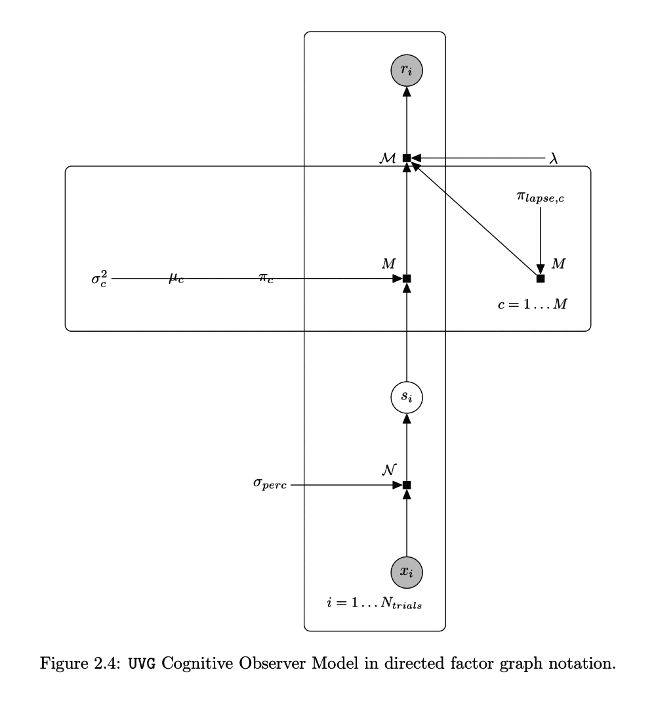
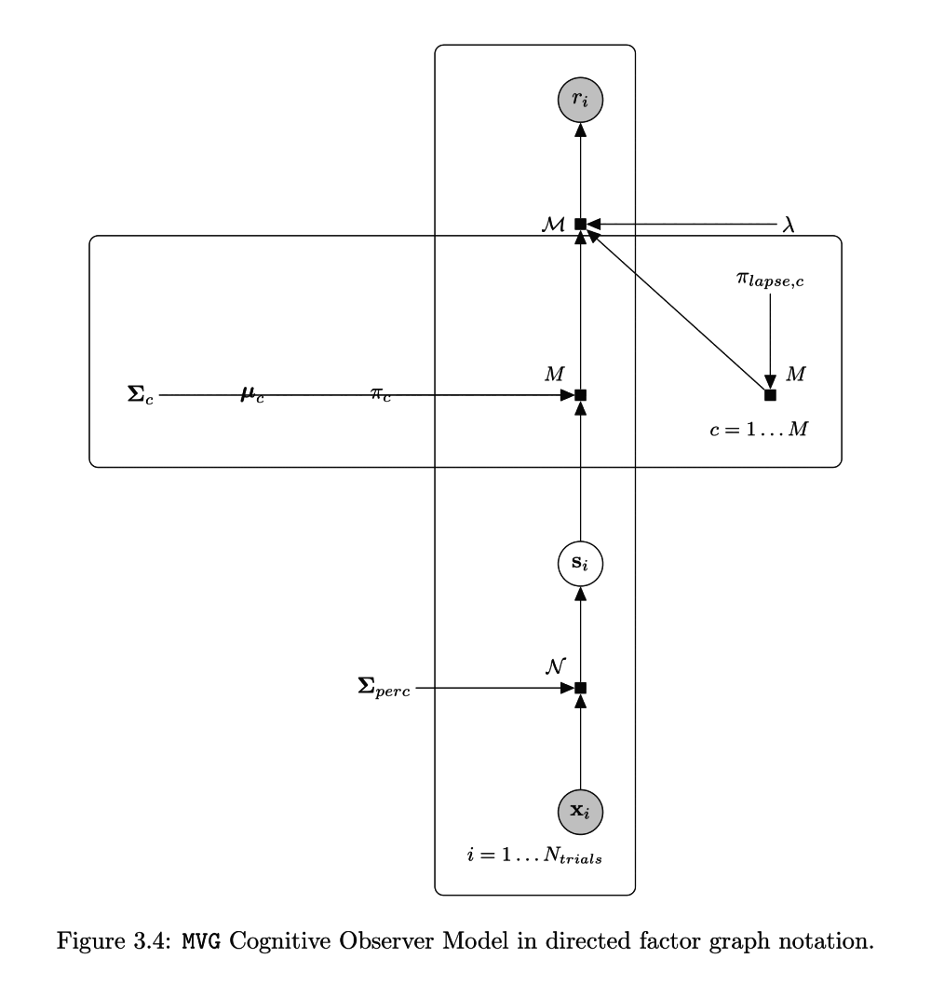
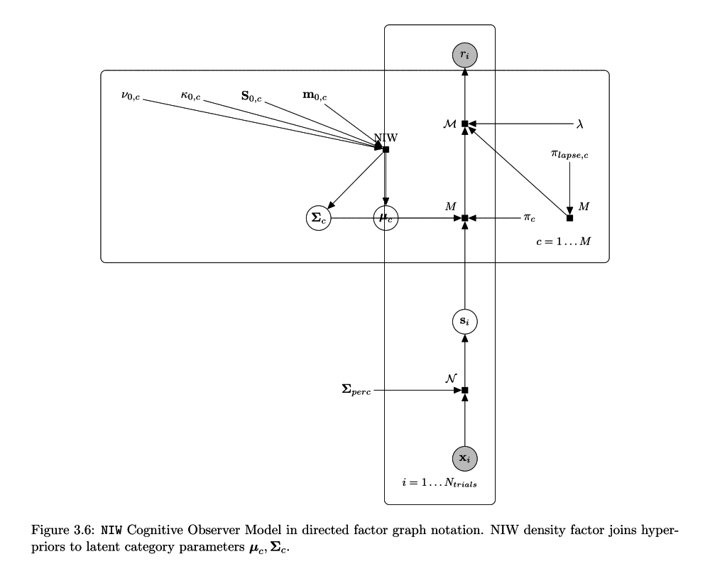
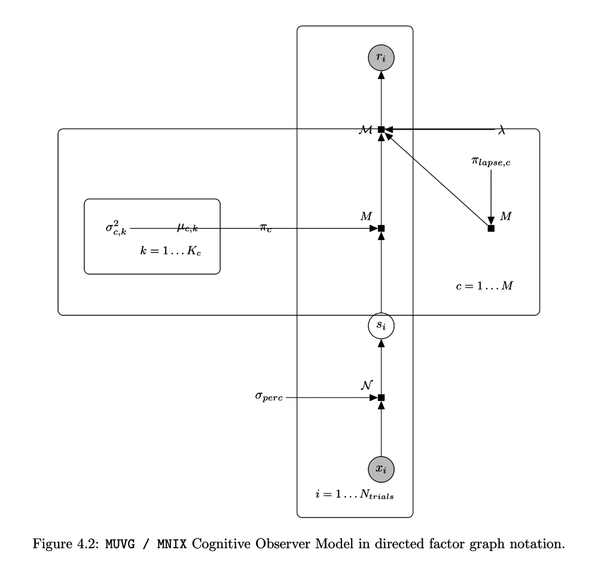
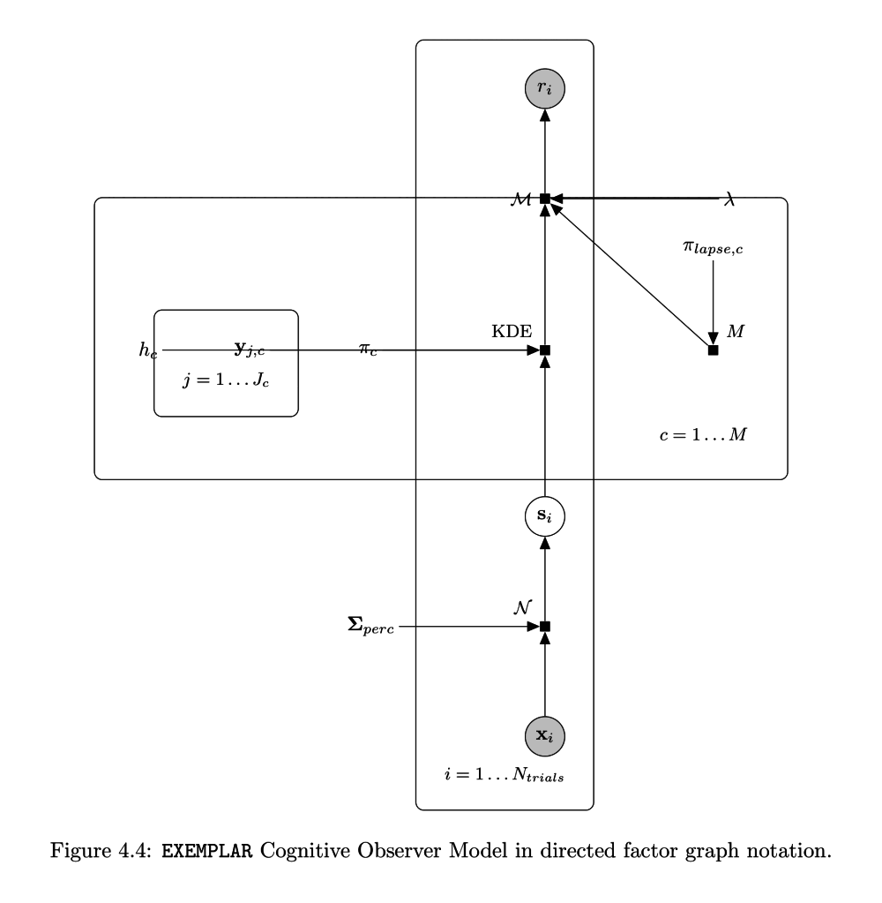
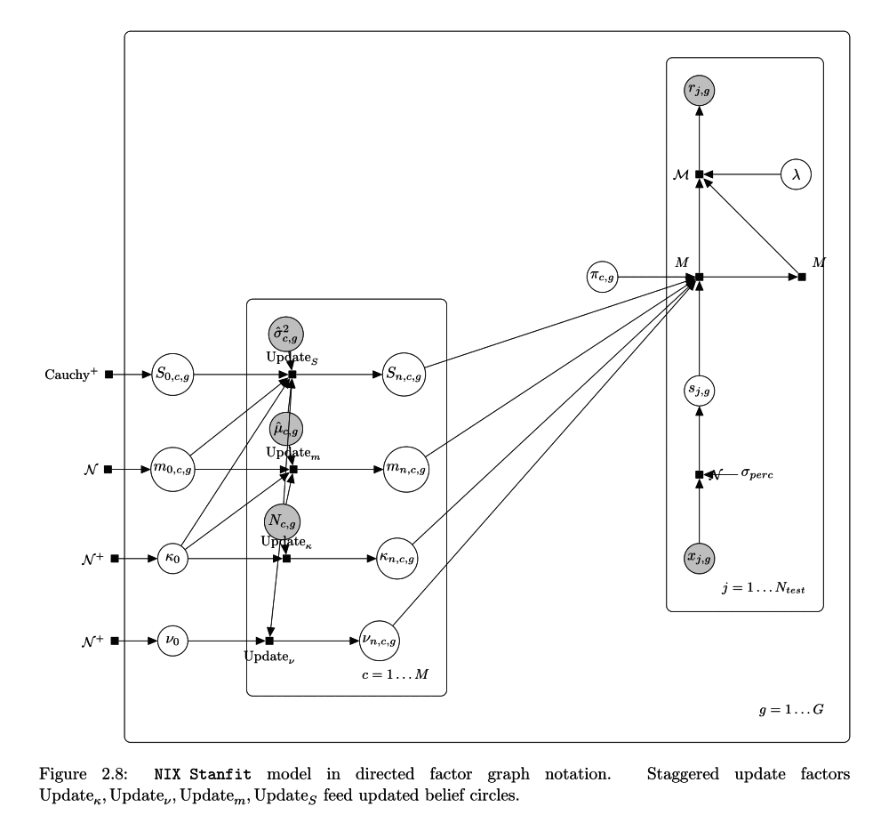
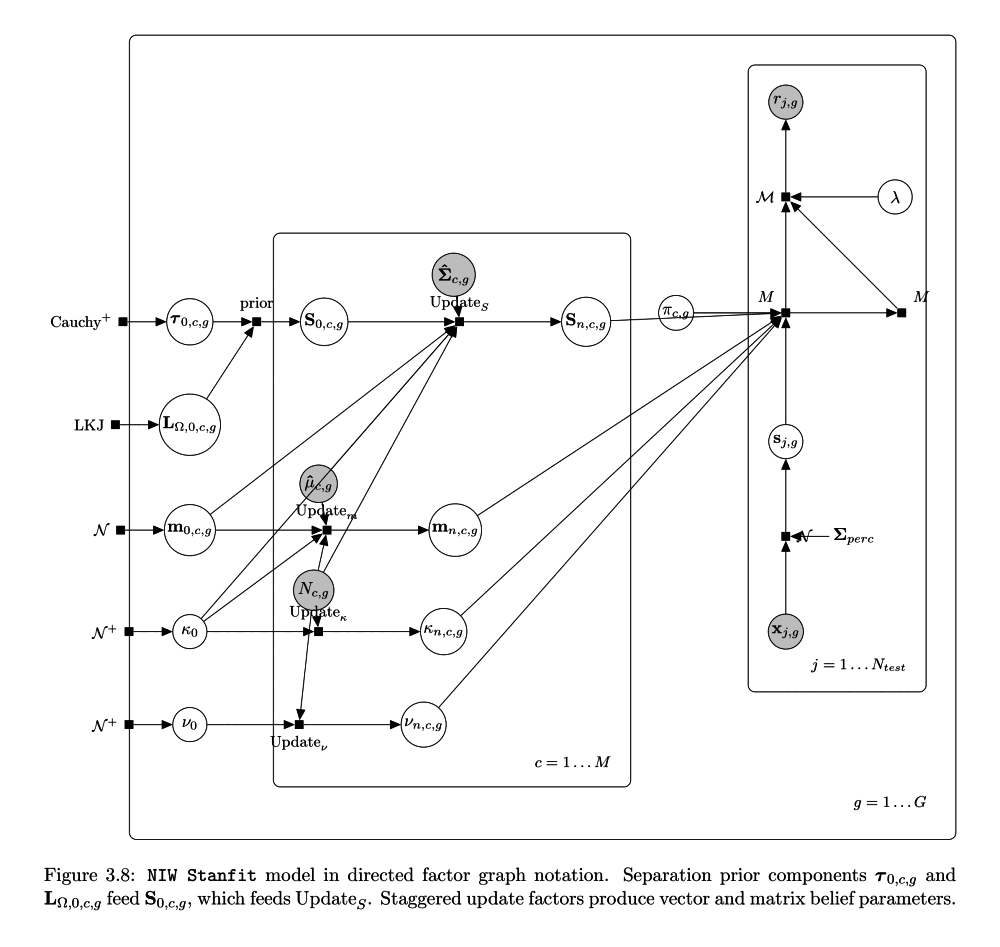
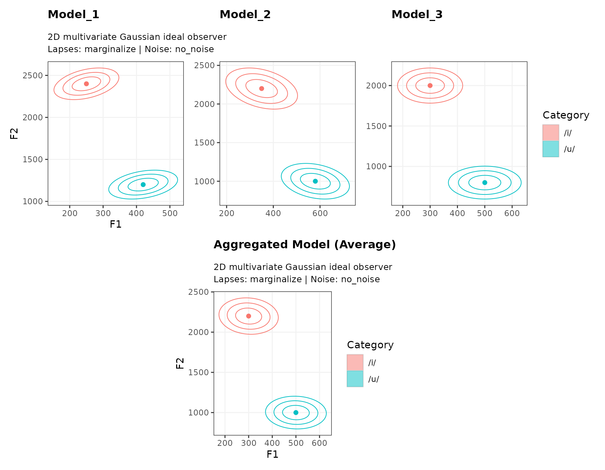

# S7 Class Architecture, Constructors, and Workflows

## 1. Introduction and The S7 Object Model

The **MVBeliefUpdatr** package provides computational cognitive models
of category representation, multidimensional perceptual decision making,
and Bayesian belief updating. Version 1.0 of the package redesigns the
underlying architecture around R’s new **S7** object-oriented system
(PEP / R Consortium object system).

In previous versions, category distributions and cognitive models were
represented as nested tibbles with list-columns of vectors and matrices.
While accessible for simple data-wrangling pipelines, weakly typed
tabular models suffered from several limitations:

- Parameter matrices and dimensions were validated only at the point of
  computation, making errors hard to trace.
- Model metadata, cue labels, and decision rules were loosely coupled
  with distributional parameters.
- Method dispatch was split across ad-hoc S3 methods, legacy S4 classes,
  and family-specific wrapper functions.

The **S7 class architecture** replaces this with strongly typed,
validated, and composable objects:

1.  **Category Representations** (`MVBU_CategoryRepresentation`):
    Distributional beliefs about a single category in continuous
    multidimensional cue space (e.g., Gaussian \[UVG/MVG/MUVG\],
    Normal-Inverse-Wishart \[NIW\], Normal-Inverse-$`\chi^2`$
    \[NIX/MNIX\], or exemplar sets).
2.  **Category Representation Templates**
    (`MVBU_CategoryRepresentationTemplate`): Sets of category
    representations sharing a common cue space and coordinate system.
3.  **Cognitive Decision Models** (`MVBU_CognitiveModel`): Complete
    observer or adaptor models composing a category template with
    category priors $`P(c)`$, decision rules (e.g., criterion,
    proportional, sampling), internal perceptual noise, and lapse
    behaviors.
4.  **Collections of Cognitive Models** (`MVBU_ModelList`): Strongly
    typed, ordered collections of cognitive decision models across
    experimental conditions, exposure blocks, or updating trajectories.
5.  **Stan Input & Fit Objects** (`MVBU_Staninput`, `MVBU_Stanfit`,
    `MVBU_StanfitPosterior`): Typed data bundles and Bayesian posterior
    fits for incremental belief-updating models.

Underpinning these classes is the **Model Family System
(`MVBU_Family`)**: a registry pattern that decouples the mathematical
functions governing category density evaluation, observation sampling,
and expected moment calculations from object definitions.

#### Companion Vignettes

- For Bayesian model fitting, post-processing, and model comparison
  workflows, see the vignette [Fitting and Working with MVBeliefUpdatr
  Stanfit
  Models](https://hlplab.github.io/MVBeliefUpdatr/articles/fitting-and-working-with-stanfit-models.md).

- For visualization workflows corresponding to these objects, see the
  vignette: [Visualizing Categories, Categorization Functions, and
  Belief
  Updating](https://hlplab.github.io/MVBeliefUpdatr/articles/visualizing-models-and-categories.md).

- For extending the package with custom distributional families, see the
  vignette: [Extending MVBeliefUpdatr: Adding Model
  Families](https://hlplab.github.io/MVBeliefUpdatr/articles/extending-mvbeliefupdatr-adding-model-families.md).

- For legacy code compatibility, see the vignette: [Backward
  Compatibility: Working with Legacy
  Code](https://hlplab.github.io/MVBeliefUpdatr/articles/backward-compatibility-working-with-legacy-code.md).

``` r

library(MVBeliefUpdatr)
library(tibble)
library(dplyr)
```

------------------------------------------------------------------------

## 2. Quick Exploration with `example_*()` Functions

To immediately inspect the structure, labels, and parameters of any
class in the package without manually assembling matrices,
**MVBeliefUpdatr** provides a suite of lightweight `example_*()`
constructors.

### Example Category Representations

Single-category representations can be instantiated for any supported
family:

``` r

# Multivariate Gaussian representation (2D: F1, F2)
rep_mvg <- example_category_representation("MVG")
rep_mvg
#> <MVBeliefUpdatr::MVG_CategoryRepresentation>
#>   Category: /b/
#>   Cues (1): VOT
#>   mu: 8.397
#>   Sigma: 23.86

# Multivariate Univariate Gaussian representation (2D: independent variances)
rep_muvg <- example_category_representation("MUVG")
rep_muvg
#> <MVBeliefUpdatr::MUVG_CategoryRepresentation>
#>   Category: /b/
#>   Cues (2): VOT, f0_semitones
#>   mu: c( 8.478, -1.368)
#>   sigma2: c(23.20, 14.69)

# Normal-Inverse-Wishart belief distribution (2D)
rep_niw <- example_category_representation("NIW")
rep_niw
#> <MVBeliefUpdatr::NIW_CategoryRepresentation>
#>   Category: /b/
#>   Cues (1): VOT
#>   kappa: 1
#>   nu: 3
#>   m: 8.397
#>   S: 23.86

# Multivariate Normal-Inverse-Chi-Squared belief distribution (2D)
rep_mnix <- example_category_representation("MNIX")
rep_mnix
#> <MNIX_CategoryRepresentation>
#>   Category: /b/
#>   Cues (2): VOT, f0_semitones
#>   kappa: c(1, 1)
#>   nu: c(4, 4)
#>   m: c( 8.478, -1.368)
#>   sigma2: c(11.601,  7.345)

# Non-parametric Exemplar representation (2D)
rep_ex <- example_category_representation("EXEMPLAR")
rep_ex
#> <MVBeliefUpdatr::Exemplar_CategoryRepresentation>
#>   Category: /b/
#>   Cues (1): VOT
#>   Exemplars (17659 points):
#>     [1] (9)
#>     [2] (5)
#>     [3] (15)
#>     [4] (10)
#>     [5] (17)
#>     ...
```

Family-specific example helpers are also available, such as
[`example_uvg_category_representation()`](https://hlplab.github.io/MVBeliefUpdatr/reference/example-s7-objects.md),
[`example_mvg_category_representation()`](https://hlplab.github.io/MVBeliefUpdatr/reference/example-s7-objects.md),
[`example_muvg_category_representation()`](https://hlplab.github.io/MVBeliefUpdatr/reference/example-s7-objects.md),
[`example_niw_category_representation()`](https://hlplab.github.io/MVBeliefUpdatr/reference/example-s7-objects.md),
[`example_mnix_category_representation()`](https://hlplab.github.io/MVBeliefUpdatr/reference/example-s7-objects.md),
and
[`example_exemplar_category_representation()`](https://hlplab.github.io/MVBeliefUpdatr/reference/example-s7-objects.md).

### Example Category Representation Templates

Templates bind multiple category representations together into a shared
space:

``` r

# 2-category vowel template (/i/, /u/)
tpl_mvg <- example_category_representation_template("MVG")
tpl_mvg
#> <MVBU_CategoryRepresentationTemplate>
#>   Categories (6): /b/, /d/, /g/, /k/, /p/, /t/
#>   Cues (1): VOT
#>   Representations (6):
#>     /b/: MVG(mu = 8.397, Sigma = 23.86)
#>     /d/: MVG(mu = 13.81, Sigma = 77.64)
#>     /g/: MVG(mu = 16.71, Sigma = 108.7)
#>     /k/: MVG(mu = 54.04, Sigma = 418.8)
#>     /p/: MVG(mu = 50.24, Sigma = 445.2)
#>     /t/: MVG(mu = 60.48, Sigma = 476.4)

# Inspect the categories and cues in the template
get_category_labels(tpl_mvg)
#> [1] "/b/" "/d/" "/g/" "/k/" "/p/" "/t/"
get_cue_labels(tpl_mvg)
#> [1] "VOT"
```

### Example Cognitive Decision Models

Full decision models can be generated directly across all supported
model families:

``` r

# Ideal Observer with MVG category representations
mod_observer <- example_mvg_ideal_observer()
mod_observer
#> <MVBeliefUpdatr::MVG_IdealObserver>
#>   Categories (6): /b/, /d/, /g/, /k/, /p/, /t/
#>   Cues (1): VOT
#>   Decision rule: sampling
#>   Category prior: /b/: 0.167, /d/: 0.167, /g/: 0.167, /k/: 0.167, /p/: 0.167, /t/: 0.167
#>   Lapse rate: 0 (treatment: no_lapses)
#>   Perceptual noise: none (treatment: no_noise)
#>   Category representations (6):
#>     /b/: MVG(mu = 8.397, Sigma = 23.86)
#>     /d/: MVG(mu = 13.81, Sigma = 77.64)
#>     /g/: MVG(mu = 16.71, Sigma = 108.7)
#>     /k/: MVG(mu = 54.04, Sigma = 418.8)
#>     /p/: MVG(mu = 50.24, Sigma = 445.2)
#>     /t/: MVG(mu = 60.48, Sigma = 476.4)

# Ideal Observer with MUVG category representations
mod_muvg <- example_muvg_ideal_observer()
mod_muvg
#> <MVBeliefUpdatr::MUVG_IdealObserver>
#>   Categories (6): /b/, /d/, /g/, /k/, /p/, /t/
#>   Cues (2): VOT, f0_semitones
#>   Decision rule: sampling
#>   Category prior: /b/: 0.167, /d/: 0.167, /g/: 0.167, /k/: 0.167, /p/: 0.167, /t/: 0.167
#>   Lapse rate: 0 (treatment: no_lapses)
#>   Perceptual noise: none (treatment: no_noise)
#>   Category representations (6):
#>     /b/: MUVG(mu = vector(2), sigma2 = vector(2))
#>     /d/: MUVG(mu = vector(2), sigma2 = vector(2))
#>     /g/: MUVG(mu = vector(2), sigma2 = vector(2))
#>     /k/: MUVG(mu = vector(2), sigma2 = vector(2))
#>     /p/: MUVG(mu = vector(2), sigma2 = vector(2))
#>     /t/: MUVG(mu = vector(2), sigma2 = vector(2))

# Ideal Adaptor with NIW category representations
mod_adaptor <- example_niw_ideal_adaptor()
mod_adaptor
#> <MVBeliefUpdatr::NIW_IdealAdaptor>
#>   Categories (6): /b/, /d/, /g/, /k/, /p/, /t/
#>   Cues (1): VOT
#>   Decision rule: sampling
#>   Category prior: /b/: 0.167, /d/: 0.167, /g/: 0.167, /k/: 0.167, /p/: 0.167, /t/: 0.167
#>   Lapse rate: 0 (treatment: no_lapses)
#>   Perceptual noise: none (treatment: no_noise)
#>   Category representations (6):
#>     /b/: NIW(kappa = 1, nu = 3, m = 8.397, S = 23.86)
#>       E[mu] = 8.397, E[Sigma] = 23.86, Sigma_marg = 47.71
#>     /d/: NIW(kappa = 1, nu = 3, m = 13.81, S = 77.64)
#>       E[mu] = 13.81, E[Sigma] = 77.64, Sigma_marg = 155.3
#>     /g/: NIW(kappa = 1, nu = 3, m = 16.71, S = 108.7)
#>       E[mu] = 16.71, E[Sigma] = 108.7, Sigma_marg = 217.5
#>     /k/: NIW(kappa = 1, nu = 3, m = 54.04, S = 418.8)
#>       E[mu] = 54.04, E[Sigma] = 418.8, Sigma_marg = 837.6
#>     /p/: NIW(kappa = 1, nu = 3, m = 50.24, S = 445.2)
#>       E[mu] = 50.24, E[Sigma] = 445.2, Sigma_marg = 890.3
#>     /t/: NIW(kappa = 1, nu = 3, m = 60.48, S = 476.4)
#>       E[mu] = 60.48, E[Sigma] = 476.4, Sigma_marg = 952.8

# Ideal Adaptor with MNIX category representations
mod_mnix <- example_mnix_ideal_adaptor()
mod_mnix
#> <MVBeliefUpdatr::MNIX_IdealAdaptor_IdealIntegrator>
#>   Categories (6): /b/, /d/, /g/, /k/, /p/, /t/
#>   Cues (2): VOT, f0_semitones
#>   Decision rule: sampling
#>   Category prior: /b/: 0.167, /d/: 0.167, /g/: 0.167, /k/: 0.167, /p/: 0.167, /t/: 0.167
#>   Lapse rate: 0 (treatment: no_lapses)
#>   Perceptual noise: none (treatment: no_noise)
#>   Category representations (6):
#>     /b/: MNIX(kappa = vector(2), nu = vector(2), m = vector(2), sigma2 = vector(2))
#>       E[mu] = vector(2), E[Sigma] = matrix(2, 2), Sigma_marg = matrix(2, 2)
#>     /d/: MNIX(kappa = vector(2), nu = vector(2), m = vector(2), sigma2 = vector(2))
#>       E[mu] = vector(2), E[Sigma] = matrix(2, 2), Sigma_marg = matrix(2, 2)
#>     /g/: MNIX(kappa = vector(2), nu = vector(2), m = vector(2), sigma2 = vector(2))
#>       E[mu] = vector(2), E[Sigma] = matrix(2, 2), Sigma_marg = matrix(2, 2)
#>     /k/: MNIX(kappa = vector(2), nu = vector(2), m = vector(2), sigma2 = vector(2))
#>       E[mu] = vector(2), E[Sigma] = matrix(2, 2), Sigma_marg = matrix(2, 2)
#>     /p/: MNIX(kappa = vector(2), nu = vector(2), m = vector(2), sigma2 = vector(2))
#>       E[mu] = vector(2), E[Sigma] = matrix(2, 2), Sigma_marg = matrix(2, 2)
#>     /t/: MNIX(kappa = vector(2), nu = vector(2), m = vector(2), sigma2 = vector(2))
#>       E[mu] = vector(2), E[Sigma] = matrix(2, 2), Sigma_marg = matrix(2, 2)

# Exemplar decision model
mod_exemplar <- example_exemplar_model()
mod_exemplar
#> <MVBeliefUpdatr::Exemplar_Model>
#>   Categories (6): /b/, /d/, /g/, /k/, /p/, /t/
#>   Cues (1): VOT
#>   Decision rule: sampling
#>   Category prior: /b/: 0.167, /d/: 0.167, /g/: 0.167, /k/: 0.167, /p/: 0.167, /t/: 0.167
#>   Lapse rate: 0 (treatment: no_lapses)
#>   Perceptual noise: none (treatment: no_noise)
#>   Category representations (6):
#>     /b/: Exemplar(N = 17659, (9), (5), (15), (10), (17), ...)
#>     /d/: Exemplar(N = 24369, (5), (26), (21), (5), (7), ...)
#>     /g/: Exemplar(N = 16179, (15), (29), (32), (4), (24), ...)
#>     /k/: Exemplar(N = 16409, (72), (59), (35), (41), (56), ...)
#>     /p/: Exemplar(N = 13522, (15), (57), (42), (38), (37), ...)
#>     /t/: Exemplar(N = 8219, (63), (34), (43), (64), (52), ...)
```

#### Model Summaries

Calling [`summary()`](https://rdrr.io/r/base/summary.html) on a
representation, multi-category template, or complete cognitive model
outputs structured tables detailing both the category representations
and their distributional moments (see [Section
4.3](#parameter-extraction) for the mathematical definitions of expected
vs. marginal moments):

``` r

# Summary of an NIW ideal adaptor model
summary(mod_adaptor)
#> <MVBeliefUpdatr::NIW_IdealAdaptor>
#>   Categories (6): /b/, /d/, /g/, /k/, /p/, /t/
#>   Cues (1): VOT
#>   Decision rule: sampling
#>   Category prior: /b/: 0.167, /d/: 0.167, /g/: 0.167, /k/: 0.167, /p/: 0.167, /t/: 0.167
#>   Lapse rate: 0 (treatment: no_lapses)
#>   Perceptual noise: none (treatment: no_noise)
#>   Category representations (6):
#>     /b/: NIW(kappa = 1, nu = 3, m = 8.397, S = 23.86)
#>       E[mu] = 8.397, E[Sigma] = 23.86, Sigma_marg = 47.71
#>     /d/: NIW(kappa = 1, nu = 3, m = 13.81, S = 77.64)
#>       E[mu] = 13.81, E[Sigma] = 77.64, Sigma_marg = 155.3
#>     /g/: NIW(kappa = 1, nu = 3, m = 16.71, S = 108.7)
#>       E[mu] = 16.71, E[Sigma] = 108.7, Sigma_marg = 217.5
#>     /k/: NIW(kappa = 1, nu = 3, m = 54.04, S = 418.8)
#>       E[mu] = 54.04, E[Sigma] = 418.8, Sigma_marg = 837.6
#>     /p/: NIW(kappa = 1, nu = 3, m = 50.24, S = 445.2)
#>       E[mu] = 50.24, E[Sigma] = 445.2, Sigma_marg = 890.3
#>     /t/: NIW(kappa = 1, nu = 3, m = 60.48, S = 476.4)
#>       E[mu] = 60.48, E[Sigma] = 476.4, Sigma_marg = 952.8
#> 
#> Expected Category Moments:
#>  Category Parameter Cue1 Cue2     Value
#>       /b/        mu  VOT        8.39663
#>       /b/     Sigma  VOT  VOT  23.85665
#>       /d/        mu  VOT       13.81306
#>       /d/     Sigma  VOT  VOT  77.63595
#>       /g/        mu  VOT       16.71445
#>       /g/     Sigma  VOT  VOT 108.72649
#>       /k/        mu  VOT       54.04223
#>       /k/     Sigma  VOT  VOT 418.79468
#>       /p/        mu  VOT       50.23845
#>       /p/     Sigma  VOT  VOT 445.17052
#>       /t/        mu  VOT       60.48317
#>       /t/     Sigma  VOT  VOT 476.40070
#> 
#> Marginal Category Moments:
#>  Category Parameter Cue1 Cue2     Value
#>       /b/        mu  VOT        8.39663
#>       /b/     Sigma  VOT  VOT  47.71330
#>       /d/        mu  VOT       13.81306
#>       /d/     Sigma  VOT  VOT 155.27190
#>       /g/        mu  VOT       16.71445
#>       /g/     Sigma  VOT  VOT 217.45299
#>       /k/        mu  VOT       54.04223
#>       /k/     Sigma  VOT  VOT 837.58935
#>       /p/        mu  VOT       50.23845
#>       /p/     Sigma  VOT  VOT 890.34104
#>       /t/        mu  VOT       60.48317
#>       /t/     Sigma  VOT  VOT 952.80141
```

### Example Fitted Stan Models

Fitted incremental belief-updating models (`MVBU_Stanfit`) can be
accessed through
[`example_ideal_adaptor_stanfit()`](https://hlplab.github.io/MVBeliefUpdatr/reference/example_ideal_adaptor_stanfit.md):

``` r

# Load or fit 1-cue NIW ideal adaptor Stanfit model
models_dir <- if (dir.exists("../tests/testthat/models")) {
  "../tests/testthat/models"
} else if (dir.exists("tests/testthat/models")) {
  "tests/testthat/models"
} else {
  tempdir()
}
fit_file <- file.path(
  models_dir,
  "example-stanfit-NIW_ideal_adaptor-1-standardize-42.rds"
)
fit_1cue <- example_ideal_adaptor_stanfit(
  model_family = "NIW",
  n_cues = 1L,
  file = fit_file,
  file_refit = "never"
)
fit_1cue
#> <NIW_IdealAdaptorStanfit>
#>   Model family: NIW
#>   Categories (2): /d/, /t/
#>   Cues (1): VOT
#>   Groups (3): no_exposure, left_shifted, right_shifted
#>   Draws: 25
```

------------------------------------------------------------------------

## 3. Object Hierarchy and Constructors

The class system is organized into hierarchical levels alongside the
model family registry:

    MVBU_Object
      ├── MVBU_CategoryRepresentation
      │     ├── UVG_CategoryRepresentation
      │     ├── MVG_CategoryRepresentation
      │     ├── MUVG_CategoryRepresentation
      │     ├── NIW_CategoryRepresentation
      │     ├── NIX_CategoryRepresentation
      │     ├── MNIX_CategoryRepresentation
      │     └── Exemplar_CategoryRepresentation
      ├── MVBU_CategoryRepresentationTemplate
      ├── MVBU_CognitiveModel
      │     ├── MVG_IdealObserver
      │     ├── MUVG_IdealObserver
      │     ├── NIW_IdealAdaptor
      │     ├── NIX_IdealAdaptor
      │     ├── MNIX_IdealAdaptor
      │     │     ├── Early Integration ({Integrator}_MNIX_IdealAdaptor)
      │     │     │     ├── IdealIntegrator_MNIX_IdealAdaptor
      │     │     │     ├── WeightedIntegrator_MNIX_IdealAdaptor
      │     │     │     ├── CategoryWeightedIntegrator_MNIX_IdealAdaptor
      │     │     │     ├── GroupWeightedIntegrator_MNIX_IdealAdaptor
      │     │     │     ├── GroupCategoryWeightedIntegrator_MNIX_IdealAdaptor
      │     │     │     └── InformativityWeightedIntegrator_MNIX_IdealAdaptor
      │     │     └── Late Integration (MNIX_IdealAdaptor_{Integrator})
      │     │           ├── MNIX_IdealAdaptor_IdealIntegrator
      │     │           ├── MNIX_IdealAdaptor_WeightedIntegrator
      │     │           ├── MNIX_IdealAdaptor_CategoryWeightedIntegrator
      │     │           ├── MNIX_IdealAdaptor_GroupWeightedIntegrator
      │     │           ├── MNIX_IdealAdaptor_GroupCategoryWeightedIntegrator
      │     │           └── MNIX_IdealAdaptor_InformativityWeightedIntegrator
      │     └── Exemplar_Model
      ├── MVBU_ModelList
      ├── MVBU_Staninput
      │     └── IdealAdaptorStaninput
      │           ├── NIX_IdealAdaptorStaninput
      │           ├── MNIX_IdealAdaptorStaninput (12 Symmetrical Early & Late Integrators)
      │           └── NIW_IdealAdaptorStaninput
      ├── MVBU_Stanfit
      │     └── IdealAdaptorStanfit
      │           ├── NIX_IdealAdaptorStanfit
      │           ├── MNIX_IdealAdaptorStanfit (12 Symmetrical Early & Late Integrators)
      │           └── NIW_IdealAdaptorStanfit
      └── MVBU_StanfitPosterior

    MVBU_Family (Model Family Registry)
      ├── UVG
      ├── MVG
      ├── MUVG
      ├── NIW
      ├── NIX
      ├── MNIX
      └── Exemplar

### The Model Family System (`MVBU_Family`)

A key architectural design in **MVBeliefUpdatr** is the separation
between the **object structures** (which store parameters, cues, labels,
and priors) and the **computational algorithms** (which evaluate
densities, draw samples, and compute moments).

All computational behavior is encapsulated in `MVBU_Family` descriptors
registered in a central registry:

``` r

# List all registered model families
list_model_families()
#>  [1] "category_weighted_integrator_MNIX"      
#>  [2] "EXEMPLAR"                               
#>  [3] "group_category_weighted_integrator_MNIX"
#>  [4] "group_weighted_integrator_MNIX"         
#>  [5] "ideal_integrator_MNIX"                  
#>  [6] "informativity_weighted_integrator_MNIX" 
#>  [7] "MNIX"                                   
#>  [8] "MNIX_category_weighted_integrator"      
#>  [9] "MNIX_group_category_weighted_integrator"
#> [10] "MNIX_group_weighted_integrator"         
#> [11] "MNIX_ideal_integrator"                  
#> [12] "MNIX_informativity_weighted_integrator" 
#> [13] "MNIX_weighted_integrator"               
#> [14] "MUVG"                                   
#> [15] "MVG"                                    
#> [16] "NIW"                                    
#> [17] "NIX"                                    
#> [18] "UVG"                                    
#> [19] "weighted_integrator_MNIX"

# Inspect a specific model family descriptor
fam_mvg <- get_family("MVG")
fam_mvg
#> <MVBeliefUpdatr::MVBU_Family>
#>  @ family_names                  :List of 3
#>  .. $ name_short  : chr "MVG"
#>  .. $ name_long   : chr "Multivariate Gaussian Ideal Observer"
#>  .. $ name_details:List of 4
#>  ..  ..$ CategoryRepresentation_name: chr "MVG_CategoryRepresentation"
#>  ..  ..$ CategoryTemplate_name      : chr "MVG_CategoryRepresentationTemplate"
#>  ..  ..$ CognitiveModel_name        : chr "MVG_IdealObserver"
#>  ..  ..$ CognitiveModelList_name    : chr "MVG_CognitiveModelList"
#>  @ density_function              : function (x, rep, log = FALSE, noise_treatment = "no_noise", Sigma_noise = NULL)  
#>  @ sampling_function             : function (rep, n = 1L, with_replacement = TRUE, ...)  
#>  @ expected_moments              : function (rep)  
#>  @ marginal_moments              : NULL
#>  @ sufficient_statistics_function: NULL
#>  @ stanmodel                     : NULL

# Inspect the mathematical closures encapsulated by the family
fam_mvg@density_function
#> function (x, rep, log = FALSE, noise_treatment = "no_noise", 
#>     Sigma_noise = NULL) 
#> {
#>     d <- length(rep@mu)
#>     x <- .as_observation_matrix(x, d = d, arg_name = "x")
#>     if (identical(noise_treatment, "sample") && !is.null(Sigma_noise)) {
#>         x <- x + mvtnorm::rmvnorm(n = nrow(x), mean = rep(0, 
#>             ncol(x)), sigma = Sigma_noise)
#>     }
#>     Sigma_eff <- if (!is.null(Sigma_noise) && (identical(noise_treatment, 
#>         "sample") || identical(noise_treatment, "marginalize"))) {
#>         rep@Sigma + Sigma_noise
#>     }
#>     else {
#>         rep@Sigma
#>     }
#>     mvtnorm::dmvnorm(x, mean = rep@mu, sigma = Sigma_eff, log = log)
#> }
#> <bytecode: 0x605ab8ea50f8>
#> <environment: 0x605ab8eb53e0>
fam_mvg@expected_moments
#> function (rep) 
#> {
#>     list(mu = rep@mu, Sigma = rep@Sigma, weights = NULL)
#> }
#> <bytecode: 0x605ab8ea66b0>
#> <environment: 0x605ab8eb53e0>
```

Each `MVBU_Family` specifies: - `family_names`: Canonical short and long
names for display and dispatch. - `density_function`: Vectorized
evaluation of category likelihood $`p(x \mid c)`$. -
`sampling_function`: Sampling synthetic observations from the
category. - `expected_moments`: Calculation of expected mean
$`\boldsymbol{\mu}`$ and covariance $`\boldsymbol{\Sigma}`$. -
`default_parameters`: Template list of required parameter names and
types. - `support`: Supported cue dimensionalities (e.g., 1D only
vs. multidimensional).

### Level 1: Category Representations

#### Low-Level Bare Constructors

When category parameters are already known, representations can be
constructed by passing numeric vectors and matrices directly:

``` r

# Multivariate Gaussian: mean vector mu and covariance matrix Sigma
mu_b <- c(F1 = 350, F2 = 1100)
Sigma_b <- matrix(c(2500, 500, 500, 3600),
  nrow = 2, ncol = 2,
  dimnames = list(names(mu_b), names(mu_b))
)

rep_b <- new_mvg_category_representation(
  category_labels = "/b/",
  cue_labels = c("F1", "F2"),
  mu = mu_b,
  Sigma = Sigma_b
)
rep_b
#> <MVBeliefUpdatr::MVG_CategoryRepresentation>
#>   Category: /b/
#>   Cues (2): F1, F2
#>   mu: c( 350, 1100)
#>   Sigma:
#>      F1   F2
#> F1 2500  500
#> F2  500 3600

# MUVG: Multivariate Univariate Gaussian (diagonal variances sigma2)
rep_muvg_custom <- new_muvg_category_representation(
  category_labels = "/b/",
  cue_labels = c("F1", "F2"),
  mu = mu_b,
  sigma2 = c(F1 = 2500, F2 = 3600)
)
rep_muvg_custom
#> <MVBeliefUpdatr::MUVG_CategoryRepresentation>
#>   Category: /b/
#>   Cues (2): F1, F2
#>   mu: c( 350, 1100)
#>   sigma2: c(2500, 3600)
```





For conjugate prior representations like NIW or MNIX, specify prior
parameter moments:

``` r

rep_niw_custom <- new_niw_category_representation(
  category_labels = "/b/",
  cue_labels = c("F1", "F2"),
  m = c(F1 = 350, F2 = 1100),
  S = matrix(c(25000, 5000, 5000, 36000), nrow = 2, ncol = 2),
  kappa = 10,
  nu = 12
)
rep_niw_custom
#> <MVBeliefUpdatr::NIW_CategoryRepresentation>
#>   Category: /b/
#>   Cues (2): F1, F2
#>   kappa: 10
#>   nu: 12
#>   m: c( 350, 1100)
#>   S:
#>       [,1]  [,2]
#> [1,] 25000  5000
#> [2,]  5000 36000

# MNIX (Multivariate Normal-Inverse-Chi-Squared for independent cues)
rep_mnix_custom <- new_mnix_category_representation(
  category_labels = "/b/",
  cue_labels = c("F1", "F2"),
  m = c(F1 = 350, F2 = 1100),
  sigma2 = c(F1 = 2500, F2 = 3600),
  kappa = c(F1 = 10, F2 = 10),
  nu = c(F1 = 12, F2 = 12)
)
rep_mnix_custom
#> <MNIX_CategoryRepresentation>
#>   Category: /b/
#>   Cues (2): F1, F2
#>   kappa: c(10, 10)
#>   nu: c(12, 12)
#>   m: c( 350, 1100)
#>   sigma2: c(2500, 3600)
```






#### Empirical Constructors from Data

When starting from empirical observations, use
[`new_category_representation_from_data()`](https://hlplab.github.io/MVBeliefUpdatr/reference/new-objects-from-data.md)
(or family-specific constructors like
[`new_mvg_category_representation_from_data()`](https://hlplab.github.io/MVBeliefUpdatr/reference/family-mvg.md)):

``` r

# Sample acoustic data for a category
set.seed(42)
obs_data <- data.frame(
  F1 = rnorm(50, mean = 400, sd = 40),
  F2 = rnorm(50, mean = 1800, sd = 120),
  vowel = "ih"
)

# Estimate MVG representation from observations
rep_from_data <- new_mvg_category_representation_from_data(
  data = obs_data,
  category = "vowel",
  cues = c("F1", "F2")
)
rep_from_data
#> <MVBeliefUpdatr::MVG_CategoryRepresentation>
#>   Category: ih
#>   Cues (2): F1, F2
#>   mu: c( 398.6, 1812.1)
#>   Sigma:
#>           F1        F2
#> F1  2121.437 -1222.053
#> F2 -1222.053 12320.544
```

### Level 2: Category Representation Templates

Templates aggregate multiple category representations into a unified
inventory.

#### Manual Template Construction

``` r

mu_d <- c(F1 = 450, F2 = 1700)
Sigma_d <- matrix(c(3000, 200, 200, 4000),
  nrow = 2, ncol = 2,
  dimnames = list(names(mu_d), names(mu_d))
)
rep_d <- new_mvg_category_representation(
  category_labels = "/d/",
  cue_labels = c("F1", "F2"),
  mu = mu_d,
  Sigma = Sigma_d
)

# Combine representations into a template
tpl_custom <- new_category_representation_template(
  representations = list(rep_b, rep_d)
)
tpl_custom
#> <MVBU_CategoryRepresentationTemplate>
#>   Categories (2): /b/, /d/
#>   Cues (2): F1, F2
#>   Representations (2):
#>     /b/: MVG(mu = vector(2), Sigma = matrix(2, 2))
#>     /d/: MVG(mu = vector(2), Sigma = matrix(2, 2))
```

#### Empirical Template from Data

``` r

# Multi-category training data
train_data <- data.frame(
  F1 = c(rnorm(40, 300, 30), rnorm(40, 600, 40)),
  F2 = c(rnorm(40, 2200, 80), rnorm(40, 1100, 70)),
  category = rep(c("/i/", "/u/"), each = 40)
)

tpl_empirical <- new_mvg_category_representation_template_from_data(
  data = train_data,
  category = "category",
  cues = c("F1", "F2")
)
tpl_empirical
#> <MVBU_CategoryRepresentationTemplate>
#>   Categories (2): /i/, /u/
#>   Cues (2): F1, F2
#>   Representations (2):
#>     /i/: MVG(mu = vector(2), Sigma = matrix(2, 2))
#>     /u/: MVG(mu = vector(2), Sigma = matrix(2, 2))
```

### Level 3: Cognitive Decision Models

A cognitive model combines a category template with:

- `category_prior`: Prior probabilities $`P(c)`$ across categories (must
  sum to 1).
- `decision_rule`: How posterior probabilities map to categorization
  responses (`"criterion"`, `"proportional"`, or `"sampling"`).
- `lapse_rate` and `lapse_bias`: Probability and distribution of lapse
  responses (unrelated to cue values).
- `Sigma_noise` and `noise_treatment`: Internal perceptual noise
  covariance and handling (`"no_noise"`, `"sample"`, or
  `"marginalize"`).

``` r

# Instantiate an Ideal Observer model from the template
observer_model <- new_mvg_ideal_observer(
  category_template = tpl_empirical,
  category_prior = c("/i/" = 0.5, "/u/" = 0.5),
  decision_rule = "proportional",
  lapse_rate = 0.02
)
observer_model
#> <MVBeliefUpdatr::MVG_IdealObserver>
#>   Categories (2): /i/, /u/
#>   Cues (2): F1, F2
#>   Decision rule: proportional
#>   Category prior: /i/: 0.5, /u/: 0.5
#>   Lapse rate: 0.02 (treatment: marginalize)
#>   Perceptual noise: none (treatment: no_noise)
#>   Category representations (2):
#>     /i/: MVG(mu = vector(2), Sigma = matrix(2, 2))
#>     /u/: MVG(mu = vector(2), Sigma = matrix(2, 2))
```

Similarly, empirical constructors can build the complete cognitive model
directly from data in a single step:

``` r

model_from_data <- new_mvg_ideal_observer_from_data(
  data = train_data,
  category = "category",
  cues = c("F1", "F2"),
  decision_rule = "criterion"
)
model_from_data
#> <MVBeliefUpdatr::MVG_IdealObserver>
#>   Categories (2): /i/, /u/
#>   Cues (2): F1, F2
#>   Decision rule: criterion
#>   Category prior: /i/: 0.5, /u/: 0.5
#>   Lapse rate: 0 (treatment: no_lapses)
#>   Perceptual noise: none (treatment: no_noise)
#>   Category representations (2):
#>     /i/: MVG(mu = vector(2), Sigma = matrix(2, 2))
#>     /u/: MVG(mu = vector(2), Sigma = matrix(2, 2))
```

#### Multi-Cue Integration Models (Early vs. Late Integration)

When categorization involves multiple acoustic or perceptual cues (e.g.,
$`F_1`$, $`F_2`$, duration, or VOT), cognitive architectures differ
fundamentally in **where** and **how** cue combination occurs relative
to category belief representation and adaptation:

1.  **Late Cue Integration (MNIX Family)**: In late integration
    architectures, listeners maintain multi-cue category distributions
    over continuous input cue dimensions. Individual cue log-likelihoods
    are computed and then integrated across cues at decision time:
    - `MNIX_IdealAdaptor_IdealIntegrator`: Unweighted Bayes rule
      integration across cues:
      ``` math
      \log p(\mathbf{x} \mid c) = \sum_{k=1}^D \log p(x_k \mid c)
      ```
    - `MNIX_IdealAdaptor_WeightedIntegrator`: Global attention/precision
      simplex weights $`\mathbf{w}`$ ($`w_k \ge 0, \sum_k w_k = 1`$):
      ``` math
      \log p(\mathbf{x} \mid c) = \sum_{k=1}^D w_k \log p(x_k \mid c)
      ```
    - `MNIX_IdealAdaptor_CategoryWeightedIntegrator`: Category-specific
      attention simplex weights $`\mathbf{w}_c`$:
      ``` math
      \log p(\mathbf{x} \mid c) = \sum_{k=1}^D w_{c, k} \log p(x_k \mid c)
      ```
    - `MNIX_IdealAdaptor`: Dynamic cue weights driven by empirical cue
      informativity and marginal category overlap.
2.  **Early Cue Integration (MNIX Family)**: In early integration
    architectures, multi-dimensional cues $`\mathbf{x}`$ are linearly
    combined prior to category evaluation into a 1-dimensional
    perceptual decision variable $`z`$:
    - `IdealIntegrator_MNIX_IdealAdaptor`: Multi-cue input is projected
      via fixed weights to $`z = \mathbf{w}^T \mathbf{x}`$, which is
      evaluated against univariate 1D category representations.
    - `WeightedIntegrator_MNIX_IdealAdaptor`: Multi-cue input is
      projected via subjective simplex weights $`\mathbf{w}`$ to
      $`z = \mathbf{w}^T \mathbf{x}`$.
    - `CategoryWeightedIntegrator_MNIX_IdealAdaptor`: Category-specific
      projection weights $`\mathbf{w}_c`$ map the cues to
      category-specific 1D decision variables
      $`z_c = \mathbf{w}_c^T \mathbf{x}`$.

``` r

# Example: Construct an early integrator MNIX model with 2 cues
nix_tpl_1d <- example_category_representation_template("NIX")
mod_early_weighted <- WeightedIntegrator_MNIX_IdealAdaptor(
  category_template = nix_tpl_1d,
  weights = c(F1 = 0.6, F2 = 0.4),
  cues = c("F1", "F2")
)

# Example: Construct a late integrator MNIX model with category-specific weights
mnix_tpl_2d <- example_category_representation_template("MNIX")
mod_late_cat <- MNIX_IdealAdaptor_CategoryWeightedIntegrator(
  category_template = mnix_tpl_2d,
  weights = rbind("/b/" = c(0.7, 0.3), "/d/" = c(0.4, 0.6))
)
```



### Level 4: Model Collections (`MVBU_ModelList`)

An `MVBU_ModelList` object represents an ordered sequence or collection
of cognitive models (such as incremental belief-updating histories
across exposure trials, or alternative model specifications).

``` r

# Create an exposure update sequence
m1 <- example_nix_ideal_adaptor()
m2 <- update_template(m1, observations = data.frame(VOT = c(10, 12, 15), category = "A"))
m3 <- update_template(m2, observations = data.frame(VOT = c(20, 25), category = "A"))

# Wrap models into an S7 MVBU_ModelList container
model_history <- as_model_list(list(Prior = m1, Block_1 = m2, Block_2 = m3))
model_history
#> <MVBU_ModelList>

# Inspect model labels and subsetting
model_history@model_labels
#> [1] "Prior"   "Block_1" "Block_2"
sub_history <- model_history[1:2] # Returns subsetted MVBU_ModelList
sub_history
#> <MVBU_ModelList>
```

------------------------------------------------------------------------

## 4. Standard Generics: Inspection, Evaluation, and Sampling

The S7 architecture provides consistent generic functions across all
model families.

### Label Accessors and Mutation

``` r

# Extract cue names
get_cue_labels(observer_model)
#> [1] "F1" "F2"

# Extract category names
get_category_labels(observer_model)
#> [1] "/i/" "/u/"

# Extract response category names
get_response_category_labels(observer_model)
#> [1] "/i/" "/u/"

# Extract group labels
get_group_labels(observer_model)
#> character(0)

# Extract full 4-element label structure
get_labels(observer_model)
#> $cue
#> [1] "F1" "F2"
#> 
#> $category
#> [1] "/i/" "/u/"
#> 
#> $response_category
#> [1] "/i/" "/u/"
#> 
#> $group
#> character(0)

# Update or customize labels with set_labels()
labeled_model <- set_labels(
  observer_model,
  cue = c("First_Formant", "Second_Formant")
)
get_cue_labels(labeled_model)
#> [1] "First_Formant"  "Second_Formant"
```

### Type and Family Introspection

``` r

# Model family name
get_family_name(observer_model)
#> [1] "MVG"

# Extract underlying MVBU_Family object
get_family(observer_model)
#> <MVBeliefUpdatr::MVBU_Family>
#>  @ family_names                  :List of 3
#>  .. $ name_short  : chr "MVG"
#>  .. $ name_long   : chr "Multivariate Gaussian Ideal Observer"
#>  .. $ name_details:List of 4
#>  ..  ..$ CategoryRepresentation_name: chr "MVG_CategoryRepresentation"
#>  ..  ..$ CategoryTemplate_name      : chr "MVG_CategoryRepresentationTemplate"
#>  ..  ..$ CognitiveModel_name        : chr "MVG_IdealObserver"
#>  ..  ..$ CognitiveModelList_name    : chr "MVG_CognitiveModelList"
#>  @ density_function              : function (x, rep, log = FALSE, noise_treatment = "no_noise", Sigma_noise = NULL)  
#>  @ sampling_function             : function (rep, n = 1L, with_replacement = TRUE, ...)  
#>  @ expected_moments              : function (rep)  
#>  @ marginal_moments              : NULL
#>  @ sufficient_statistics_function: NULL
#>  @ stanmodel                     : NULL

# Representation family name
get_family_name(rep_b)
#> [1] "MVG"

# Model list family name (or "MIXED_ModelList" if heterogeneous)
get_family_name(model_history)
#> [1] "NIX"
```

### Parameter Extraction

In **MVBeliefUpdatr**, model parameters are standardized across all four
architectural tiers via the `metadata$parameters` property and the
[`get_parameters()`](https://hlplab.github.io/MVBeliefUpdatr/reference/get_parameters.md)
generic:

1.  **Category Representation (`MVBU_CategoryRepresentation`)**:
    Contains the named list of parameters defining that specific
    category (e.g., `mu` and `Sigma` for Gaussian families, or `m`, `S`,
    `kappa`, `nu` for NIW/NIX).
2.  **Category Representation Template
    (`MVBU_CategoryRepresentationTemplate`)**: Contains a named list
    aggregating each category’s parameter list, indexed by category
    label (`lapply(template@representations, get_parameters)`).
3.  **Cognitive Model (`MVBU_CognitiveModel`)**: Contains the parameter
    list from its underlying category template.
4.  **Model List (`MVBU_ModelList`)**: Contains a named list aggregating
    the parameter lists of each constituent cognitive model, indexed by
    model label (`lapply(models, get_parameters)`).

Across all four tiers, `x@metadata$parameters` is guaranteed to be
present, meaning downstream workflows can rely uniformly on
`get_parameters(x)`:

``` r

# Extract parameters from a single representation
get_parameters(rep_b)
#> $mu
#> [1]  350 1100
#> 
#> $Sigma
#>      F1   F2
#> F1 2500  500
#> F2  500 3600

# Extract parameters across a full template
get_parameters(tpl_custom)
#> $`/b/`
#> $`/b/`$mu
#> [1]  350 1100
#> 
#> $`/b/`$Sigma
#>      F1   F2
#> F1 2500  500
#> F2  500 3600
#> 
#> 
#> $`/d/`
#> $`/d/`$mu
#> [1]  450 1700
#> 
#> $`/d/`$Sigma
#>      F1   F2
#> F1 3000  200
#> F2  200 4000

# Extract parameters across a cognitive model
get_parameters(observer_model)
#> $`/i/`
#> $`/i/`$mu
#> [1]  295.8446 2194.0005
#> 
#> $`/i/`$Sigma
#>          F1        F2
#> F1 879.4676  277.9215
#> F2 277.9215 6374.2936
#> 
#> 
#> $`/u/`
#> $`/u/`$mu
#> [1]  597.4734 1097.9542
#> 
#> $`/u/`$Sigma
#>           F1        F2
#> F1 1163.3153 -114.4647
#> F2 -114.4647 3797.0386

# Extract parameters across a model collection (ModelList)
get_parameters(model_history)
#> $Prior
#> $Prior$`/b/`
#> $Prior$`/b/`$m
#> [1] 8.39663
#> 
#> $Prior$`/b/`$kappa
#> [1] 1
#> 
#> $Prior$`/b/`$nu
#> [1] 3
#> 
#> $Prior$`/b/`$sigma2
#> [1] 7.952217
#> 
#> 
#> $Prior$`/d/`
#> $Prior$`/d/`$m
#> [1] 13.81306
#> 
#> $Prior$`/d/`$kappa
#> [1] 1
#> 
#> $Prior$`/d/`$nu
#> [1] 3
#> 
#> $Prior$`/d/`$sigma2
#> [1] 25.87865
#> 
#> 
#> $Prior$`/g/`
#> $Prior$`/g/`$m
#> [1] 16.71445
#> 
#> $Prior$`/g/`$kappa
#> [1] 1
#> 
#> $Prior$`/g/`$nu
#> [1] 3
#> 
#> $Prior$`/g/`$sigma2
#> [1] 36.24216
#> 
#> 
#> $Prior$`/k/`
#> $Prior$`/k/`$m
#> [1] 54.04223
#> 
#> $Prior$`/k/`$kappa
#> [1] 1
#> 
#> $Prior$`/k/`$nu
#> [1] 3
#> 
#> $Prior$`/k/`$sigma2
#> [1] 139.5982
#> 
#> 
#> $Prior$`/p/`
#> $Prior$`/p/`$m
#> [1] 50.23845
#> 
#> $Prior$`/p/`$kappa
#> [1] 1
#> 
#> $Prior$`/p/`$nu
#> [1] 3
#> 
#> $Prior$`/p/`$sigma2
#> [1] 148.3902
#> 
#> 
#> $Prior$`/t/`
#> $Prior$`/t/`$m
#> [1] 60.48317
#> 
#> $Prior$`/t/`$kappa
#> [1] 1
#> 
#> $Prior$`/t/`$nu
#> [1] 3
#> 
#> $Prior$`/t/`$sigma2
#> [1] 158.8002
#> 
#> 
#> 
#> $Block_1
#> $Block_1$`/b/`
#> $Block_1$`/b/`$m
#> [1] 8.39663
#> 
#> $Block_1$`/b/`$kappa
#> [1] 1
#> 
#> $Block_1$`/b/`$nu
#> [1] 3
#> 
#> $Block_1$`/b/`$sigma2
#> [1] 7.952217
#> 
#> 
#> $Block_1$`/d/`
#> $Block_1$`/d/`$m
#> [1] 13.81306
#> 
#> $Block_1$`/d/`$kappa
#> [1] 1
#> 
#> $Block_1$`/d/`$nu
#> [1] 3
#> 
#> $Block_1$`/d/`$sigma2
#> [1] 25.87865
#> 
#> 
#> $Block_1$`/g/`
#> $Block_1$`/g/`$m
#> [1] 16.71445
#> 
#> $Block_1$`/g/`$kappa
#> [1] 1
#> 
#> $Block_1$`/g/`$nu
#> [1] 3
#> 
#> $Block_1$`/g/`$sigma2
#> [1] 36.24216
#> 
#> 
#> $Block_1$`/k/`
#> $Block_1$`/k/`$m
#> [1] 54.04223
#> 
#> $Block_1$`/k/`$kappa
#> [1] 1
#> 
#> $Block_1$`/k/`$nu
#> [1] 3
#> 
#> $Block_1$`/k/`$sigma2
#> [1] 139.5982
#> 
#> 
#> $Block_1$`/p/`
#> $Block_1$`/p/`$m
#> [1] 50.23845
#> 
#> $Block_1$`/p/`$kappa
#> [1] 1
#> 
#> $Block_1$`/p/`$nu
#> [1] 3
#> 
#> $Block_1$`/p/`$sigma2
#> [1] 148.3902
#> 
#> 
#> $Block_1$`/t/`
#> $Block_1$`/t/`$m
#> [1] 60.48317
#> 
#> $Block_1$`/t/`$kappa
#> [1] 1
#> 
#> $Block_1$`/t/`$nu
#> [1] 3
#> 
#> $Block_1$`/t/`$sigma2
#> [1] 158.8002
#> 
#> 
#> 
#> $Block_2
#> $Block_2$`/b/`
#> $Block_2$`/b/`$m
#> [1] 8.39663
#> 
#> $Block_2$`/b/`$kappa
#> [1] 1
#> 
#> $Block_2$`/b/`$nu
#> [1] 3
#> 
#> $Block_2$`/b/`$sigma2
#> [1] 7.952217
#> 
#> 
#> $Block_2$`/d/`
#> $Block_2$`/d/`$m
#> [1] 13.81306
#> 
#> $Block_2$`/d/`$kappa
#> [1] 1
#> 
#> $Block_2$`/d/`$nu
#> [1] 3
#> 
#> $Block_2$`/d/`$sigma2
#> [1] 25.87865
#> 
#> 
#> $Block_2$`/g/`
#> $Block_2$`/g/`$m
#> [1] 16.71445
#> 
#> $Block_2$`/g/`$kappa
#> [1] 1
#> 
#> $Block_2$`/g/`$nu
#> [1] 3
#> 
#> $Block_2$`/g/`$sigma2
#> [1] 36.24216
#> 
#> 
#> $Block_2$`/k/`
#> $Block_2$`/k/`$m
#> [1] 54.04223
#> 
#> $Block_2$`/k/`$kappa
#> [1] 1
#> 
#> $Block_2$`/k/`$nu
#> [1] 3
#> 
#> $Block_2$`/k/`$sigma2
#> [1] 139.5982
#> 
#> 
#> $Block_2$`/p/`
#> $Block_2$`/p/`$m
#> [1] 50.23845
#> 
#> $Block_2$`/p/`$kappa
#> [1] 1
#> 
#> $Block_2$`/p/`$nu
#> [1] 3
#> 
#> $Block_2$`/p/`$sigma2
#> [1] 148.3902
#> 
#> 
#> $Block_2$`/t/`
#> $Block_2$`/t/`$m
#> [1] 60.48317
#> 
#> $Block_2$`/t/`$kappa
#> [1] 1
#> 
#> $Block_2$`/t/`$nu
#> [1] 3
#> 
#> $Block_2$`/t/`$sigma2
#> [1] 158.8002

# For Bayesian belief distributions (like the NIW ideal adaptor),
# extract expected moments under the belief distribution:
get_expected_mu(mod_adaptor)
#> $`/b/`
#> [1] 8.39663
#> 
#> $`/d/`
#> [1] 13.81306
#> 
#> $`/g/`
#> [1] 16.71445
#> 
#> $`/k/`
#> [1] 54.04223
#> 
#> $`/p/`
#> [1] 50.23845
#> 
#> $`/t/`
#> [1] 60.48317
get_expected_sigma(mod_adaptor)
#> $`/b/`
#>          [,1]
#> [1,] 23.85665
#> 
#> $`/d/`
#>          [,1]
#> [1,] 77.63595
#> 
#> $`/g/`
#>          [,1]
#> [1,] 108.7265
#> 
#> $`/k/`
#>          [,1]
#> [1,] 418.7947
#> 
#> $`/p/`
#>          [,1]
#> [1,] 445.1705
#> 
#> $`/t/`
#>          [,1]
#> [1,] 476.4007

# Extract marginal moments:
get_marginal_mu(mod_adaptor)
#> $`/b/`
#> [1] 8.39663
#> 
#> $`/d/`
#> [1] 13.81306
#> 
#> $`/g/`
#> [1] 16.71445
#> 
#> $`/k/`
#> [1] 54.04223
#> 
#> $`/p/`
#> [1] 50.23845
#> 
#> $`/t/`
#> [1] 60.48317
get_marginal_sigma(mod_adaptor)
#> $`/b/`
#>         [,1]
#> [1,] 47.7133
#> 
#> $`/d/`
#>          [,1]
#> [1,] 155.2719
#> 
#> $`/g/`
#>         [,1]
#> [1,] 217.453
#> 
#> $`/k/`
#>          [,1]
#> [1,] 837.5894
#> 
#> $`/p/`
#>         [,1]
#> [1,] 890.341
#> 
#> $`/t/`
#>          [,1]
#> [1,] 952.8014
```

#### Expected vs. Marginal Moments

In Bayesian belief-updating models (such as NIW, NIX, and MNIX),
category representations encode a joint distribution over the category
mean $`\boldsymbol{\mu}`$ and covariance $`\boldsymbol{\Sigma}`$.
Downstream inferences distinguish between two related but distinct
category moments:

1.  **Expected Moments (`get_expected_mu`, `get_expected_sigma`)**:
    Conditional on current hyperparameters, the point expectation of the
    distribution parameters:
    ``` math
    \mathbb{E}[\boldsymbol{\mu}] = \mathbf{m}, \qquad \mathbb{E}[\boldsymbol{\Sigma}] = \frac{\mathbf{S}}{\nu - D - 1}
    ```
    This represents the expected category distribution under the current
    belief state.

2.  **Marginal Moments (`get_marginal_mu`, `get_marginal_sigma`)**:
    Marginalizing out parameter uncertainty in the category mean
    $`\boldsymbol{\mu}`$:
    ``` math
    \boldsymbol{\mu}_{\text{marg}} = \mathbf{m}, \qquad \boldsymbol{\Sigma}_{\text{marg}} = \frac{\kappa + 1}{\kappa} \frac{\mathbf{S}}{\nu - D - 1}
    ```
    Because the observer has finite confidence $`\kappa`$ in the
    category mean $`\boldsymbol{\mu}`$, the marginal predictive
    distribution for new observations $`x`$ has an increased dispersion
    scaled by $`\frac{\kappa + 1}{\kappa} = 1 + \frac{1}{\kappa}`$. As
    exposure sample size $`N \to \infty`$ (and $`\kappa \to \infty`$),
    the marginal covariance $`\boldsymbol{\Sigma}_{\text{marg}}`$
    converges to the expected covariance
    $`\mathbb{E}[\boldsymbol{\Sigma}]`$.

### Likelihood and Posterior Computation

Category representations provide an optional
`category_likelihood_function` property that defaults to `NULL`. When
`NULL`,
[`get_category_likelihood_function()`](https://hlplab.github.io/MVBeliefUpdatr/reference/get_category_likelihood_function.md)
automatically looks up the registered model family descriptor via
`get_family(rep)` and wraps its `density_function` directly,
incorporating any decision noise or log-transformation settings.
Consequently, whenever a model family is registered in the registry, all
downstream operations
([`likelihood()`](https://hlplab.github.io/MVBeliefUpdatr/reference/likelihood.md),
[`posterior()`](https://hlplab.github.io/MVBeliefUpdatr/reference/posterior.md),
[`categorize()`](https://hlplab.github.io/MVBeliefUpdatr/reference/categorize.md),
and
[`evaluate_model()`](https://hlplab.github.io/MVBeliefUpdatr/reference/evaluate_model.md))
work immediately out of the box.

Evaluate category likelihoods $`p(x \mid c)`$ and posterior
probabilities $`P(c \mid x)`$ for new observations:

``` r

# New test observations in cue space:
# Point 1: clearly within /i/
# Point 2: near the category boundary (F1 = 464.5 Hz, F2 = 1598 Hz)
# Point 3: clearly within /u/
test_points <- matrix(
  c(
    320, 2100,
    444.5, 1598,
    580, 1150
  ),
  nrow = 3, byrow = TRUE,
  dimnames = list(c("clear_i", "boundary", "clear_u"), c("F1", "F2"))
)

# Compute category likelihoods
lik_mat <- likelihood(observer_model, test_points)
lik_mat
#>               /i/          /u/
#> [1,] 2.136194e-05 1.024496e-73
#> [2,] 1.241329e-24 1.047051e-22
#> [3,] 3.094133e-69 4.760218e-05

# Compute posterior category probabilities P(c | x)
post_mat <- posterior(observer_model, test_points)
post_mat
#>             /i/       /u/
#> [1,] 0.99000000 0.0100000
#> [2,] 0.02148224 0.9785178
#> [3,] 0.01000000 0.9900000
```

### Categorization Under Decision Rules

The function
[`categorize()`](https://hlplab.github.io/MVBeliefUpdatr/reference/categorize.md)
applies a decision rule to map an observer’s posterior belief
distribution $`P(c \mid x)`$ into categorization responses. The package
supports three decision rules:

1.  **`decision_rule = "criterion"` (Deterministic MAP / Optimal):**
    Deterministically selects the category that maximizes posterior
    probability (maximum a posteriori / argmax):
    ``` math
    \hat{c} = \arg\max_c P(c \mid x)
    ```
    This optimal rule minimizes expected classification error under 0-1
    loss.

2.  **`decision_rule = "proportional"` (Luce Choice / Probability
    Matching):** Response choice probabilities match the posterior
    probabilities:
    ``` math
    P(\text{Response} = c \mid x) = P(c \mid x)
    ```
    When computing categorization probabilities or evaluating model
    likelihoods in
    [`evaluate_model()`](https://hlplab.github.io/MVBeliefUpdatr/reference/evaluate_model.md),
    `"proportional"` represents smooth probability matching across
    stimulus space.

3.  **`decision_rule = "sampling"` (Posterior Sampling):** Generates a
    discrete category choice sampled stochastically from the categorical
    distribution defined by $`P(c \mid x)`$:
    ``` math
    \hat{c} \sim \text{Categorical}(P(c_1 \mid x), \dots, P(c_K \mid x))
    ```
    Across repeated trials, the empirical frequency of choices converges
    to the proportional posterior probabilities.

Let’s evaluate our test observations under each decision rule:

``` r

# 1. Deterministic MAP classification ("criterion")
# At the boundary point, the category with max posterior probability is
# chosen deterministically
cat_criterion <- categorize(
  observer_model,
  test_points,
  decision_rule = "criterion"
)
cat_criterion
#> [1] "/i/" "/u/" "/u/"

# 2. Probability matching ("proportional")
# Reports the model's posterior probability matching classification
cat_proportional <- categorize(
  observer_model,
  test_points,
  decision_rule = "proportional"
)
cat_proportional
#>   response_category response_probability
#> 1               /i/            0.9900000
#> 2               /u/            0.9785178
#> 3               /u/            0.9900000

# 3. Stochastic posterior sampling ("sampling")
# Produces stochastic discrete choices weighted by P(c | x)
set.seed(42)
cat_sampling_1 <- categorize(
  observer_model,
  test_points,
  decision_rule = "sampling"
)
cat_sampling_1
#> [1] "/i/" "/u/" "/u/"

# A second independent sampling run reflects trial-by-trial stochasticity
# at the boundary
set.seed(101)
cat_sampling_2 <- categorize(
  observer_model,
  test_points,
  decision_rule = "sampling"
)
cat_sampling_2
#> [1] "/i/" "/u/" "/u/"
```

#### Understanding the Return Format of `categorize()`

By default,
[`categorize()`](https://hlplab.github.io/MVBeliefUpdatr/reference/categorize.md)
uses
`simplify = if (identical(decision_rule, "proportional")) FALSE else TRUE`: -
Under deterministic or sampled discrete decision rules (`"criterion"` or
`"sampling"`),
[`categorize()`](https://hlplab.github.io/MVBeliefUpdatr/reference/categorize.md)
simplifies its return value to a character vector containing the
selected `response_category`. - Under `"proportional"`, or whenever
`simplify = FALSE` is explicitly requested,
[`categorize()`](https://hlplab.github.io/MVBeliefUpdatr/reference/categorize.md)
returns a data frame with columns: - `response_category`: The category
selected under the decision rule. - `response_probability`: The
probability of making that categorization response under the decision
rule (equal to $`1.0`$ for deterministic `"criterion"` or sampled
`"sampling"` selections, and equal to the posterior probability
$`P(c \mid x)`$ under `"proportional"` probability matching).

To access full posterior category probabilities $`P(c \mid x)`$ across
all categories simultaneously, use `posterior(model, new_data)`.

### Sampling Observations

Generate synthetic perceptual tokens drawn from category
representations:

``` r

# Sample 5 observations from the /i/ category representation
sample_observations(tpl_empirical@representations[["/i/"]], n = 5)
#> # A tibble: 5 × 3
#>   category    F1    F2
#>   <fct>    <dbl> <dbl>
#> 1 /i/       301. 2134.
#> 2 /i/       316. 2314.
#> 3 /i/       307. 2153.
#> 4 /i/       248. 2326.
#> 5 /i/       283. 2202.

# Sample 6 observations across categories weighted by category priors
sample_observations(observer_model, n = 6)
#> # A tibble: 6 × 3
#>   category    F1    F2
#>   <fct>    <dbl> <dbl>
#> 1 /i/       295. 2129.
#> 2 /u/       528. 1090.
#> 3 /u/       593. 1127.
#> 4 /u/       547. 1146.
#> 5 /u/       622. 1081.
#> 6 /u/       549. 1128.
```

------------------------------------------------------------------------

## 5. Bayesian Fitting Architecture: `Staninput` and `Stanfit`

> **Dedicated Vignette:** For a complete step-by-step guide on model
> fitting, pre-extracting parameter draws with `add_parameter_draws()`,
> adding information criteria
> ([`add_criterion()`](https://hlplab.github.io/MVBeliefUpdatr/reference/add_criterion.md)),
> LOO model comparisons
> ([`loo_compare()`](https://mc-stan.org/loo/reference/loo_compare.html)),
> and posterior predictive checks
> ([`pp_check()`](https://mc-stan.org/bayesplot/reference/pp_check.html)),
> see: [Fitting and Working with MVBeliefUpdatr Stanfit
> Models](https://hlplab.github.io/MVBeliefUpdatr/articles/fitting-and-working-with-stanfit-models.md).

Fitting ideal adaptor models with incremental belief updating (IBBU)
follows a clean two-tier pipeline.

    Observations (data.frame)
            │
            ▼
    prepare_staninput() ───► IdealAdaptorStanfitInput (S7)
                                     │
                                     ▼
                             fit() / stan()
                                     │
                                     ▼
                             MVBU_Stanfit (S7)

### Preparing Typed Stan Input (`new_ideal_adaptor_stanfit_input`)

[`new_ideal_adaptor_stanfit_input()`](https://hlplab.github.io/MVBeliefUpdatr/reference/new_ideal_adaptor_stanfit_input.md)
transforms empirical exposure data, test data, priors, and cue
specifications into a typed S7 `IdealAdaptorStanfitInput` object:

``` r

# (Workflow demonstration; requires model specification)
stan_input <- new_ideal_adaptor_stanfit_input(
  exposure = train_data,
  test = test_data,
  cues = c("F1", "F2"),
  category = "category",
  response = "response_category",
  stanmodel = "NIW_ideal_adaptor"
)

# Inspect typed staninput slots and standardized labels
class(stan_input)
get_cue_labels(stan_input)
get_category_labels(stan_input)
get_response_category_labels(stan_input)
get_group_labels(stan_input)
get_transform_information(stan_input)
```

### Inspecting Fitted Stan Models (`MVBU_Stanfit`)

Fitted models encapsulate the Stan MCMC output, typed Stan input, cue
transform metadata, and prior parameters:

``` r

# Inspect example fitted model
fit_1cue
#> <NIW_IdealAdaptorStanfit>
#>   Model family: NIW
#>   Categories (2): /d/, /t/
#>   Cues (1): VOT
#>   Groups (3): no_exposure, left_shifted, right_shifted
#>   Draws: 25
get_family_name(fit_1cue)
#> [1] "NIW"

# Extract underlying rstan stanfit object
raw_stanfit <- get_stanfit(fit_1cue)
class(raw_stanfit)
#> [1] "stanfit"
#> attr(,"package")
#> [1] "rstan"

# Extract MCMC draws in tidy format
draws_df <- get_draws(fit_1cue)
head(draws_df)
#> # A tibble: 6 × 12
#>   .chain .iteration .draw group category kappa    nu m      S        lapse_rate
#>    <int>      <int> <int> <fct> <fct>    <dbl> <dbl> <list> <list>        <dbl>
#> 1      1          1     1 prior /d/       78.8  42.5 <dbl>  <dbl[…]>    0.00244
#> 2      1          1     1 prior /t/       78.8  42.5 <dbl>  <dbl[…]>    0.00244
#> 3      1          2     2 prior /d/       13.2  26.3 <dbl>  <dbl[…]>    0.0277 
#> 4      1          2     2 prior /t/       13.2  26.3 <dbl>  <dbl[…]>    0.0277 
#> 5      1          3     3 prior /d/       25.4  56.2 <dbl>  <dbl[…]>    0.0223 
#> 6      1          3     3 prior /t/       25.4  56.2 <dbl>  <dbl[…]>    0.0223 
#> # ℹ 2 more variables: Sigma_exp <dbl>, Sigma_marg <list>
```

### Posterior Draws and Diagnostics

`MVBU_Stanfit` supports standard diagnostics and posterior formats from
the **posterior**, **bayesplot**, and **loo** ecosystems:

``` r

# Rhat convergence diagnostic
head(rhat(fit_1cue))
#>   kappa_0_shared_param[1]      nu_0_shared_param[1] category_prior_param[1,1] 
#>                 0.9903867                 0.9896015                 0.9610481 
#> category_prior_param[1,2]     lapse_bias_param[1,1]     lapse_bias_param[1,2] 
#>                 0.9610481                 0.9882127                 0.9882127

# Effective sample size ratio
head(neff_ratio(fit_1cue))
#>   kappa_0_shared_param[1]      nu_0_shared_param[1] category_prior_param[1,1] 
#>                 0.5272677                 0.7065037                 0.4123210 
#> category_prior_param[1,2]     lapse_bias_param[1,1]     lapse_bias_param[1,2] 
#>                 0.4123210                 0.5272677                 0.5272677

# Model summary
summary(fit_1cue)
#>  // MVBeliefUpdatr Stanfit Model Summary
#>  Model Family: NIW IdealAdaptor
#>  Cues:         VOT (K = 1)
#>  Categories:   /d/, /t/ (M = 2)
#>  Observations: Total test observations = 15 across L = 3 exposure groups
#>  Draws:        1 chains, each with iter = 50; warmup = 25; thin = 1
#>                Total post-warmup draws = 25
#> 
#> Fitted parameters:
#>   Parameter Dist. Group Category Cue1 Cue2          mean      se_mean
#>       kappa prior                           7.899678e+01 2.061247e+01
#>       kappa prior                           7.899678e+01 2.061247e+01
#>       kappa prior                           7.899678e+01 2.061247e+01
#>          nu prior                           4.576389e+01 6.872093e+00
#>          nu prior                           4.576389e+01 6.872093e+00
#>          nu prior                           4.576389e+01 6.872093e+00
#>           m prior            /d/  VOT       4.775269e+00 2.620190e+00
#>           m prior            /d/ <NA>      -9.609973e-01 7.756631e-02
#>           m prior            /d/ <NA>       2.083971e-01 1.596156e-01
#>           m prior            /t/  VOT       4.427742e+01 5.391816e+00
#>           S prior            /d/  VOT  VOT  5.647951e+03 2.401513e+03
#>           S prior            /t/  VOT  VOT  2.168915e+06 1.414180e+06
#>  lapse_bias                  /d/            4.264910e-01 6.718138e-02
#>  lapse_bias                  /t/            5.735090e-01 6.718138e-02
#>  lapse_bias                  /d/            4.264910e-01 6.718138e-02
#>  lapse_bias                  /d/            5.735090e-01 6.718138e-02
#>  lapse_rate                                 2.448485e-02 4.191057e-03
#>            sd          2.5%           50%         97.5%    n_eff      Rhat
#>  8.987895e+01  5.478642e+00  2.544328e+01  2.999590e+02 19.01322 0.9825430
#>  8.987895e+01  5.478642e+00  2.544328e+01  2.999590e+02 19.01322 0.9825430
#>  8.987895e+01  5.478642e+00  2.544328e+01  2.999590e+02 19.01322 0.9825430
#>  3.436314e+01  8.733379e+00  4.253962e+01  1.145754e+02 25.00388 0.9809190
#>  3.436314e+01  8.733379e+00  4.253962e+01  1.145754e+02 25.00388 0.9809190
#>  3.436314e+01  8.733379e+00  4.253962e+01  1.145754e+02 25.00388 0.9809190
#>  8.895793e+00 -1.777735e+01  8.618990e+00  1.500751e+01 11.52667 1.0560544
#>  2.633449e-01 -1.628629e+00 -8.472104e-01 -6.580890e-01 11.52667 1.0560544
#>  9.436036e-01 -1.336491e+00  1.507154e-01  2.411372e+00 34.94850 0.9584253
#>  3.187493e+01 -7.908921e+00  4.232893e+01  1.186939e+02 34.94850 0.9584253
#>  1.240040e+04  1.657548e+02  2.392622e+03  3.250483e+04 26.66255 0.9813301
#>  7.446067e+06  1.409518e+03  3.745507e+04  1.788816e+07 27.72328 1.0048682
#>  2.743576e-01  7.283122e-02  4.422716e-01  9.550368e-01 16.67770 0.9789888
#>  2.743576e-01  4.496316e-02  5.577284e-01  9.271688e-01 16.67770 0.9789888
#>  2.743576e-01  7.283122e-02  4.422716e-01  9.550368e-01 16.67770 0.9789888
#>  2.743576e-01  4.496316e-02  5.577284e-01  9.271688e-01 16.67770 0.9789888
#>  2.477638e-02  2.590717e-03  1.957022e-02  9.223799e-02 34.94850 0.9815544
#> 
#> Category moments (distributions across draws):
#>   Parameter         Group Category Cue1 Cue2         mean           sd
#>          mu  left_shifted      /d/  VOT          2.664136 7.789014e+00
#>   Sigma_exp  left_shifted      /d/  VOT  VOT   132.897231 8.245047e+01
#>  Sigma_marg  left_shifted      /d/  VOT  VOT   138.251080 9.109069e+01
#>          mu  left_shifted      /t/  VOT         44.800085 2.686326e+01
#>   Sigma_exp  left_shifted      /t/  VOT  VOT 38727.397817 1.205916e+05
#>  Sigma_marg  left_shifted      /t/  VOT  VOT 39634.216952 1.222828e+05
#>          mu   no_exposure      /d/  VOT          4.775269 8.895793e+00
#>   Sigma_exp   no_exposure      /d/  VOT  VOT    89.639051 9.939850e+01
#>  Sigma_marg   no_exposure      /d/  VOT  VOT    96.921697 1.176367e+02
#>          mu   no_exposure      /t/  VOT         44.277420 3.187493e+01
#>   Sigma_exp   no_exposure      /t/  VOT  VOT 43059.926217 1.314125e+05
#>  Sigma_marg   no_exposure      /t/  VOT  VOT 44374.702831 1.334896e+05
#>          mu         prior      /d/  VOT          4.775269 8.895793e+00
#>   Sigma_exp         prior      /d/  VOT  VOT    89.639051 9.939850e+01
#>  Sigma_marg         prior      /d/  VOT  VOT    96.921697 1.176367e+02
#>          mu         prior      /t/  VOT         44.277420 3.187493e+01
#>   Sigma_exp         prior      /t/  VOT  VOT 43059.926217 1.314125e+05
#>  Sigma_marg         prior      /t/  VOT  VOT 44374.702831 1.334896e+05
#>          mu right_shifted      /d/  VOT          9.527333 8.841726e+00
#>   Sigma_exp right_shifted      /d/  VOT  VOT   206.277047 1.370019e+02
#>  Sigma_marg right_shifted      /d/  VOT  VOT   213.457534 1.425721e+02
#>          mu right_shifted      /t/  VOT         47.442429 2.751265e+01
#>   Sigma_exp right_shifted      /t/  VOT  VOT 38892.171598 1.205855e+05
#>  Sigma_marg right_shifted      /t/  VOT  VOT 39803.661860 1.222758e+05
#>         2.5%         50%        97.5%
#>  -15.9620005    2.627774     11.42249
#>   53.6859942  109.923310    320.79622
#>   55.8034709  114.250501    342.04950
#>    0.3253109   42.981832    107.68585
#>  113.1548639 1599.577033 293380.08200
#>  123.9710021 1617.810209 300268.82526
#>  -17.7773464    8.618990     15.00751
#>   12.9392842   71.421506    324.96400
#>   13.1676410   72.328169    367.24806
#>   -7.9089212   42.328931    118.69394
#>  113.2182006 1465.108759 325350.42298
#>  129.0852146 1567.623337 336006.30388
#>  -17.7773464    8.618990     15.00751
#>   12.9392842   71.421506    324.96400
#>   13.1676410   72.328169    367.24806
#>   -7.9089212   42.328931    118.69394
#>  113.2182006 1465.108759 325350.42298
#>  129.0852146 1567.623337 336006.30388
#>  -10.1296290   11.771837     20.72671
#>   50.6147658  149.229304    527.85208
#>   52.4653576  152.653202    558.34325
#>    2.6127790   45.010401    109.89988
#>  247.2698852 1533.174518 293479.56404
#>  255.1015679 1537.704659 300372.55523
#> 
#> Warnings:
#>   * Warning: The largest R-hat is 1.06, indicating potential convergence issues.
#> 
#> Parameters with Rhats > 1.05:
#>  Parameter     Dist.       Group Category Cue1 Cue2     Rhat
#>          m     prior                  /d/  VOT      1.056054
#>          m     prior                  /d/ <NA>      1.056054
#>          m posterior no_exposure      /d/  VOT      1.056054
```

Hierarchical Bayesian belief-updating models (`MVBU_Stanfit`) combine
prior hyperpriors with exposure sample statistics
($`N_{c,g}, \hat{\mu}_{c,g}, \hat{\sigma}^2_{c,g}`$ /
$`\mathbf{\hat{\Sigma}}_{c,g}`$) via dedicated update factor nodes
($`\text{Update}_\kappa, \text{Update}_\nu, \text{Update}_m, \text{Update}_S`$)
to yield group-updated belief parameters
($`\kappa_{n,c,g}, \nu_{n,c,g}, m_{n,c,g}, S_{n,c,g}`$):





------------------------------------------------------------------------

## 6. Aggregating Models and Representations

In many experimental and modeling scenarios (e.g., combining
individual-participant models or creating group-level representations),
multiple cognitive models or category templates need to be aggregated
into a single combined model. The
[`aggregate_models()`](https://hlplab.github.io/MVBeliefUpdatr/reference/aggregate_models.md)
function and
[`aggregate()`](https://hlplab.github.io/MVBeliefUpdatr/reference/aggregate_models.md)
generic handle this across S7 classes.

### Aggregating Multivariate Gaussian (MVG) Models

Consider three individual observer models representing vowel categories
with distinctly different estimated means and covariances (e.g.,
positive correlation, negative correlation, and uncorrelated cues):

``` r

library(ggplot2)
library(patchwork)

# Individual Observer 1: Positive cue covariance, shifted top-left
mvg1 <- new_mvg_ideal_observer(
  category_template = new_category_representation_template(
    representations = list(
      "/i/" = new_mvg_category_representation("/i/", c("F1", "F2"), mu = c(250, 2400), Sigma = matrix(c(800, 600, 600, 3000), 2, 2, dimnames = list(c("F1", "F2"), c("F1", "F2")))),
      "/u/" = new_mvg_category_representation("/u/", c("F1", "F2"), mu = c(420, 1200), Sigma = matrix(c(900, 500, 500, 2500), 2, 2, dimnames = list(c("F1", "F2"), c("F1", "F2"))))
    )
  ),
  lapse_rate = 0.01
)

# Individual Observer 2: Negative cue covariance and larger variance, shifted right
mvg2 <- new_mvg_ideal_observer(
  category_template = new_category_representation_template(
    representations = list(
      "/i/" = new_mvg_category_representation("/i/", c("F1", "F2"), mu = c(350, 2200), Sigma = matrix(c(2000, -1200, -1200, 6000), 2, 2, dimnames = list(c("F1", "F2"), c("F1", "F2")))),
      "/u/" = new_mvg_category_representation("/u/", c("F1", "F2"), mu = c(580, 1000), Sigma = matrix(c(1800, -800, -800, 4500), 2, 2, dimnames = list(c("F1", "F2"), c("F1", "F2"))))
    )
  ),
  lapse_rate = 0.05
)

# Individual Observer 3: Uncorrelated cues, shifted down
mvg3 <- new_mvg_ideal_observer(
  category_template = new_category_representation_template(
    representations = list(
      "/i/" = new_mvg_category_representation("/i/", c("F1", "F2"), mu = c(300, 2000), Sigma = matrix(c(1200, 0, 0, 4000), 2, 2, dimnames = list(c("F1", "F2"), c("F1", "F2")))),
      "/u/" = new_mvg_category_representation("/u/", c("F1", "F2"), mu = c(500, 800), Sigma = matrix(c(1500, 0, 0, 3500), 2, 2, dimnames = list(c("F1", "F2"), c("F1", "F2"))))
    )
  ),
  lapse_rate = 0.03
)

# Bundle individual models into an MVBU_ModelList container
mvg_list <- as_model_list(
  list(Model_1 = mvg1, Model_2 = mvg2, Model_3 = mvg3)
)

# Inspect individual models before aggregation
cat("--- Model List ---\n")
#> --- Model List ---
print(mvg_list)
#> <MVBU_ModelList>

# Aggregate all three models via MVBU_ModelList (unweighted mean)
mvg_aggregated <- aggregate_models(mvg_list)

cat("\n--- Aggregated MVG Model ---\n")
#> 
#> --- Aggregated MVG Model ---
mvg_aggregated
#> <MVBeliefUpdatr::MVG_IdealObserver>
#>   Categories (2): /i/, /u/
#>   Cues (2): F1, F2
#>   Decision rule: sampling
#>   Category prior: /i/: 0.5, /u/: 0.5
#>   Lapse rate: 0.03 (treatment: marginalize)
#>   Perceptual noise: none (treatment: no_noise)
#>   Category representations (2):
#>     /i/: MVG(mu = vector(2), Sigma = matrix(2, 2))
#>     /u/: MVG(mu = vector(2), Sigma = matrix(2, 2))
```

To see how category representation parameters change during aggregation,
we can explicitly compare the category means ($`\mu`$) and covariance
matrices ($`\Sigma`$) before and after aggregation:

``` r

# Compare category parameters before and after aggregation
for (cat_name in c("/i/", "/u/")) {
  cat(sprintf("\n=== Category: %s ===\n", cat_name))
  cat("Model 1 mu:", mvg1@category_template@representations[[cat_name]]@mu, "\n")
  cat("Model 2 mu:", mvg2@category_template@representations[[cat_name]]@mu, "\n")
  cat("Model 3 mu:", mvg3@category_template@representations[[cat_name]]@mu, "\n")
  cat("Aggregated mu:", mvg_aggregated@category_template@representations[[cat_name]]@mu, "\n\n")

  cat("Model 1 Sigma:\n")
  print(mvg1@category_template@representations[[cat_name]]@Sigma)
  cat("Model 2 Sigma:\n")
  print(mvg2@category_template@representations[[cat_name]]@Sigma)
  cat("Model 3 Sigma:\n")
  print(mvg3@category_template@representations[[cat_name]]@Sigma)
  cat("Aggregated Sigma:\n")
  print(mvg_aggregated@category_template@representations[[cat_name]]@Sigma)
}
#> 
#> === Category: /i/ ===
#> Model 1 mu: 250 2400 
#> Model 2 mu: 350 2200 
#> Model 3 mu: 300 2000 
#> Aggregated mu: 300 2200 
#> 
#> Model 1 Sigma:
#>     F1   F2
#> F1 800  600
#> F2 600 3000
#> Model 2 Sigma:
#>       F1    F2
#> F1  2000 -1200
#> F2 -1200  6000
#> Model 3 Sigma:
#>      F1   F2
#> F1 1200    0
#> F2    0 4000
#> Aggregated Sigma:
#>          F1       F2
#> F1 1333.333 -200.000
#> F2 -200.000 4333.333
#> 
#> === Category: /u/ ===
#> Model 1 mu: 420 1200 
#> Model 2 mu: 580 1000 
#> Model 3 mu: 500 800 
#> Aggregated mu: 500 1000 
#> 
#> Model 1 Sigma:
#>     F1   F2
#> F1 900  500
#> F2 500 2500
#> Model 2 Sigma:
#>      F1   F2
#> F1 1800 -800
#> F2 -800 4500
#> Model 3 Sigma:
#>      F1   F2
#> F1 1500    0
#> F2    0 3500
#> Aggregated Sigma:
#>      F1   F2
#> F1 1400 -100
#> F2 -100 3500
```

We can also visualize the category likelihood ellipses of the individual
models in the `MVBU_ModelList` alongside the aggregated model:

``` r

# Faceted plot of all individual models in the ModelList
p_individuals <- plot_categories(mvg_list, mode = "facet", interactive = FALSE)
p_agg <- plot(mvg_aggregated) + ggtitle("Aggregated Model (Average)")

p_individuals / (plot_spacer() + p_agg + plot_spacer())
```



### Aggregating Exemplar Models

Exemplar models are aggregated by concatenating their underlying
exemplar sets, normalizing exemplar weights, and averaging lapse rates
and tuning parameters:

``` r

# Create three exemplar models with distinct stored exemplars
ex_data1 <- matrix(c(300, 2200, 310, 2180), ncol = 2, dimnames = list(NULL, c("F1", "F2")))
ex_data2 <- matrix(c(320, 2150, 325, 2130), ncol = 2, dimnames = list(NULL, c("F1", "F2")))
ex_data3 <- matrix(c(280, 2250, 290, 2230), ncol = 2, dimnames = list(NULL, c("F1", "F2")))

ex_m1 <- new_exemplar_model(
  category_template = new_category_representation_template(
    representations = list(
      "/i/" = new_exemplar_category_representation("/i/", c("F1", "F2"), exemplars = ex_data1, c = 1.0)
    )
  ),
  lapse_rate = 0.02
)

ex_m2 <- new_exemplar_model(
  category_template = new_category_representation_template(
    representations = list(
      "/i/" = new_exemplar_category_representation("/i/", c("F1", "F2"), exemplars = ex_data2, c = 1.5)
    )
  ),
  lapse_rate = 0.04
)

ex_m3 <- new_exemplar_model(
  category_template = new_category_representation_template(
    representations = list(
      "/i/" = new_exemplar_category_representation("/i/", c("F1", "F2"), exemplars = ex_data3, c = 2.0)
    )
  ),
  lapse_rate = 0.03
)

# Inspect individual exemplar models before aggregation
cat("--- Individual Exemplar Model 1 ---\n")
#> --- Individual Exemplar Model 1 ---
ex_m1
#> <MVBeliefUpdatr::Exemplar_Model>
#>   Categories (1): /i/
#>   Cues (2): F1, F2
#>   Decision rule: sampling
#>   Category prior: /i/: 1
#>   Lapse rate: 0.02 (treatment: marginalize)
#>   Perceptual noise: none (treatment: no_noise)
#>   Category representations (1):
#>     /i/: Exemplar(N = 2, (300, 310), (2200, 2180))
cat("\n--- Individual Exemplar Model 2 ---\n")
#> 
#> --- Individual Exemplar Model 2 ---
ex_m2
#> <MVBeliefUpdatr::Exemplar_Model>
#>   Categories (1): /i/
#>   Cues (2): F1, F2
#>   Decision rule: sampling
#>   Category prior: /i/: 1
#>   Lapse rate: 0.04 (treatment: marginalize)
#>   Perceptual noise: none (treatment: no_noise)
#>   Category representations (1):
#>     /i/: Exemplar(N = 2, (320, 325), (2150, 2130))
cat("\n--- Individual Exemplar Model 3 ---\n")
#> 
#> --- Individual Exemplar Model 3 ---
ex_m3
#> <MVBeliefUpdatr::Exemplar_Model>
#>   Categories (1): /i/
#>   Cues (2): F1, F2
#>   Decision rule: sampling
#>   Category prior: /i/: 1
#>   Lapse rate: 0.03 (treatment: marginalize)
#>   Perceptual noise: none (treatment: no_noise)
#>   Category representations (1):
#>     /i/: Exemplar(N = 2, (280, 290), (2250, 2230))

# Aggregate all three exemplar models
ex_aggregated <- aggregate_models(list(ex_m1, ex_m2, ex_m3))

cat("\n--- Aggregated Exemplar Model ---\n")
#> 
#> --- Aggregated Exemplar Model ---
ex_aggregated
#> <MVBeliefUpdatr::Exemplar_Model>
#>   Categories (1): /i/
#>   Cues (2): F1, F2
#>   Decision rule: sampling
#>   Category prior: /i/: 1
#>   Lapse rate: 0.03 (treatment: marginalize)
#>   Perceptual noise: none (treatment: no_noise)
#>   Category representations (1):
#>     /i/: Exemplar(N = 6, (300, 310), (2200, 2180), (320, 325), (2150, 2130), (280, 290), ...)

# Total combined exemplars stored in the aggregated model:
nrow(ex_aggregated@category_template@representations[["/i/"]]@exemplars)
#> [1] 6
```
