# Visualizing Categories, Categorization Functions, and Belief Updating

## Introduction

Visualizing distributional representations and response probabilities is
essential for understanding multidimensional category structures,
decision boundaries, and belief updating. The **MVBeliefUpdatr** package
provides a unified, highly extensible visualization system built on top
of **ggplot2** and **plotly**. Any of the returned `ggplot` or `plotly`
objects can be customized with any native `ggplot2` or `plotly` layers,
color scales, facets, and themes.

Every visualization function in the package dispatches on the new **S7**
class architecture, accepting:

- Single category representations (`MVBU_CategoryRepresentation`)
- Multi-category templates (`MVBU_CategoryRepresentationTemplate`)
- Complete cognitive decision models (`MVBU_CognitiveModel`)
- Fitted Bayesian models (`MVBU_Stanfit`)

> **Interactive and Rendered Visualizations:** To view this vignette
> with all rendered figures, interactive 3D WebGL scenes, and animated
> belief updates, visit the online documentation at:
> <https://hlplab.github.io/MVBeliefUpdatr/articles/visualizing-models-and-categories.html>.
> In local interactive R sessions, all code examples below can be
> executed directly in RStudio to inspect and customize the figures.

``` r

library(MVBeliefUpdatr)
library(ggplot2)
library(patchwork)
```

------------------------------------------------------------------------

## 1. Visualizing Category Representations (`plot_categories`)

The
[`plot_categories()`](https://hlplab.github.io/MVBeliefUpdatr/reference/plot_categories.md)
generic visualizes the distributional layout of category beliefs in cue
space. Users can select which cues to plot through the `cues` argument:

- `cues`: Character vector of cues to be plotted. By default, as many
  cues as contained in the category representation(s), up to a maximum
  of three cues. If there are more than three cues, the first three cues
  will be plotted. Selecting fewer than the full set of cues causes the
  function to [marginalize over the unplotted
  cues](#dimensionality-reduction-and-marginal-projections).
- `categories`: Optional character vector subset of category labels to
  plot (e.g., `categories = c("/b/", "/d/")`). Defaults to all
  categories.

### 1D Representations and Templates

In one cue is selected for plotting (`length(cues) == 1L`), category
representations are visualized as univariate probability density
functions $`p(x \mid c)`$. Core arguments (listed in order of function
signature):

- `aes`: Aesthetic layer type (`"contour"` for density line curves,
  `"fill-discrete"` or alias `"fill"` for shaded density ribbons;
  `"fill-gradient"` yields equivalent continuous density shading).
- `limits`: A 2-element numeric vector `c(min, max)` or named list
  `list(cue = c(min, max))` specifying axis bounds. Defaults to the span
  of the plotted distributions across all categories.
- `resolution`: Number of evaluation points along the continuous cue
  grid (default `200`).

Other arguments are ignored.

``` r

# Construct a 1D MVG category representation for /b/ along Voice-Onset Time (ms)
rep_1d_mvg <- example_mvg_category_representation(n_cues = 1, category = "/b/")
p_1d_rep <- plot_categories(rep_1d_mvg)
p_1d_rep
```

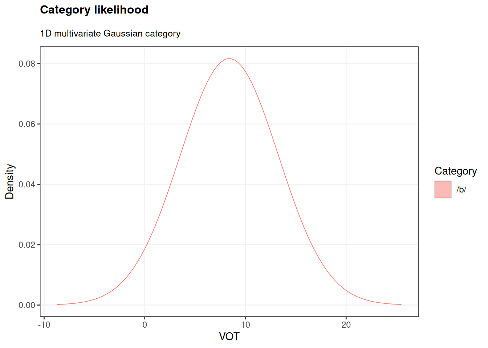

When applied to a multi-category template or cognitive model, all
categories are plotted simultaneously with unified color mapping and a
shared legend:

``` r

# 1D MVG multi-category template (/b/, /d/, /g/)
tpl_1d_mvg <- example_mvg_category_representation_template(n_cues = 1, categories = c("/b/", "/d/", "/g/"))

# Left: Line contour curves (default aes = 'contour')
p_tpl_line <- plot_categories(tpl_1d_mvg, limits = c(-50, 120)) +
  labs(title = "Line Density (default aes = 'contour')")

# Right: Shaded density ribbons (aes = 'fill')
p_tpl_fill <- plot_categories(tpl_1d_mvg, aes = "fill", limits = c(-50, 120)) +
  labs(title = "Shaded Ribbon (aes = 'fill')")

p_tpl_line + p_tpl_fill + plot_layout(guides = "collect")
```

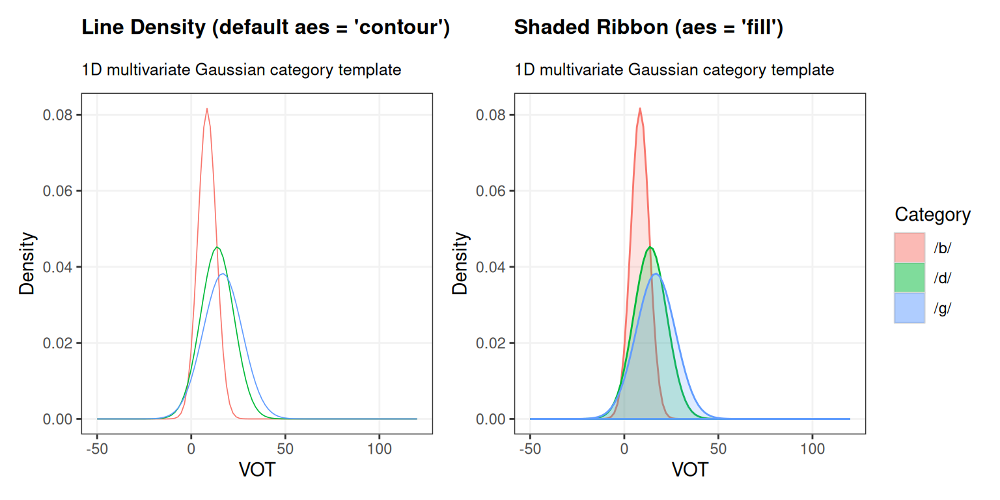

### 1D Exemplar-Based Categories

For exemplar representations (`Exemplar_CategoryRepresentation`),
[`plot_categories()`](https://hlplab.github.io/MVBeliefUpdatr/reference/plot_categories.md)
evaluates a non-parametric kernel density estimate (KDE) over the stored
discrete exemplars.

- `n_exemplars`: Number of stored exemplars to sample and display as rug
  tick marks (default `0L`, plotting clean density curves without rugs).
  When `n_exemplars > 0`, the rug tick marks are rendered with an
  opacity of $`1 / K`$ (where $`K`$ is the number of plotted
  categories).

``` r

tpl_1d_ex <- example_exemplar_category_representation_template(n_cues = 1)

# Sampling 100 stored exemplars to render rug tick marks
plot_categories(tpl_1d_ex, n_exemplars = 100)
```

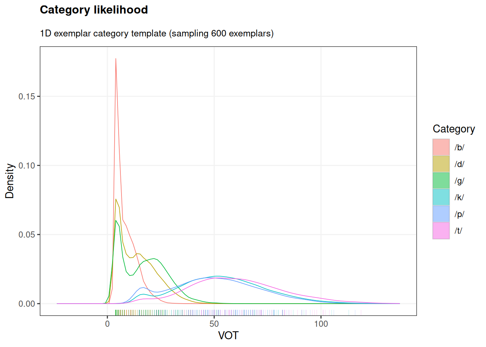

------------------------------------------------------------------------

### Customizing the Returned `ggplot` or `plotly` Object

As mentioned above, all plotting functions return standard `ggplot` or
`plotly` objects. So you can customize them with any native `ggplot2` or
`plotly` layers, color scales, facets, and themes. For instance, for the
1d category representation plot, we could choose a theme, add labs, and
further annotation, and change the color assignment:

``` r

# Customizing scales, adding reference thresholds and annotations
p_tpl_line +
  scale_color_manual(values = c("/b/" = "#E41A1C", "/d/" = "#377EB8", "/g/" = "#4DAF4A")) +
  geom_vline(xintercept = 0, linetype = "dashed", color = "gray40") +
  labs(
    title = "Voice-Onset Time Distributions across Stop Consonants",
    subtitle = "Parametric Gaussian representations with custom aesthetics",
    x = "Voice-Onset Time (ms)",
    y = "Probability Density"
  ) +
  theme_minimal()
```

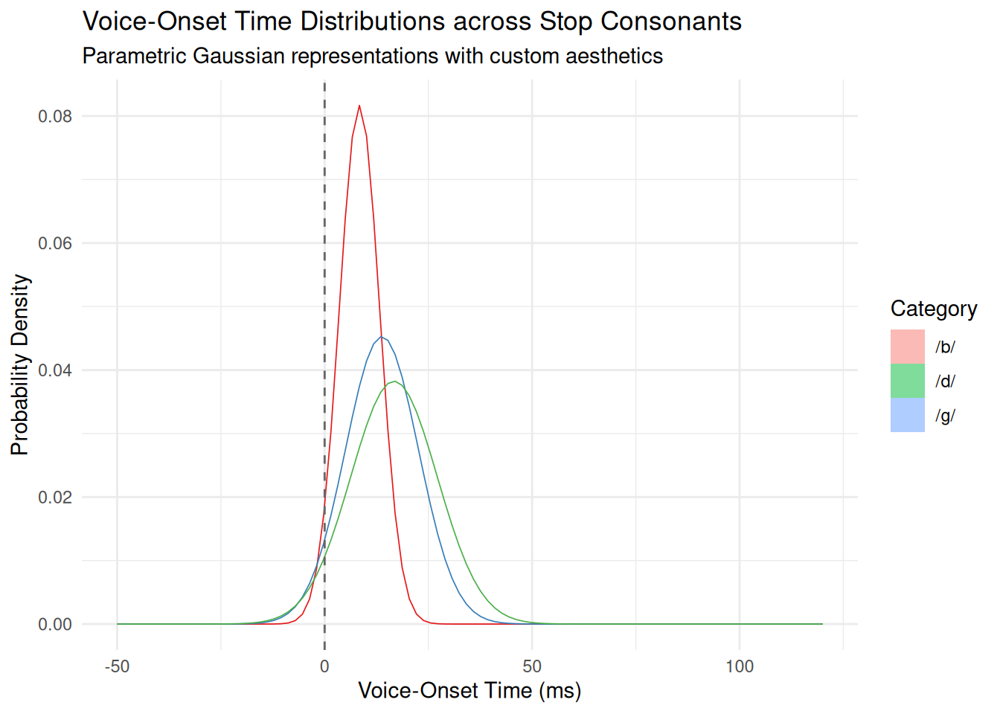

------------------------------------------------------------------------

### 2D Representations and Templates

When two cues are selected for plotting (`length(cues) == 2L`), category
representations can be visualized using covariance ellipses, continuous
density gradients, or discrete density bands. Core arguments (in order
of function signature):

- `aes`: Aesthetic layer type:
  - `"contour"`: Draws boundary contour lines (covariance ellipses for
    parametric models; 2D KDE contours for exemplar models).
  - `"fill-discrete"` (alias `"fill"`): Shaded discrete confidence
    regions colored by category.
  - `"fill-gradient"`: Continuous density heatmap with alpha
    proportional to $`p(\mathbf{x} \mid c)`$.
  - Combinations like `c("fill-gradient", "contour")` or
    `c("fill-discrete", "contour")`. When both fill and contour
    aesthetics are present, their fill and color keys are automatically
    unified into a single legend.
- `levels`: Central probability mass regions to enclose (defaulting to
  `levels = 2 * pnorm(1:3) - 1` $`\approx 0.683, 0.954, 0.997`$). Users
  can specify custom regions, such as `levels = c(0.50, 0.95)` for 50%
  and 95% intervals.
- `limits`: Coordinate bounds along the axes. Specified as a named list
  (e.g., `limits = list(VOT = c(-30, 90), f0_semitones = c(-4, 6))`) or
  a 2-element numeric vector `c(min, max)` applied to both dimensions.
  When `"fill-gradient"` is used, the density raster tiles seamlessly
  cover the entire plotted space up to the panel boundaries without
  artificial padding.
- `resolution`: Grid density along each cue axis (default `100`).

``` r

tpl_2d_mvg <- example_mvg_category_representation_template(n_cues = 2)

# Mode 1: Custom 50% and 95% central probability contours for /b/ and /p/
p_2d_contour <- plot_categories(
  tpl_2d_mvg,
  categories = c("/b/", "/p/"),
  aes = "contour",
  levels = c(0.50, 0.95),
  limits = list(VOT = c(-30, 90), f0_semitones = c(-4, 6))
) + labs(title = "50% & 95% Central Contours")

# Mode 2: Continuous density gradient + contour borders for /b/ and /p/
p_2d_combined <- plot_categories(
  tpl_2d_mvg,
  categories = c("/b/", "/p/"),
  aes = c("fill-gradient", "contour"),
  limits = list(VOT = c(-30, 90), f0_semitones = c(-4, 6))
) + labs(title = "Gradient Fill + Contours")

p_2d_contour + p_2d_combined + plot_layout(guides = "collect")
```

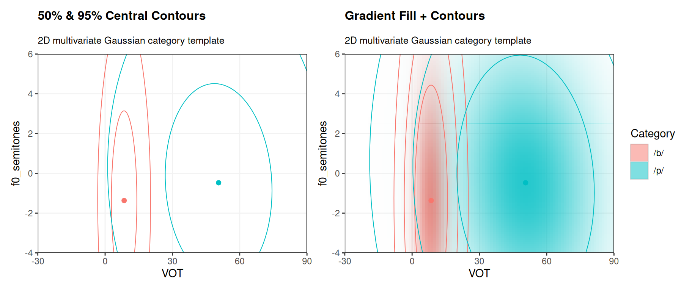

### 2D Exemplar Models: Raw Exemplars vs. KDE Densities

For 2D exemplar templates,
[`plot_categories()`](https://hlplab.github.io/MVBeliefUpdatr/reference/plot_categories.md)
evaluates vectorized bivariate kernel densities and optionally overlays
sampled exemplar points:

``` r

tpl_2d_ex <- example_exemplar_category_representation_template(n_cues = 2)

# Plot 2D KDE density contours and sample 120 exemplars as scatter points
plot_categories(
  tpl_2d_ex,
  categories = c("/b/", "/p/"),
  aes = "contour",
  n_exemplars = 120,
  limits = list(VOT = c(-30, 90), f0_semitones = c(-4, 6))
)
```

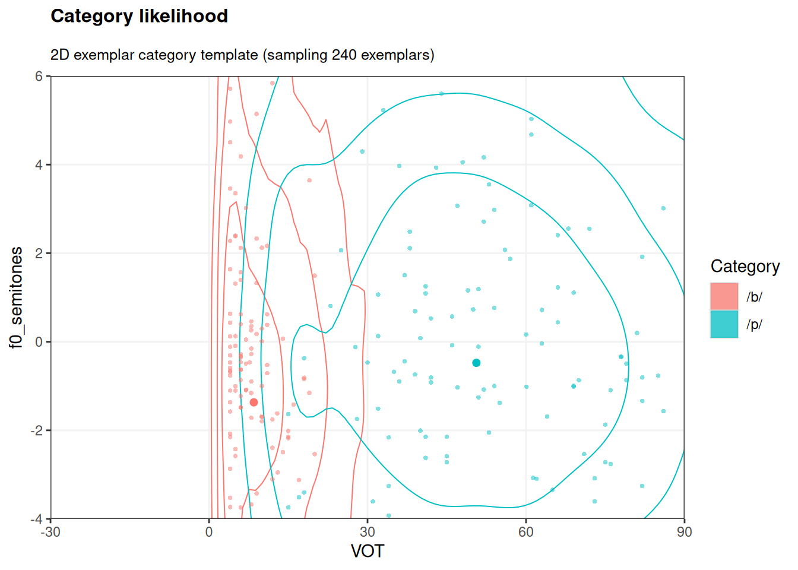

### Interactive Categories over 2D cues: 3D Density Surfaces

When `interactive = TRUE` (or `aes = "interactive"`) is set for a 2-cue
plot,
[`plot_categories()`](https://hlplab.github.io/MVBeliefUpdatr/reference/plot_categories.md)
renders an interactive 3D WebGL scene via **plotly** where the third
vertical dimension represents probability density
$`p(x_1, x_2 \mid c)`$:

- `aes`: Aesthetic surface mode:
  - `"fill-discrete"` (alias `"fill"`, default): 3D density surface with
    solid category coloring and constant opaqueness across the surface.
  - `"fill-gradient"`: 3D density surface with opacity gradient
    proportional to the height of the probability density.
  - `"contour"`: Only 3D contour lines across density heights (hiding
    the surface fill).

``` r

# Interactive 3D density surface over two acoustic cues (default solid fill)
plot_categories(
  tpl_2d_mvg,
  categories = c("/b/", "/p/"),
  interactive = TRUE
)
```

Just like the `ggplot` objects returned by non-interactive 1D and 2D
plots can be further customized using standard `ggplot2` functions, so
too can the **plotly** objects returned by interactive 2D and 3D plots
be customized using **plotly** functions (e.g., using
[`layout()`](https://rdrr.io/r/graphics/layout.html) to adjust the
camera angle or aspect ratio).

------------------------------------------------------------------------

### 3D Visualizations of Category Representations

When working with three cues (such as $`F_1 \times F_2 \times F_3`$ in
vowel perception or $`\text{VOT} \times f_0 \times \text{duration}`$ in
stop voicing), categories inhabit a volume in $`\mathbb{R}^3`$.
**MVBeliefUpdatr** supports two complementary approaches: multi-panel 2D
slices and fully interactive 3D WebGL scenes.

#### Sliced Multi-Panel Visualizations

The sliced view conditions on discrete values of the third cue,
rendering a multi-panel `ggplot` figure where each panel displays the 2D
subspace at that slice level:

- `cues`: Character vector of length 3 `c("cue1", "cue2", "cue3")`,
  where the third cue is sliced across facets.
- `slices`: Numeric vector of values along the third cue to slice at
  (e.g. `slices = c(2200, 2600, 3000)`). If omitted, slices default to 5
  standard deviation intervals at $`-2, -1, 0, 1,`$ and $`2\sigma`$ from
  the pooled mean of the third cue.
- `levels`: Central probability mass intervals (defaults to 1 to 4
  standard deviation equivalents:
  $`\approx 0.683, 0.954, 0.997, 0.9999`$). Each contour line displays a
  text label indicating the percentage of probability mass it encloses,
  with line width varying linearly from thickest at the central mass to
  thinnest at the outermost boundary.

``` r

# Construct a 3-cue MVG Ideal Observer
m3 <- new_mvg_ideal_observer(
  category_template = new_category_representation_template(list(
    "vowel 1" = new_mvg_category_representation("vowel 1", c("F1", "F2", "F3"), c(300, 1000, 2200), diag(c(40, 120, 180)^2)),
    "vowel 2" = new_mvg_category_representation("vowel 2", c("F1", "F2", "F3"), c(450, 1600, 2600), diag(c(50, 140, 200)^2)),
    "vowel 3" = new_mvg_category_representation("vowel 3", c("F1", "F2", "F3"), c(600, 2200, 3000), diag(c(55, 160, 220)^2))
  )),
  category_prior = c("vowel 1" = 1 / 3, "vowel 2" = 1 / 3, "vowel 3" = 1 / 3)
)

# Sliced 3D category plot using default 5 slices (-2 to +2 sigma) and default 1:3 sigma contours
plot_categories(m3)
```

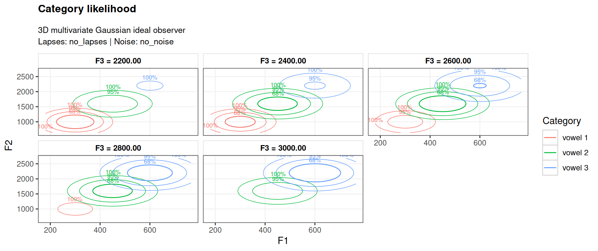

------------------------------------------------------------------------

#### 3D Interactive Category Plots: (Plotly)

For interactive 3D exploration,
[`plot_categories()`](https://hlplab.github.io/MVBeliefUpdatr/reference/plot_categories.md)
provides native WebGL rendering via **plotly** simply by setting
`interactive = TRUE` (or specifying `aes = "interactive"`):

- `levels`: Central probability mass intervals. Defaults to the 2-sigma
  central ellipsoid ($`\approx 95.45\%`$).
- `aes`: Aesthetic layer type, the default of which depends on the type
  of category representation:
  - `"fill-discrete"` (alias `"fill"`, default for parametric models):
    3D ellipsoids with constant semi-opacity per category.
  - `"fill-gradient"`: Nested ellipsoids with opacity gradient across
    probability mass levels.
  - `"contour"`: 3D wireframe contour lines.
  - `"scatter"`: For exemplar models only (default), interactive 3D
    scatter point cloud (controlled by `n_exemplars`).

While Exemplar models can also use `aes = "fill-discrete"`,
`"fill-gradient"`, or `"contour"`, note that **3D isosurface generation
for exemplar models is computationally intensive.**

``` r

# Native interactive 3D WebGL category plot with default 2-sigma ellipsoid
plot_categories(
  m3,
  interactive = TRUE
)
```

Interactive 3D plots are fully responsive: users can click and drag to
rotate the 3D volume, scroll to zoom, hover to inspect category labels,
and toggle category visibilities in the legend.

#### 3D Exemplar Models: Sliced Contours vs. Interactive Scatter Clouds

For 3D exemplar templates,
[`plot_categories()`](https://hlplab.github.io/MVBeliefUpdatr/reference/plot_categories.md)
provides two distinct visualization strategies:

1.  **Sliced 2D Density Contours (`interactive = FALSE`)**: Evaluates
    bivariate Kernel Density Estimation (KDE) over 2D slices along the
    third cue dimension, displaying how the local exemplar distribution
    and category densities shift across cue values:

``` r

tpl_3d_ex <- example_exemplar_category_representation_template(n_cues = 3)

# Sliced 2D density contours for /b/ and /p/ across vowel_duration slices (50, 100, 150 ms)
plot_categories(
  tpl_3d_ex,
  categories = c("/b/", "/p/"),
  slices = c(50, 100, 150),
  resolution = 35
)
```

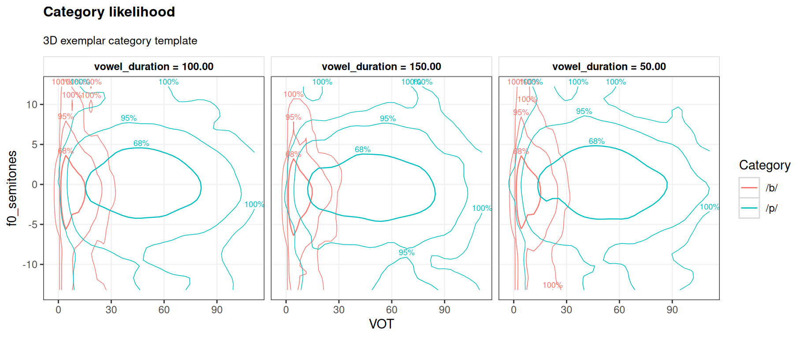

2.  **Interactive 3D Scatter Clouds (`interactive = TRUE`)**: Renders
    stored exemplars directly as a 3D point cloud:

``` r

# Interactive 3D scatter plot sampling 150 exemplars per category
plot_categories(
  tpl_3d_ex,
  categories = c("/b/", "/p/"),
  interactive = TRUE,
  n_exemplars = 150
)
```

*Note on continuous 3D density surfaces for exemplar models:* While
parametric representations (e.g., MVG) have closed-form ellipsoid
equations that render efficiently in 3D WebGL, continuous 3D density
isosurfaces for non-parametric exemplar models require estimating a 3D
kernel density across a high-resolution 3D voxel grid
($`O(N \cdot G^3)`$ evaluations, where $`N`$ can exceed 50,000 empirical
tokens) followed by 3D isosurface mesh extraction (e.g., marching
cubes). In addition to being computationally demanding, nested 3D
density shells suffer from severe visual occlusion in complex
multi-category spaces. Consequently, sliced 2D contour panels and
interactive 3D scatter clouds provide the clearest, fastest, and most
faithful visual diagnostics for 3D exemplar categories.

------------------------------------------------------------------------

## 2. Categorization Functions (`plot_categorization_functions`)

While
[`plot_categories()`](https://hlplab.github.io/MVBeliefUpdatr/reference/plot_categories.md)
displays generative likelihood densities $`p(\mathbf{x} \mid c)`$,
[`plot_categorization_functions()`](https://hlplab.github.io/MVBeliefUpdatr/reference/plot_categorization_functions.md)
visualizes predicted response probabilities
$`P_{\text{resp}}(c \mid \mathbf{x})`$, incorporating perceptual
decision rules, lapse rates, and category biases:
``` math
P_{\text{resp}}(c \mid \mathbf{x}) = (1 - \lambda) P(c \mid \mathbf{x}) + \lambda b_c
```
where:

- $`\lambda \in [0, 1]`$ is the **lapse rate** (representing probability
  of random guessing, perceptual error, or task-unrelated lapses of
  attention).
- $`b_c \in [0, 1]`$ is the **lapse bias** for category $`c`$, with
  $`\sum_{k} b_k = 1`$.
- $`P(c \mid \mathbf{x})`$ is the posterior response probability derived
  from the generative model:
  ``` math
  P(c \mid \mathbf{x}) = \frac{p(\mathbf{x} \mid c) P(c)}{\sum_{k} p(\mathbf{x} \mid k) P(k)}
  ```
  according to the chosen `decision_rule` (e.g., `"proportional"` for
  probability matching or `"criterion"` for deterministic
  winner-take-all classification).

*For an introduction to lapse rates, category biases, and perceptual
noise in speech categorization models, see [Xie, Jaeger, & Kurumada
(2023)](https://doi.org/10.1016/j.cortex.2023.05.011).* Core Arguments
for `plot_categorization_functions` include:

- `cues`: Character vector of cue dimensions to plot (1, 2, or 3 cues;
  defaults to as many cues as possible up to 3, selecting the first cues
  in the model).
- `categories`: Optional character vector specifying a subset of
  category labels to evaluate and plot (defaults to the first category).
- `decision_rule`: Decision rule label (defaults to `"proportional"`):
  - `"proportional"`: Response probability equals posterior probability
    $`P(c \mid \mathbf{x})`$ (probability matching).
  - `"criterion"`: Deterministic maximum a posteriori rule
    (winner-take-all classification boundary).
  - `"sampling"`: Stochastic sampling of category choices from posterior
    beliefs.
- `aes`: Aesthetic layer type (`"contour"` for decision boundary
  contours, `"fill"` or `"fill-gradient"` for continuous response
  probability heatmaps, or `"fill-discrete"` for winner-take-all
  partition regions). Defaults to `"contour"`.
- `limits`: Axis bounds, specified as a 2-element vector `c(min, max)`
  or named list `list(VOT = c(-30, 90), f0_semitones = c(-4, 6))`.
- `resolution`: Grid density along each cue dimension (default `100`).

Note: When all category priors are identical, the plot summary concisely
indicates `all = {1 / K}`.

### 1D Categorization Functions

In 1D, categorization functions are classic psychometric identification
curves:

``` r

model_1d <- example_mvg_ideal_observer(n_cues = 1)

# Left: Default proportional probability matching
p_cat_prop <- plot_categorization_functions(
  model_1d,
  categories = c("/b/", "/d/", "/g/")
) + labs(title = "Proportional Rule (Default)")

# Right: Criterion (deterministic argmax)
p_cat_crit <- plot_categorization_functions(
  model_1d,
  categories = c("/b/", "/d/", "/g/"),
  decision_rule = "criterion"
) + labs(title = "Criterion Rule (Step Boundaries)")

p_cat_prop + p_cat_crit + plot_layout(guides = "collect")
```

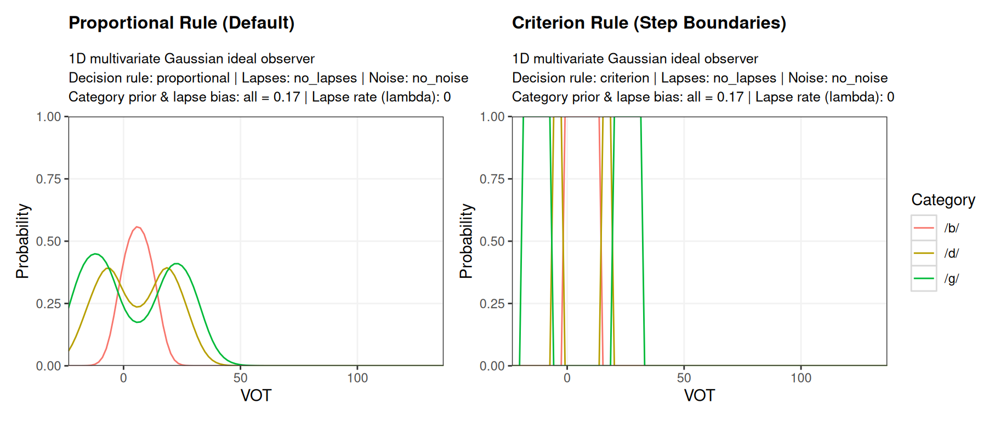

### 2D Categorization Functions

In 2D space, categorization functions partition the continuum into
perceptual decision regions, separated by boundary contours
(e.g. $`P(c \mid \mathbf{x}) = 0.50`$):

``` r

model_2d <- example_mvg_ideal_observer(n_cues = 2)

# Mode 1: Decision boundary contours for /b/ and /p/ (default aes = 'contour')
p_cat_cont <- plot_categorization_functions(
  model_2d,
  categories = c("/b/", "/p/"),
  limits = list(VOT = c(-30, 90), f0_semitones = c(-4, 6))
) + labs(title = "Decision Contours (default aes = 'contour')")

# Mode 2: Shaded posterior probability surface + contours for /b/ and /p/
p_cat_fill <- plot_categorization_functions(
  model_2d,
  categories = c("/b/", "/p/"),
  aes = c("fill-gradient", "contour"),
  limits = list(VOT = c(-30, 90), f0_semitones = c(-4, 6))
) + labs(title = "Posterior Probability Landscape")

p_cat_cont + p_cat_fill
```

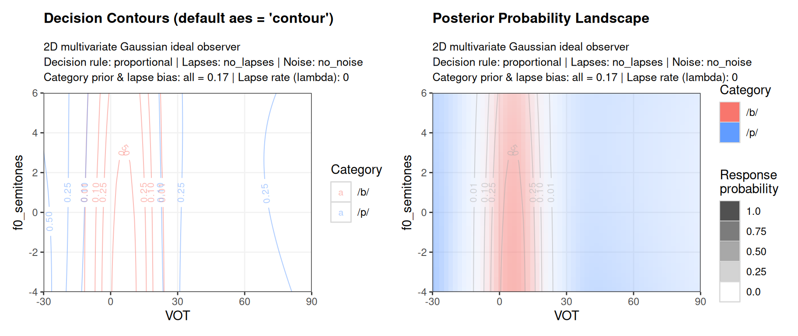

### Interactive Categorization Functions over 2D cues: 3D Categorization Surfaces

Just like 2D category densities can be rendered as 3D interactive
elevation surfaces, 2D categorization functions can be rendered in 3D
WebGL with `interactive = TRUE`. By default, interactive 3D surfaces use
discrete fill (`aes = "fill-discrete"`), providing an intuitive
visualization of the response probability landscape across the cue
space. The $`z`$-axis represents the predicted response probability
$`P_{\text{resp}}(c \mid \mathbf{x}) \in [0, 1]`$:

``` r

# 3D interactive response probability surface for category /b/
plot_categorization_functions(
  model_2d,
  categories = "/b/",
  interactive = TRUE
)
```

### 3D Sliced Categorization Functions

For 3-cue models,
[`plot_categorization_functions()`](https://hlplab.github.io/MVBeliefUpdatr/reference/plot_categorization_functions.md)
computes 2D decision contours and posterior response probabilities
across slices of the third dimension, illustrating how boundaries shift
as a function of the third acoustic cue:

``` r

# Multi-category decision contours across slices of F3
plot_categorization_functions(
  m3,
  categories = c("vowel 1", "vowel 2", "vowel 3"),
  slices = c(2200, 2600, 3000),
  aes = c("fill-gradient", "contour")
)
```

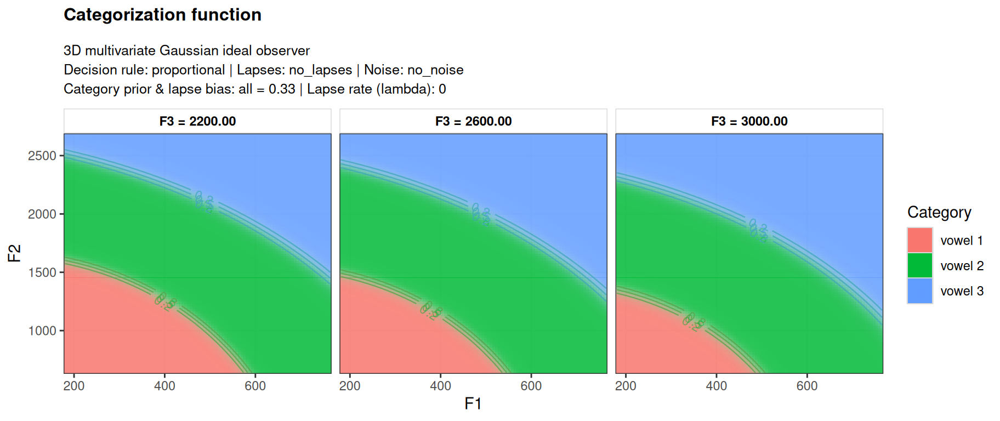

------------------------------------------------------------------------

## 3. Dimensionality Reduction & Marginal Projections

When working with multidimensional models ($`D \ge 3`$), visualizing all
cue dimensions simultaneously becomes challenging.
[`plot_categories()`](https://hlplab.github.io/MVBeliefUpdatr/reference/plot_categories.md)
and
[`plot_categorization_functions()`](https://hlplab.github.io/MVBeliefUpdatr/reference/plot_categorization_functions.md)
support plotting 1D, 2D, or 3D subspaces by marginalizing over all
omitted cues.

### Mathematical Principle of Marginalization

When a user requests a 2D plot for a 3-cue model (for example,
specifying `cues = c("F1", "F2")` for a model defined on
`c("F1", "F2", "F3")`), **MVBeliefUpdatr** does **not** take an
arbitrary slice at zero. Instead, it analytically **marginalizes out**
the omitted dimensions by integrating over $`\mathbb{R}`$:
``` math
p(x_1, x_2 \mid c) = \int_{-\infty}^{\infty} p(x_1, x_2, x_3 \mid c) \, dx_3
```

For a multivariate Gaussian category representation with mean vector
$`\boldsymbol{\mu} \in \mathbb{R}^D`$ and covariance matrix
$`\boldsymbol{\Sigma} \in \mathbb{R}^{D \times D}`$, marginalizing out
cue $`k`$ yields an exact Gaussian distribution with:
``` math
\boldsymbol{\mu}_{\text{proj}} = \boldsymbol{\mu}_I, \quad \boldsymbol{\Sigma}_{\text{proj}} = \boldsymbol{\Sigma}_{I, I}
```
where $`I \subset \{1, \dots, D\}`$ indexes the retained cue subset.
This guarantees that all variances, covariances, and central density
intervals displayed in the 2D plot reflect the true marginal
distributions of the underlying model without distortion.

Similarly, for categorization functions, marginalizing out omitted cues
corresponds to computing the posterior response probabilities of the
marginalized category representations:
``` math
P(c \mid \mathbf{x}_I) = \frac{p(\mathbf{x}_I \mid c) P(c)}{\sum_{k} p(\mathbf{x}_I \mid k) P(k)}
```
reflecting the decision boundaries of an observer who only has access to
the subset of cues $`\mathbf{x}_I`$, and thus has to marginalize over
all other cues to make a categorization decision.

### Pairwise 2D Projections of a 3D Model

We can visualize all three pairwise combinations of a 3-cue phonetic
space ($`(F_1, F_2)`$, $`(F_1, F_3)`$, and $`(F_2, F_3)`$) for both
category densities and categorization functions:

#### Pairwise Category Densities

``` r

# 1. Height vs. Backness (F1 x F2)
p_f1_f2 <- plot_categories(m3, cues = c("F1", "F2"), aes = c("fill-gradient", "contour")) +
  labs(title = "Category likelihood", subtitle = "Marginalized over F3")

# 2. Height vs. Rhoticity (F1 x F3)
p_f1_f3 <- plot_categories(m3, cues = c("F1", "F3"), aes = c("fill-gradient", "contour")) +
  labs(title = "", subtitle = "Marginalized over F2")

# 3. Backness vs. Rhoticity (F2 x F3)
p_f2_f3 <- plot_categories(m3, cues = c("F2", "F3"), aes = c("fill-gradient", "contour")) +
  labs(title = "", subtitle = "Marginalized over F1")

# Assemble via patchwork
p_f1_f2 + p_f1_f3 + p_f2_f3 + plot_layout(guides = "collect")
```

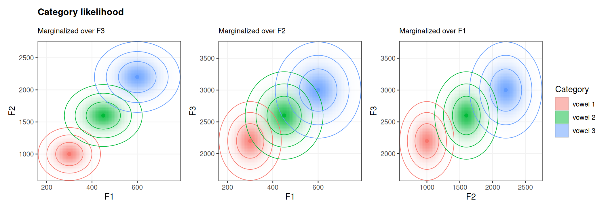

#### Pairwise Categorization Functions

``` r

# 1. F1 x F2 categorization
p_cat_f1_f2 <- plot_categorization_functions(
  m3,
  cues = c("F1", "F2"),
  categories = c("vowel 1", "vowel 2", "vowel 3"),
  aes = c("fill-gradient", "contour")
) + labs(title = "Categorization functions", subtitle = "Marginalized over F3")

# 2. F1 x F3 categorization
p_cat_f1_f3 <- plot_categorization_functions(
  m3,
  cues = c("F1", "F3"),
  categories = c("vowel 1", "vowel 2", "vowel 3"),
  aes = c("fill-gradient", "contour")
) + labs(title = "", subtitle = "Marginalized over F2")

# 3. F2 x F3 categorization
p_cat_f2_f3 <- plot_categorization_functions(
  m3,
  cues = c("F2", "F3"),
  categories = c("vowel 1", "vowel 2", "vowel 3"),
  aes = c("fill-gradient", "contour")
) + labs(title = "", subtitle = "Marginalized over F1")

# Assemble via patchwork
p_cat_f1_f2 + p_cat_f1_f3 + p_cat_f2_f3 + plot_layout(guides = "collect")
```

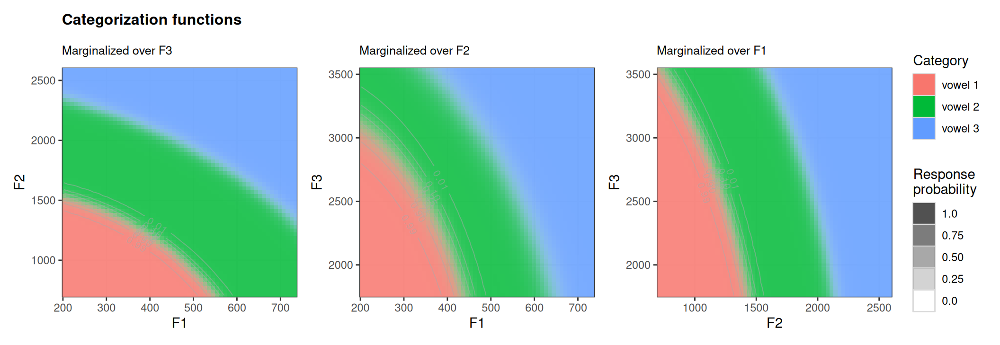

------------------------------------------------------------------------

## 4. Visualizing Bayesian Belief Updating Models (`MVBU_Stanfit`)

Fitted **MVBeliefUpdatr** Stan models (`MVBU_Stanfit`) contain posterior
MCMC draws reflecting uncertainty over category parameters across prior
and exposure groups.

#### Posterior Category Beliefs: Marginalized vs. Sample Uncertainty

Using
[`plot_categories()`](https://hlplab.github.io/MVBeliefUpdatr/reference/plot_categories.md)
on an `MVBU_Stanfit` object provides two complementary modes to inspect
posterior beliefs via `uncertainty_treatment`:

- `uncertainty_treatment = "marginalize"` (default): Marginalizes across
  the selected posterior draws, plotting category distributions computed
  from the posterior parameter expectations and marginal covariances.
- `uncertainty_treatment = "sample"`: Evaluates category distributions
  across the selected individual posterior MCMC draws, overlaying sample
  contours or curves to faithfully convey parameter estimation
  uncertainty.
- `ndraws`: Integer specifying the number of posterior draws to sample
  and display (default `20`).

``` r

# Load or fit 2D NIW ideal adaptor model
models_dir <- if (dir.exists("../tests/testthat/models")) {
  "../tests/testthat/models"
} else if (dir.exists("tests/testthat/models")) {
  "tests/testthat/models"
} else {
  tempdir()
}
fit_path <- file.path(
  models_dir,
  "minimal-niw_ideal_adaptor-NIW-2cue.rds"
)
fit <- example_ideal_adaptor_stanfit(
  model_family = "NIW",
  n_cues = 2L,
  file = fit_path,
  file_refit = "never"
)

# 1. Marginalized Posterior Representation (uncertainty_treatment = "marginalize")
p_fit_marg <- plot_categories(fit, uncertainty_treatment = "marginalize") +
  labs(title = "Marginalized (uncertainty_treatment = 'marginalize')")

# 2. Posterior Uncertainty Draws (uncertainty_treatment = "sample", ndraws = 20)
p_fit_sample <- plot_categories(fit, uncertainty_treatment = "sample", ndraws = 20) +
  labs(title = "Sample Draws (uncertainty_treatment = 'sample', ndraws = 20)")

p_fit_marg + p_fit_sample + plot_layout(guides = "collect")
```

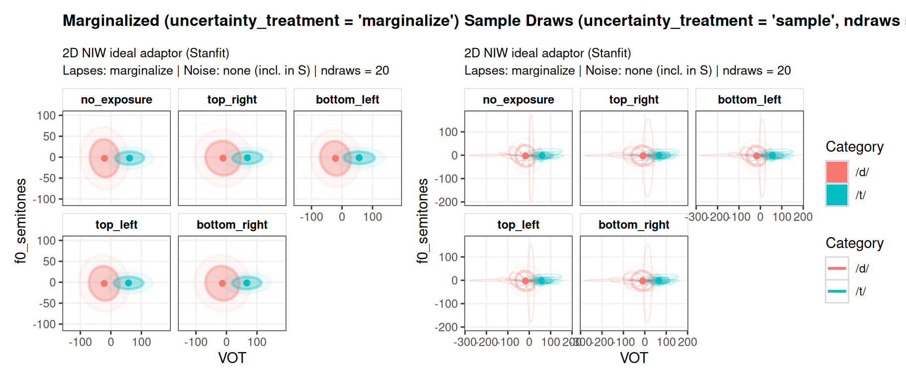

#### Fitted 1D Categorization Function with Uncertainty

[`plot_categorization_functions()`](https://hlplab.github.io/MVBeliefUpdatr/reference/plot_categorization_functions.md)
evaluates posterior response probability curves across exposure groups,
with 95% posterior credible interval ribbons:

``` r

plot_categorization_functions(
  fit,
  cues = "VOT",
  uncertainty_treatment = "marginalize"
)
```

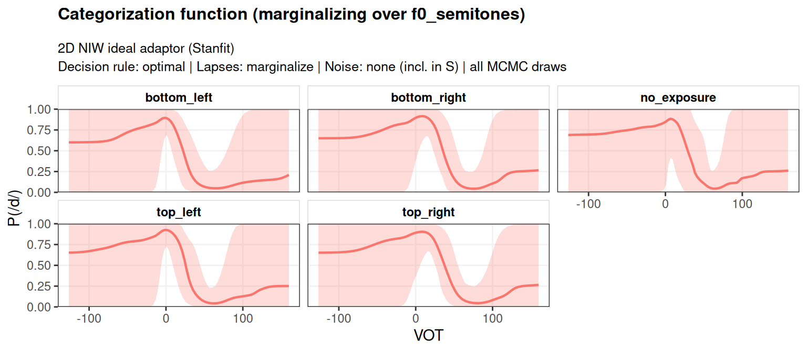

#### Fitted 2D Categorization Function with Uncertainty

[`plot_categorization_functions()`](https://hlplab.github.io/MVBeliefUpdatr/reference/plot_categorization_functions.md)
evaluates posterior response probability surfaces for the fitted
exposure groups, with optional MCMC draw overlay:

``` r

plot_categorization_functions(
  fit,
  cues = c("VOT", "f0_semitones"),
  aes = c("fill-gradient", "contour"),
  ndraws = 30
)
```

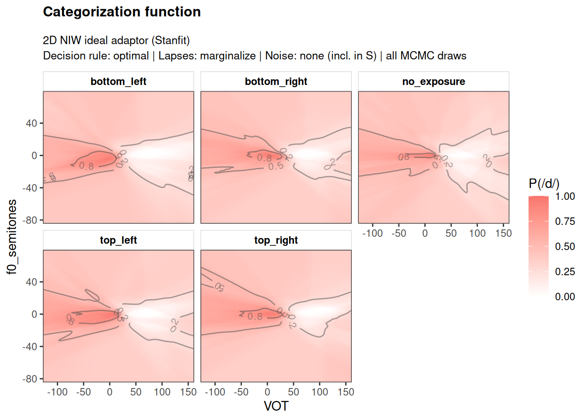

#### Posterior Parameter Distributions (`plot_parameters`)

[`plot_parameters()`](https://hlplab.github.io/MVBeliefUpdatr/reference/plot_parameters.md)
extracts marginal posterior distributions for all model parameters:

- `parameters`: Character vector of parameter names to plot (defaults to
  all parameters).
- `categories`: Subset of categories to include (defaults to all
  categories).
- `combine_into_single_plot`: Logical (defaults to `TRUE`), combining
  parameter subplots into a single unified patchwork layout. If `FALSE`,
  returns a named list of individual `ggplot` objects for custom
  arrangement.

``` r

# Combined parameter distribution plot (combine_into_single_plot defaults to TRUE)
plot_parameters(fit)
```

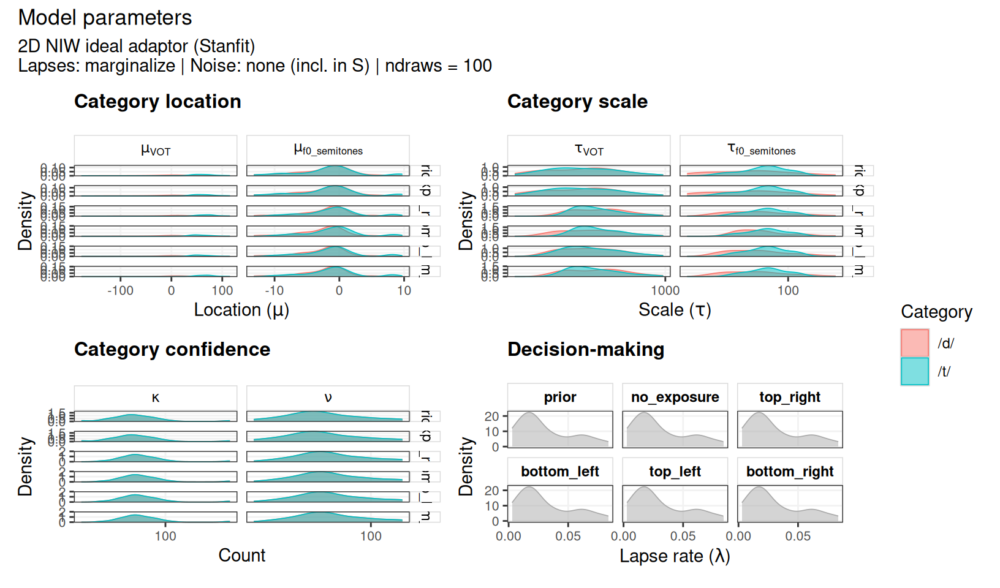

#### Parameter Correlation Heatmap (`plot_parameter_correlations`)

[`plot_parameter_correlations()`](https://hlplab.github.io/MVBeliefUpdatr/reference/plot_parameters.md)
computes Pearson correlation coefficients between all parameter pairs
across MCMC draws. Gray bounding boxes along the diagonal group
parameters belonging to the same category:

- `parameters`: Vector specifying a subset of parameter types to include
  in the correlation matrix (defaults to all parameters).
- `groups`: Subset of experimental exposure/prior groups (defaults to
  `"prior"`).

``` r

# Correlation heatmap for prior group parameters (groups defaults to "prior")
plot_parameter_correlations(fit)
```

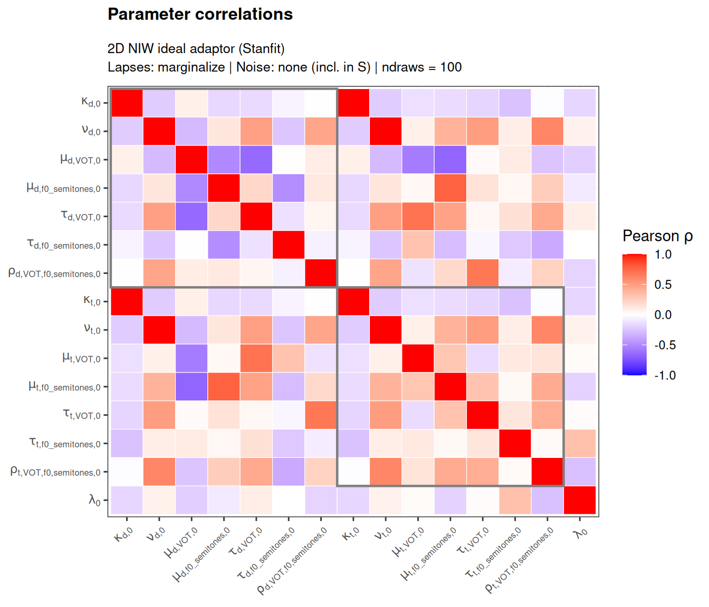

#### Pairwise Posterior Relationships (`plot_parameters_pairwise`)

[`plot_parameters_pairwise()`](https://hlplab.github.io/MVBeliefUpdatr/reference/plot_parameters.md)
provides comprehensive MCMC diagnostics across parameter pairs:

- **Lower triangle:** Scatterplots of posterior draws with LOESS
  trendlines
- **Diagonal:** Marginal univariate posterior auto-densities
- **Upper triangle:** 2D bivariate density contours (`geom_density_2d`)
- `parameters`: Allows focusing the scatter matrix on specific
  parameters of interest (defaults to all parameters).
- `groups`: Subset of experimental exposure/prior groups (defaults to
  `"prior"`).

``` r

# Pairwise posterior parameter matrix (groups defaults to "prior")
plot_parameters_pairwise(fit)
```

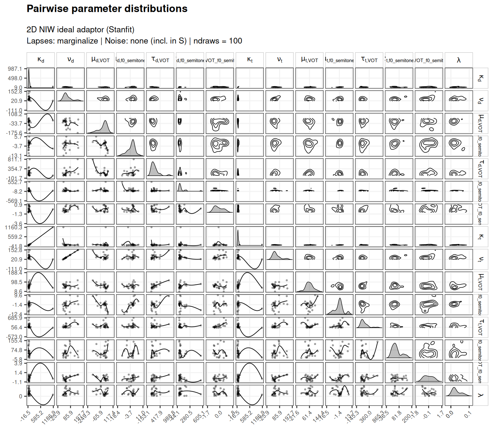

#### Visualizing Empirical Sample Data (`plot_sample`)

In addition to plotting abstract model representations and posterior
belief distributions, empirical exposure distributions and
categorization test observations can be plotted directly using
[`plot_sample()`](https://hlplab.github.io/MVBeliefUpdatr/reference/plot_sample.md)
or its convenience shorthands
[`plot_exposure_sample()`](https://hlplab.github.io/MVBeliefUpdatr/reference/plot_sample.md)
and
[`plot_test_sample()`](https://hlplab.github.io/MVBeliefUpdatr/reference/plot_sample.md).
These methods work on both Stan input objects
(`IdealAdaptorStanfitInput`) and fitted models (`MVBU_Stanfit`):

- `sample`: Choice of observations to render: `c("exposure", "test")`
  (default), `"exposure"`, or `"test"`.
- `aes`: Aesthetic style for exposure observations (e.g., `"points"`,
  `"contour"`, `"fill-gradient"`, or `"fill-discrete"`) or a named list
  such as
  `list(exposure = c("fill-gradient", "contour"), test = "points")`.
- `n.samples`: Optional integer limit for subsampling observation points
  when datasets are large.
- `densities`: Parametric `"gaussian"` (default) or non-parametric
  `"kernel"` density estimation.

``` r

# 1. Plot exposure and test observations from a Stan input object
set.seed(42)
sample_input <- new_ideal_adaptor_stanfit_input(
  exposure = data.frame(
    category = factor(rep(c("/b/", "/p/"), each = 30)),
    group = factor(rep("Group1", 60)),
    VOT = c(rnorm(30, 10, 8), rnorm(30, 45, 8)),
    f0_semitones = c(rnorm(30, 2, 1), rnorm(30, 4, 1))
  ),
  test = data.frame(
    response = factor(sample(c("/b/", "/p/"), 40, replace = TRUE)),
    group = factor(rep("Group1", 40)),
    VOT = runif(40, 0, 60),
    f0_semitones = runif(40, 1, 5)
  ),
  cues = c("VOT", "f0_semitones"),
  category = "category",
  response = "response",
  group = "group",
  stanmodel = "NIW_ideal_adaptor"
)

p_sample_all <- plot_sample(
  sample_input,
  aes = list(exposure = c("fill-gradient", "contour"), test = "points")
) + labs(title = "Exposure & Test Sample (Stan Input)")

# 2. Plot empirical exposure observations from the fitted model
p_sample_fit <- plot_exposure_sample(
  fit,
  aes = "points"
) + labs(subtitle = c("", ""))

p_sample_all + p_sample_fit + plot_layout(guides = "collect")
```

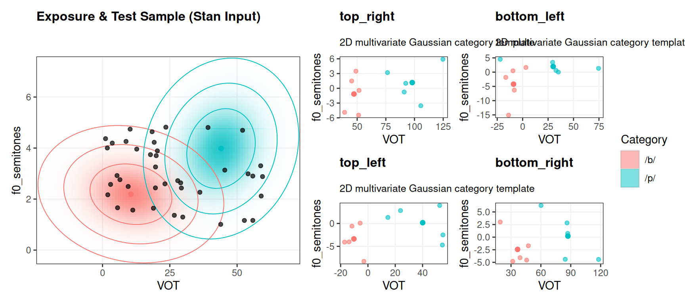

------------------------------------------------------------------------

## 5. Visualizing Incremental Adaptation (`MVBU_ModelList`)

When studying exposure dynamics, researchers need to visualize how
category structures and decision functions shift across belief updates.

By calling
[`plot_categories()`](https://hlplab.github.io/MVBeliefUpdatr/reference/plot_categories.md)
or
[`plot_categorization_functions()`](https://hlplab.github.io/MVBeliefUpdatr/reference/plot_categorization_functions.md)
on an `MVBU_ModelList` container object, you can generate:

1.  **Faceted Panel Grids (`mode = "facet"`)**: Display step-by-step
    belief distributions side-by-side.
2.  **Animated Transitions (`mode = "animate"`)**: Render dynamic
    `gganimate` transitions across exposure steps for static documents,
    or interactive `plotly` sliders.

#### Faceted Grid Example (ggplot)

``` r

# Create prior and updated model models with pronounced exposure shifts
set.seed(42)
m1 <- example_nix_ideal_adaptor()
m2 <- update_template(m1, observations = data.frame(VOT = rnorm(25, mean = 25, sd = 8), category = "/b/"))
m3 <- update_template(m2, observations = data.frame(VOT = rnorm(50, mean = 45, sd = 5), category = "/b/"))

mod_list <- as_model_list(list(Prior = m1, Exposure_Step1 = m2, Exposure_Step2 = m3))

# Render faceted panels across update steps
plot_categories(mod_list, mode = "facet", interactive = FALSE)
```

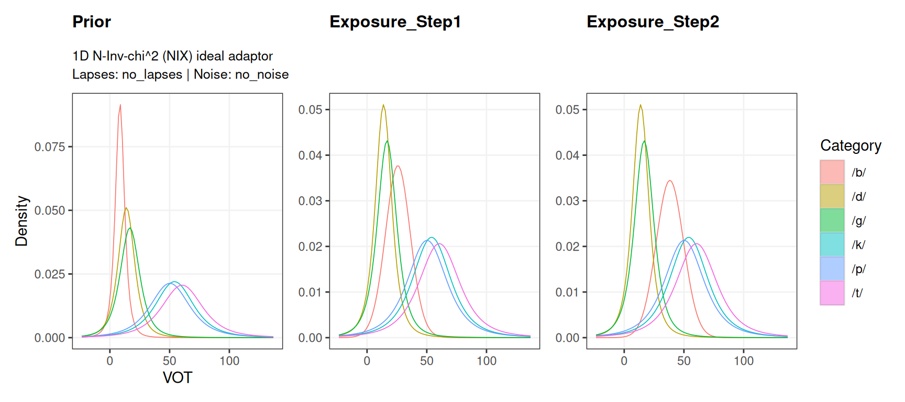

#### Faceted Decision Boundaries

``` r

# Faceted categorization decision boundaries
plot_categorization_functions(mod_list, mode = "facet", interactive = FALSE)
```

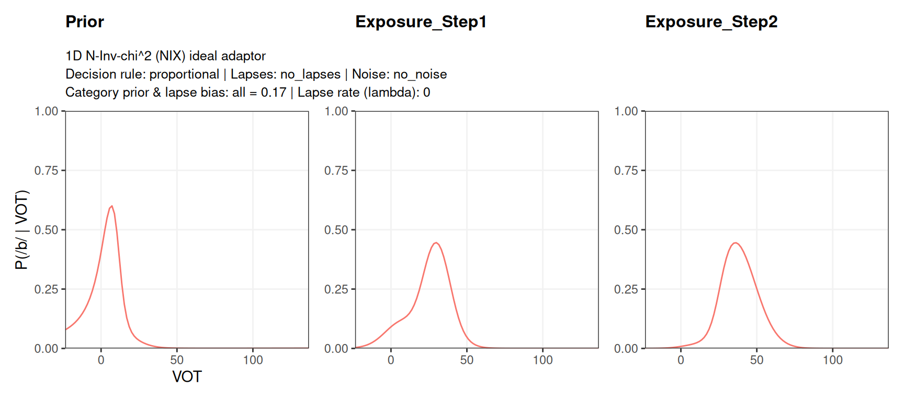

#### Animated Transitions (gganimate & plotly)

``` r

# Dynamic transition animation using gganimate (1D categories)
plot_categories(mod_list, mode = "animate", interactive = FALSE)
```

``` r

# 2D dynamic transition animation for categorization functions using gganimate
set.seed(42)
m1_2d <- example_niw_ideal_adaptor(n_cues = 2)
m2_2d <- update_template(m1_2d, data.frame(
  VOT = rnorm(25, mean = 30, sd = 8),
  f0_semitones = rnorm(25, mean = 3, sd = 1.5),
  category = "/b/"
))
m3_2d <- update_template(m2_2d, data.frame(
  VOT = rnorm(50, mean = 55, sd = 5),
  f0_semitones = rnorm(50, mean = 6, sd = 1),
  category = "/b/"
))

mod_list_2d <- as_model_list(list(
  Prior = m1_2d,
  Exposure_Step1 = m2_2d,
  Exposure_Step2 = m3_2d
))

plot_categorization_functions(
  mod_list_2d,
  mode = "animate",
  interactive = FALSE
)
```

``` r

# Interactive slider plot over 2D cue space using Plotly (95% quantile contour)
plot_categories(
  mod_list_2d,
  mode = "animate",
  interactive = TRUE,
  levels = 0.95
)
```

``` r

# Interactive 3D slider animation across belief updates using Plotly
set.seed(42)
m1_3d <- example_niw_ideal_adaptor(n_cues = 3)
m2_3d <- update_template(m1_3d, data.frame(
  VOT = rnorm(25, mean = 30, sd = 8),
  f0_semitones = rnorm(25, mean = 3, sd = 1.5),
  vowel_duration = rnorm(25, mean = 125, sd = 10),
  category = "/b/"
))
m3_3d <- update_template(m2_3d, data.frame(
  VOT = rnorm(50, mean = 55, sd = 5),
  f0_semitones = rnorm(50, mean = 6, sd = 1),
  vowel_duration = rnorm(50, mean = 155, sd = 8),
  category = "/b/"
))

mod_list_3d <- as_model_list(list(
  Prior = m1_3d,
  Exposure_Step1 = m2_3d,
  Exposure_Step2 = m3_3d
))
plot_categories(
  mod_list_3d,
  mode = "animate",
  interactive = TRUE,
  categories = c("/b/", "/p/")
)
```

#### Reconstructing and Visualizing Stanfit Update Histories

The
[`reconstruct_update_history()`](https://hlplab.github.io/MVBeliefUpdatr/reference/reconstruct_update_history.md)
generic reconstructs sequential belief updating directly from a fitted
Bayesian model (`MVBU_Stanfit`), generating an `MVBU_ModelList` of
checkpoint models along the exposure sequence:

``` r

# 1. Fast mode: sequentially updates an ideal adaptor from prior marginal moments
# Returns an MVBU_ModelList of MVBU_CognitiveModel objects
hist_fast <- reconstruct_update_history(
  fit,
  uncertainty_treatment = "discard",
  step_size = 40L
)

# Plot category belief shifts across exposure steps (multi-panel facet grid)
plot_categories(hist_fast, mode = "facet", interactive = FALSE)
```

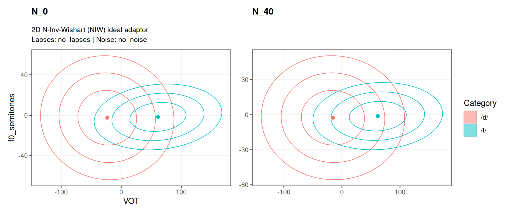

When full posterior parameter uncertainty needs to be tracked across
each update checkpoint, `uncertainty_treatment = "marginalize"` updates
each posterior MCMC draw incrementally, returning an `MVBU_ModelList` of
`MVBU_StanfitPosterior` objects:

``` r

# 2. Full posterior mode: incrementally updates posterior draws (ndraws = 200)
hist_full <- reconstruct_update_history(
  fit,
  uncertainty_treatment = "marginalize",
  ndraws = 200L,
  step_size = 40L
)

# Faceted visualization of categorization decision functions across checkpoints
plot_categorization_functions(hist_full, mode = "facet", interactive = FALSE)
```

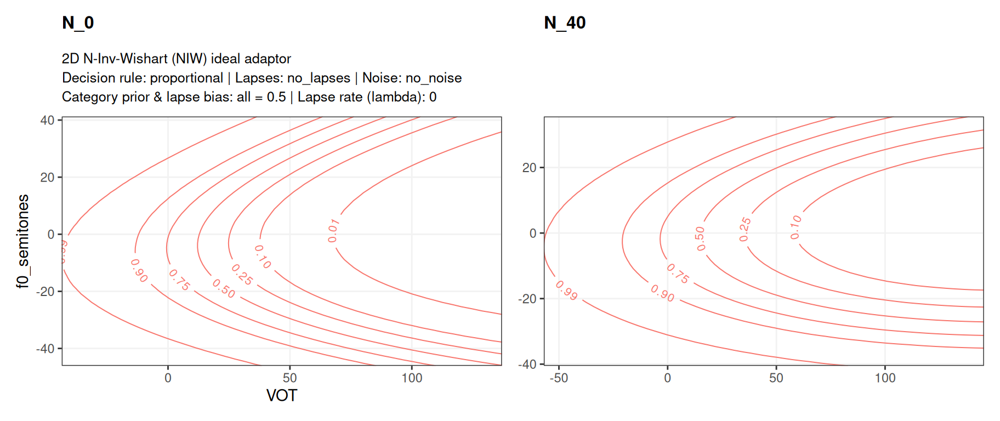

> **Note on interactive slider controls:** To explore belief updating or
> decision surfaces interactively with a time slider rather than
> multi-panel facets, specify `mode = "animate", interactive = TRUE`
> (e.g.,
> `plot_categories(hist_fast, mode = "animate", interactive = TRUE)`).
> Multi-panel faceting (`mode = "facet"`) produces tiled subplots across
> steps via `ggplot2` (`interactive = FALSE`).

------------------------------------------------------------------------

## 6. Parallelization and Performance Optimization

Evaluating continuous probability densities and response probability
surfaces over fine 2D and 3D grids can be computationally demanding,
especially for high-dimensional models or non-parametric exemplar
models. **MVBeliefUpdatr** includes native multi-core parallelization
across core evaluation functions to accelerate rendering.

#### Supported Functions

The `parallel` and `n_cores` arguments are supported across the core
workflow:

- [`plot_categories()`](https://hlplab.github.io/MVBeliefUpdatr/reference/plot_categories.md):
  Multi-category continuous grid evaluations and 3D multi-slice
  representations.
- [`plot_categorization_functions()`](https://hlplab.github.io/MVBeliefUpdatr/reference/plot_categorization_functions.md):
  High-resolution grid evaluations of posterior response probabilities
  and decision landscapes.
- [`sample_observations()`](https://hlplab.github.io/MVBeliefUpdatr/reference/sample_observations.md):
  Parallel simulation of observations across categories.
- Model fitting and MCMC sampling (`fit_stan_model()`,
  [`update()`](https://rdrr.io/r/stats/update.html)): Multi-chain
  parallel sampling via Stan.

#### Requesting Parallel Execution

To request parallel evaluation, specify `parallel = TRUE`:

``` r

# Parallel grid evaluation for high-resolution 3D sliced category plots
plot_categories(
  m3,
  cues = c("F1", "F2", "F3"),
  aes = c("fill-gradient", "contour"),
  resolution = 120,
  parallel = TRUE,
  n_cores = 4
)
```

When `n_cores` is omitted, the package automatically defaults to
`max(1L, parallel::detectCores() - 1L)` (or the value configured via
`options(mc.cores)`).

#### Parallel Architecture & Execution Details

Under the hood:

- On Unix-based systems (Linux and macOS), parallelization leverages
  forked process memory via
  [`parallel::mclapply()`](https://rdrr.io/r/parallel/mclapply.html),
  which achieves near-zero inter-process communication (IPC)
  serialization overhead.
- On Windows, a background socket cluster
  ([`parallel::makeCluster()`](https://rdrr.io/r/parallel/makeCluster.html))
  is utilized via
  [`parallel::parLapply()`](https://rdrr.io/r/parallel/clusterApply.html).
- Evaluation grids are partitioned into contiguous row slices, evaluated
  independently across worker cores, and aggregated into unified tidy
  data frames prior to rendering.

------------------------------------------------------------------------

## 6. Summary

The plotting functions in **MVBeliefUpdatr** are intended to provide a
consistent, modular interface for visualizing cognitive models at every
level of complexity:

- Use
  [`plot_categories()`](https://hlplab.github.io/MVBeliefUpdatr/reference/plot_categories.md)
  to inspect generative category structures, likelihood densities, and
  covariance geometry in 1D, 2D, and 3D.
- Use
  [`plot_categorization_functions()`](https://hlplab.github.io/MVBeliefUpdatr/reference/plot_categorization_functions.md)
  to explore posterior response probability landscapes and decision
  boundaries.
- Leverage analytic marginalization to project high-dimensional models
  onto intuitive 2D cue pairs.
- For fitted Stan models, combine `sample = TRUE`,
  [`plot_parameters()`](https://hlplab.github.io/MVBeliefUpdatr/reference/plot_parameters.md),
  [`plot_parameter_correlations()`](https://hlplab.github.io/MVBeliefUpdatr/reference/plot_parameters.md),
  and
  [`plot_parameters_pairwise()`](https://hlplab.github.io/MVBeliefUpdatr/reference/plot_parameters.md)
  to evaluate parameter uncertainty and MCMC geometry.
- Accelerate intensive grid evaluations seamlessly using
  `parallel = TRUE`.
